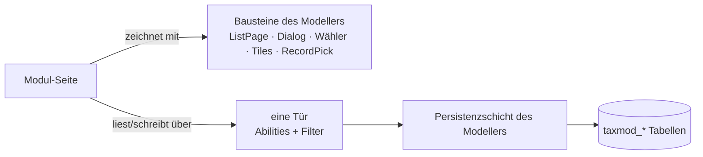

# Gestaltung und Architektur — verbindlich für alle Taxmod-Repos

**Gilt für:** `wp-taxonomy-modeler` und jedes Modul (`wp_tax_stock`, `wp_tax_manufacturing`,
`wp_tax_mail`, `wp_tax_api_*`). Beschlossen mit [D-1186](NewConcept/90-decision-log.md).
**Gemessen mit:** `php scripts/dev/design-guard.php` (ohne Argument: Modeller + alle `wp_tax_*`
daneben). **Letzter Befund:** [`audit-gestaltung-2026-11-06.md`](audit-gestaltung-2026-11-06.md).

Jede Regel nennt den Beschluss, aus dem sie kommt, mit seinem Kernsatz. Wer abweichen will, braucht
einen neuen Beschluss — nie eine stille Ausnahme ([PR-2](../CLAUDE.md)). Fehlt hier eine Vorgabe von
Stefan, die in einem Thread gefallen ist: als Beschluss nachtragen und hier verlinken.

*Ein Modul zeichnet nichts selbst, was ein Baustein schon kann, und fasst keine Tabelle an. Was ein
Baustein noch nicht kann, wird **im Baustein** ergänzt und wirkt dann auf alle Module.*

---

## 1 · Seite

| | Regel | Beschluss |
|---|---|---|
| S1 | Überschrift nur über `ListPage::heading()`: groß, «Taxonomy Modeller › Seite», mit Version. Kein eigenes `<h1>`; eine Erklärung zur Seite steht hinter dem Fragezeichen (`hint:`, D-661). Ausnahme: ein Druckblatt, das ein eigenes HTML-Dokument ist. | [D-989](NewConcept/90-decision-log.md), [D-913](NewConcept/90-decision-log.md) |
| S2 | Ein Menü: alles unter dem Modeller, Logistik mit eigener Navigation links; Wartung (Cleanup, Backup, Configuration) zuletzt. | [D-1028](NewConcept/90-decision-log.md), [D-1053](NewConcept/90-decision-log.md) |
| S3 | Jeder Hauptpunkt der Navigation öffnet eine Übersicht mit Kacheln in seine Unterpunkte; ein Klick auf eine Gruppe klappt sie im Menü auf. | [D-1128](NewConcept/90-decision-log.md), [D-1134](NewConcept/90-decision-log.md) |
| S4 | Modulseite in der Konfiguration: eigener Reiter über `taxmod_config_tabs`; Bereiche immer **Zugang · Abruf · Mail · Einstellungen · Wartung**, ein leerer Bereich mit einem Satz; Abruftakt zeichnet der Modeller; «How to connect» liefert das Modul, zeichnet der Modeller. | [D-945](NewConcept/90-decision-log.md), [D-981](NewConcept/90-decision-log.md), [D-1007](NewConcept/90-decision-log.md), [D-963](NewConcept/90-decision-log.md) |
| S5 | Kein `<style>`/`<script>` und kein `style="…"` in Seiten: Aussehen steht zentral im CSS des Modellers (`assets/admin.css`), Verhalten in seinem JS. Ausnahme nur für eigene Druckbögen (Etikett, Packzettel), die als eigenes Dokument laufen. | [D-1068](NewConcept/90-decision-log.md) («die Listen-Vorlage legt sie einmal fest») |
| S6 | Standardgerüst jeder Seite: Überschrift (Reiter) → Kacheln → Sektionen untereinander (Detail, Liste, Liste …), über `ListPage::page($screen, $tiles, $sections)`. Keine Seite ordnet ihre Teile selbst nebeneinander. Umstellung zuerst in allem, was im Logistik-Menü steht (Lager, Verkauf, Fertigung, Anbindungsseiten). | [D-1196](NewConcept/90-decision-log.md) |
| S7 | Reiter, die Stufen eines Prozesses in fester Reihenfolge sind, werden Prozess-Kacheln (Pfeile, die ineinandergreifen, mit Zahl) über `ListPage::steps`; Ansichten daneben (Archiv, Alle) bleiben Reiter rechts davon. Reiter ohne Reihenfolge bleiben `ListPage::tabs`. | [D-1197](NewConcept/90-decision-log.md) |
| S8 | Sammelaktionen nur in der einen Auswahl der Liste («--», dann alle Aktionen) mit Knopf «Sammelaktion ausführen»; wirkt nur auf angehakte Zeilen. Aktionen mit Dialog über `ListPage::bulkBar(…, $asking)`, keine eigenen Knöpfe daneben. | [D-1202](NewConcept/90-decision-log.md) |
| S9 | Meldungen nur im Meldungsfeld neben der Überschrift (`ListPage::heading`), mit Liste der letzten Meldungen; nie in die Zeile, nie ein Neuladen nur für eine Meldung. Aus dem Skript: `taxmodMessage(text, tone)` oder Ereignis `taxmod:message` `{text, ok}`. | [D-1203](NewConcept/90-decision-log.md) |
| S10 | Bilder in Listen nur über `ListPage::thumbnails($media)` (Schalter der Konfiguration, ein Zug für die Seite, lazy); das Titelbild eines Satzes liest nur eine Stelle je Modul, nie das Feld direkt. | [D-1204](NewConcept/90-decision-log.md) |
| S11 | Infokasten zu Formular/Detail rechts daneben (ab 1100 px, sonst darüber) nur über `ListPage::beside($main, $facts)`; keine eigenen Grid-Styles. | [D-1220](NewConcept/90-decision-log.md) |
| S12 | Wiederkehrende Akte in Listen als Icon mit Wort als Tooltip, nur über `ListPage::icon`/`iconLink`/`dialogAction(…, $icon)` und die Konstanten `ICON_PRINT`, `ICON_TRANSFER`, `ICON_BOOK_OUT`, `ICON_DELETE`; kein eigenes Dashicon für denselben Akt. | [D-1230](NewConcept/90-decision-log.md) |

## 2 · Liste

| | Regel | Beschluss |
|---|---|---|
| L1 | Jede Liste ist das gemeinsame Template `ListPage`: WordPress-Listentabelle, Häkchen, Sammelaktionen oben (`bulkBar`), Suche/Filter, Knöpfe **rechts** in der Zeile. | [D-989](NewConcept/90-decision-log.md) |
| L2 | Spaltenwahl je Benutzer, Filterzeile unter den Köpfen, Seitenblättern — im Template, nie je Seite. Jede Liste hat über `ListPage::table()` denselben Kopf: Gesamtfilter, «Gruppieren nach», Filterzeile, Sortieren an jedem Spaltenkopf (`assets/list-head.js`); keine Seite baut das selbst. Zeilen, die zu einer Zeile gehören, tragen `taxmod-list-more`; eine Zelle sortiert nach `data-taxmod-sort`, wenn sie es trägt. | [D-1054](NewConcept/90-decision-log.md), [D-1227](NewConcept/90-decision-log.md) |
| L3 | Was eine Zeile als Aktion hat und für mehrere Sinn ergibt, gibt es auch als Sammelaktion, überall gleich aussehend. | [D-1127](NewConcept/90-decision-log.md) |
| L4 | Lange Listen warten auf eine Suche («Alle anzeigen» als Massenansicht); Details erst beim Aufklappen per `ListPage::lazyDetails` / Filter `taxmod_list_details`. | [D-1147](NewConcept/90-decision-log.md) |
| L5 | Hat ein Eintrag Positionen, öffnet ein Klick seine **Detailansicht** (Kopf mit Daten und Knöpfen, darunter die Positionen, «Zurück zu …»); Aufklappen ist dann weg. | [D-1183](NewConcept/90-decision-log.md), [D-997](NewConcept/90-decision-log.md) |

## 3 · Knopf und Dialog

| | Regel | Beschluss |
|---|---|---|
| K1 | Alle Knöpfe einer Seite haben dieselbe Höhe, zentral festgelegt — auch «kleine» Knöpfe und Dialog-Öffner. Knöpfe stehen rechts. | [D-1068](NewConcept/90-decision-log.md), [D-989](NewConcept/90-decision-log.md) |
| K2 | Ein Dialog hat unten «OK»/«Bestätigen» und «Abbrechen», schließt nur darüber oder über ✕, nie per Klick daneben; alle Dialoge haben eine Gestalt, gezeichnet an einer Stelle. | [D-804](NewConcept/90-decision-log.md), [D-730](NewConcept/90-decision-log.md) |
| K3 | Eine Aktion, die vor dem Absenden fragt oder eine Auswahl braucht (Grund, Ort, Menge), ist dieser Dialog über `ListPage::dialogAction`; eine reine Rückfrage trägt `ListPage::confirm($text)` (gemeinsamer Bestätigungsdialog, `assets/confirm-dialog.js`) — **kein `confirm()` des Browsers**, kein überfrachtetes Feld in der Zeile. | [D-1063](NewConcept/90-decision-log.md) |

## 4 · Auswahl und Formular

| | Regel | Beschluss |
|---|---|---|
| A1 | Jedes Auswahlfeld wird an einer Stelle gebaut (`SelectMarkup`): ohne oder mit nur einem Eintrag gesperrt und grau. | [D-848](NewConcept/90-decision-log.md) |
| A2 | Einfachauswahl von Knoten oder Satz: ausgegrautes Feld mit der Wahl, rechts das Baumsymbol; beides öffnet den Dialog. | [D-1163](NewConcept/90-decision-log.md) |
| A3 | Knoten wählt ein Modul mit dem Wähler des Modellers (`taxmod_node_chooser`, mit `root`, `exclude`, `unpickable`), nie mit einem eigenen Baum. | [D-1075](NewConcept/90-decision-log.md), [D-815](NewConcept/90-decision-log.md) |
| A4 | Sätze wählt ein Modul mit der Satzauswahl des Modellers (`RecordPick::field`, `taxmod_record_chooser`): Baum links, Sätze rechts, Suchfeld, «Neu hier …» darunter; mehrfach mit Haken. Mehr als eine Ebene → immer Baum, kein `<select>` mit Gruppen. Lagerorte über `StockService::placeChooser`, Materialgruppen über `groupChooser`; ein `<select>` nur als Ersatz, wenn der Modeller fehlt (Wächter `G9`). | [D-1182](NewConcept/90-decision-log.md), [D-1011](NewConcept/90-decision-log.md), [D-1078](NewConcept/90-decision-log.md), [D-1171](NewConcept/90-decision-log.md) |
| A5 | Einen Satz bearbeitet ein Modul mit dem Formular des Modellers (`taxmod_record_editor`), nicht mit einem nachgebauten. | [D-1025](NewConcept/90-decision-log.md) |
| A6 | Pflicht ist die Multiplizität: 1..1 und 1..n sind Pflicht; vor dem Durchsetzen abgleichen — wo Daten leer sind, wird das Feld 0..1/0..n. Kein eigenes «mandatory». | [D-405](NewConcept/90-decision-log.md), [D-1070](NewConcept/90-decision-log.md) |
| A7 | Komposition nur, wenn das Teil mit dem Kopf stirbt; sonst Aggregation. | [D-498](NewConcept/90-decision-log.md) |
| A8 | Ein Wert, für den das Modell ein Feld oder einen Typ hat (Menge = Einheitswert, Material, Lagerort, Kontakt …), wird mit genau diesem Feld und seinem Steuerelement erfasst, nie mit einem eigenen Eingabefeld, Typ oder Option. Nicht Erkanntes bleibt leer, kein erfundener Vorgabewert. Das Steuerelement liefert `ModelDoor::controls()`, zurückgelesen mit `ModelDoor::typed()`; die Zeilen ordnet `ListPage::form`. | [D-1250](NewConcept/90-decision-log.md) |

## 5 · Kachel

| | Regel | Beschluss |
|---|---|---|
| C1 | Jede Kachel aus dem gemeinsamen Baustein (`Taxmod\Core\Tile\*`, `Admin\Tiles`): Name oben, große Zahl, kurze Zeilen, optional Monatsbalken, Knöpfe rechts unten; 0 = klein und grau, Handlungsbedarf = rot. Kennzahlen sind Daten am Knoten (Zusatzfunktion `metric`), nicht Code. | [D-1149](NewConcept/90-decision-log.md), [D-1167](NewConcept/90-decision-log.md) |
| C2 | Eine Zahl auf einer Kachel, die eine Abfrage kostet, wird gemerkt: `Tiles::cachedCounts($bereich, $quelle, $zählung)` (Modell-Datensätze: `Tiles::MODEL`). Vergessen wird nur in der einen Datenklasse der Tabelle, bei jedem Schreiben, nie in einem Bildschirm. | [D-1198](NewConcept/90-decision-log.md) |

## 6 · Verhalten

| | Regel | Beschluss |
|---|---|---|
| V1 | Jeder Benutzerschritt lässt sich zurücknehmen, im Modeller und in jedem Modul; ein Schritt mit Folgen sagt vorher, was mit zurückgeht. | [D-1010](NewConcept/90-decision-log.md) |
| V2 | Zurücknehmen heißt Storno, nie Löschen: Gegenbuchung mit Benutzer und Zeit; Stornopaare in Listen ausgeblendet. | [D-1036](NewConcept/90-decision-log.md) |
| V3 | Die meisten Objekte lassen sich kopieren; die Kopie ist ein Schritt und lässt sich zurücknehmen. | [D-1130](NewConcept/90-decision-log.md) |
| V4 | Gleichzeitiges Arbeiten: ein Satz samt Teilen ist die Einheit, seine Version der Wächter. | [D-1148](NewConcept/90-decision-log.md) |
| V5 | Kein Akt endet auf einer leeren Seite: jeder admin-post-/ajax-Handler läuft in `ListPage::act()`, jede Ablehnung über `ListPage::fail()` (Nonce: `ListPage::nonce()`, ajax: `ListPage::json()` / `ListPage::ajaxNonce()`); die Meldung steht im Meldungsfeld der Ausgangsseite, sonst Fehlerseite mit «Zurück». Kein nacktes `wp_die()`. | [D-1254](NewConcept/90-decision-log.md) |

## 7 · Sprache

| | Regel | Beschluss |
|---|---|---|
| W1 | Fachbegriffe der Lagerwirtschaft (Material, Bestandsposten, Charge, Wareneingang, Warenausgang, Reklamation), nicht Gesprächswörter. | [D-1005](NewConcept/90-decision-log.md) |
| W2 | Nichts Sichtbares hart kodiert: Software-Texte über die Text-Domain, Knotennamen als Labels im Modell. | `AR-2` ([`CLAUDE.md`](../CLAUDE.md)) |
| W3 | Zahlen mit dem Dezimalzeichen der Website-Sprache, Leerzeichen zwischen Zahl und Einheit (SI/DIN 1338). | [D-1175](NewConcept/90-decision-log.md) |
| W4 | Repositorien der Logistik-Module heißen `wp_tax_log_<name>` (z. B. `wp_tax_log_sales`); Umzug nach und nach, Ordner und Daten bleiben. Welche Anbindungen dazugehören, ist offen. | [D-1188](NewConcept/90-decision-log.md) |

## 8 · Architektur

| | Regel | Beschluss |
|---|---|---|
| R1 | **Eine Stelle je Tabelle/Objektgefüge.** Im Modeller hält nur die Persistenzschicht (`src/WordPress/Persistence/`) SQL auf Modelltabellen; jede eigene Tabelle (Eingang, Druckaufträge, Kurse) hat genau eine Klasse. Bildschirme, Blöcke, Abilities und Kacheln fragen diese Schicht, statt `Query::*`/`$wpdb` selbst zu benutzen. | [D-1186](NewConcept/90-decision-log.md), `CD-7`, [D-910](NewConcept/90-decision-log.md) |
| R2 | **Ein Modul hat eine Tür zum Modell**: Abilities (`taxmod/read-node`, `read-tree`, `write-data`) und Filter des Modellers, gebündelt in der Tür des Modellers `Taxmod\WordPress\ModelDoor` (seit 0.1.174; das Modul wickelt nur die Antwort in seinen Kern und benennt Fehler). Kein Modul benutzt `Taxmod\WordPress\Persistence\*`, kein Modul ruft `wp_get_ability('taxmod/…')` an der Tür vorbei. | [D-1186](NewConcept/90-decision-log.md), [D-936](NewConcept/90-decision-log.md), [D-911](NewConcept/90-decision-log.md) |
| R3 | **Kein Code doppelt über Repos.** Was zwei Module brauchen (HTTP-Transport, Tür zum Modell, Tabellen-Hilfe), liegt einmal im Modeller und wird von dort benutzt. | [D-952](NewConcept/90-decision-log.md), CLAUDE.md «Duplicating a fact» |
| R4 | Schichten: WordPress am Rand, der Kern ruft kein WordPress; Fehler als Ausnahme im Kern, `WP_Error` am Rand; Ausgabe wird zurückgegeben, nicht ge-`echo`t. | `CD-1`, `CD-8`, `CD-10` |
| R5 | Je Anbindung ein Modul `wp_tax_api_<quelle>`; `tax_mail` nur Postfach. Leser über `taxmail_parsers`, Vertrag im Modeller. | [D-1006](NewConcept/90-decision-log.md) |
| R6 | Zugangsdaten immer verschlüsselt (Tresor), nie im Klartext in Option, Log, Meldung; Dokumente mit persönlichen Daten in der verschlüsselten Ablage. | [D-951](NewConcept/90-decision-log.md), [D-1023](NewConcept/90-decision-log.md) |
| R7 | Etiketten druckt der Modeller; ein Modul gibt nur Satz und Etikett. | [D-1160](NewConcept/90-decision-log.md) |
| R8 | Vor jedem neuen Knoten/Feld/Mechanismus prüfen, ob ein vorhandener es schon abdeckt (Daten vor Code). | Arbeitsmodell §5 |

## 9 · Leistung

| | Regel | Beschluss |
|---|---|---|
| P1 | Was eine Anfrage nicht braucht, wird nicht geladen: Handler von `admin-post`/`admin-ajax` nur dort verdrahten (`Plugin::handlesAdminActions()`, Module fragen dasselbe); Einstellungen auf `admin_init`/`rest_api_init`, nicht `init`; Hook-Namen nicht als Konstanten großer Bildschirmklassen lesen. | [D-1187](NewConcept/90-decision-log.md) |
| P2 | Umbau, Saat und Gerüste laufen einmal je Release (`taxmod_up_to_date`), nie bei jedem Aufruf. | [D-1187](NewConcept/90-decision-log.md) |
| P3 | Kein N+1: kein SQL in einer Schleife, Baumweg einmal an einer Stelle; ein Knoten wird je Anfrage höchstens einmal gelesen (die Tür merkt ihn sich). | `CD-7`, [D-910](NewConcept/90-decision-log.md), [D-454](NewConcept/90-decision-log.md) |
| P4 | Lange Listen warten auf Suche, Details und Baumdialoge werden erst beim Öffnen geholt. | [D-1147](NewConcept/90-decision-log.md), [D-1011](NewConcept/90-decision-log.md) |
| P5 | SQL läuft auf MySQL 5.7 (kein `WITH RECURSIVE`, kein MySQL-8-SQL). | [D-910](NewConcept/90-decision-log.md) |

---

## Prüfliste vor jedem Commit in einem Taxmod-Repo

1. Neue Seite/Liste/Dialog/Kachel → aus dem Baustein? Fehlt etwas, dann **im Baustein** ergänzt?
2. `php scripts/dev/design-guard.php <repo>` — keine neuen Befunde gegenüber dem letzten Audit.
3. Kein `$wpdb`/`Query::*` außerhalb der Datenschicht, keine Persistenz-Klasse im Modul.
4. Keine Datei aus einem anderen Repo kopiert.
5. Jeder Schritt zurücknehmbar; Fachbegriffe; Texte über die Text-Domain.
6. Nichts Neues auf `init` oder in jeder Anfrage, was nur eine Seite braucht (P1).

## Wächter

Der Thread «Taxmod-Design und Architektur wahren» misst nach jedem Release mit `design-guard.php`,
baut Abweichungen schrittweise zurück und meldet Threads, die neue Verstöße bauen. Ist eine Regel im
ganzen Bestand sauber, wird sie mit `--fail` Teil der Prüfläufe (PR-9).
