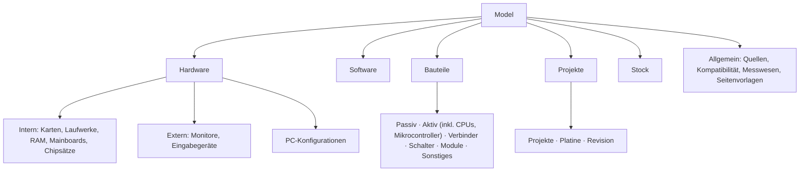

# Aufräumen · Äste «PC» und «Hardware Project» — Befund und Vorschlag

**Stand 2026-10-20. A1–A4 entschieden ([D-940](../../NewConcept/90-decision-log.md)), nichts gebaut.** Aus [INF-079](../../neues-konzept-eingang.md).

> *«ok vielleicht sollten wir vorher etwas aufräumen die pc und bauteilspate sind etwas gewuchert»* — der Eigentümer, 2026-10-20, vor dem Lager-Modul.

**Gelesen:** live per `taxmod/read-tree` am 2026-10-20, Knoten bis Tiefe 6. **Nicht gelesen:** Felder und Satzzahlen je Knoten — ein Knoten, der hier leer aussieht, kann Sätze tragen.

## 1 · Befund

| # | Was | Wo (Ids) |
|---|---|---|
| B1 | **Drei Orte für Konstanten:** `PC › Constants`, `Hardware Project › Constants`, `Primitives › Constants`; dort zusätzlich ein leerer Knoten «PC Constants» | 149000102259, 149000104441, 32493 |
| B2 | **Doppelte Konstanten:** «DIP-40» in «Sockel und Gehäuse» **und** in «Bauteil-Bauformen › THT»; «LGA775» **und** «LGA 775» | 149000108733 / 149000104398; 149000108741 / 149000109521 |
| B3 | **Zwei Kataloge für Chips:** CPUs, Koprozessoren, Mikrocontroller unter `PC › … › Prozessoren`; Mikrocontroller, Logik-, Speicher-, Video-IC unter `Electronic Parts › Active › IC` | 149000103929, 149000104028 / 149000104413, 149000109985 |
| B4 | **Zwei Wege für Revisionen:** «Mainboards», «Mainboard-Reihen», «Mainboard-Revisionen» als Geschwister unter «Internal»; «Platine» und «Revision» unter «Hardware Project» | 149000107691/7758/7757; 149000105261/5262 |
| B5 | **Zwei Kataloge für Platinen/Boards:** «Enhancement Cards» (PC) und «Electronic Parts › Module» (Mikrocontroller-Boards, Sensormodule) | 32485; 149000104428 |
| B6 | **Steckertypen doppelt gedacht:** «Steckertypen» (D-Sub, USB …) bei den Bauteilen, «Schnittstellen», «Stromanschlüsse», «Speichermodule» beim PC | 149000104367; 149000103870, 149000107683, 149000108718 |
| B7 | **Gruppen als Auswahl oder Konstante angelegt:** «Hardware», «Internal», «External», «Software», «OS», «DOS» … sind `Choice`, «Prozessoren» ist `Constant` — sonst sind Gruppen `Category` | 149000103001, 32483, 149000103929 … |
| B8 | **Lose Knoten:** «Prozessor-Familien» direkt unter «PC» neben «Models»; «Line Types › Software Change»; «PC-Konfigurationen» zwischen «Internal» und «External» | 149000104245, 149000103429, 149000109401 |
| B9 | **Name «Models» unter `Model`** — liest sich wie die Wurzel | 149000103431 |
| B10 | **Sprachmix und Tippfehler:** Hardware/Internal/Enhancement Cards/Graphics/IO/Resistor/Coil/«Condensator»/Active neben Netzwerkkarten/Soundkarten/Passiv/Schalter | 32485, 3640, 3800, 3642, 3638 |
| B11 | **Lagerdinge mitten in `Model`:** Käufe, Bestellungen, Verkäufe, Verkaufte Artikel, Preisangaben, Exemplare | → Lager-Konzept §3 |
| B12 | **Reste unter `Compositions`:** «Zutat», «Backrezept» | 13416, 13420 |

## 2 · Vorschlag — Ziel-Baum

Passt zur Idee «Module» ([INF-078](../../neues-konzept-eingang.md)); jeder Ast unten wäre später ein Modul.

| # | Schritt | löst |
|---|---|---|
| V1 | Konstanten an **einen** Ort je Modul (`Hardware › Konstanten`, `Bauteile › Konstanten`); leeres «PC Constants» weg; Doppelte zusammenführen, Verweise umhängen | B1, B2 |
| V2 | **CPUs, Koprozessoren, Mikrocontroller sind Bauteile** (unter «Aktiv › IC»); der PC verweist auf sie — ein Katalog, und die Stückliste findet sie | B3 |
| V3 | Mainboard-Reihe/-Revision auf das Muster «Platine › Revision» bringen oder ausdrücklich getrennt lassen — **seine Entscheidung** | B4 |
| V4 | Gruppen einheitlich `Category`; Auswahl/Konstante nur, wo wirklich gewählt wird | B7 |
| V5 | Lose Knoten einordnen: «Prozessor-Familien» zu den Bauteilen, «PC-Konfigurationen» unter «Hardware», «Line Types» prüfen | B8 |
| V6 | Eine Sprache für Knotennamen (Vorschlag: Deutsch), Tippfehler weg | B10 |
| V7 | Lagerdinge unter «Stock» (Lager-Konzept F2) | B11 |
| V8 | «Zutat», «Backrezept» löschen, wenn keine Sätze daran hängen | B12 |

## 3 · Was er entscheiden soll

- **A1** Ziel-Baum wie oben (Hardware · Software · Bauteile · Projekte · Stock · Allgemein)?
- **A2** CPUs & Co. zu den Bauteilen (V2)?
- **A3** Mainboard-Revisionen wie Platine/Revision (V3)?
- **A4** Knotennamen auf Deutsch (V6)?

## 4 · Wie gebaut würde

Alles über `taxmod/apply` (move_node, rename_node), ein Auftrag je Schritt über WP-Upload. Verschieben behält Ids und Werte; innerhalb von `Model` bleiben geerbte Felder sichtbar ([INF-076](../../neues-konzept-eingang.md)). Zusammenführen doppelter Konstanten und Löschen braucht ein eigenes OK im WP-Upload-Thread. Vor jedem Schritt: Felder und Satzzahlen der betroffenen Knoten live lesen.

## 5 · Umbauplan nach D-940

**Gelesen live am 2026-10-20** (35 Knoten, Felder mit `declared_at`, Satzzahlen; nicht im Browser). Die Werte hängen an der **Kante**, nicht am Knoten: verlässt ein Knoten den Bereich, in dem ein Feld erklärt ist, sind die Werte nicht weg, aber unsichtbar ([INF-076](../../neues-konzept-eingang.md)).

### 5.1 Was beim Verschieben verloren ginge

| Schritt | Felder, die der Knoten dann nicht mehr erbt | Sätze |
|---|---|---|
| Prozessoren (CPUs 118, Koprozessoren 13, Mikrocontroller 15) → Bauteile › Aktiv › IC | von «Models»: Path, Type, Hersteller (Verweis), Version, Erscheinungs Monat/Jahr, Nachfolger, Kompatibilität · von «Hardware»: Teilenummer, Gebaut bis · von «Intern»: Alternative Bezeichnungen | 146 |
| Hardware und Software aus «Models» direkt unter `Model` | alle sieben Felder von «Models» | alle Hardware- und Software-Sätze |
| Electronic Parts → `Model › Bauteile` | keine («Hardware Project» erklärt keine Felder) | — |
| Prozessor-Familien, Bauteil-Serien | keine (erben nur von `Model`) | 49 |

**Doppelt erklärte Felder**, die beim Zusammenlegen eins werden müssen: Teilenummer (Hardware 149000103844 / Bauteile 149000108567), Alternative Bezeichnungen (Intern 149000109570 / Bauteile 149000108626), Kompatibilität (Models 149000104191 / Bauteile 149000104342), **Hersteller** — bei «Models» ein Verweis auf «Manufacturer», bei den Bauteilen Freitext (149000102544 / 149000108565).

### 5.2 Dafür fehlen zwei Werkzeuge in `taxmod/apply`

- **`move_field {field, node}`** — erklärt ein Feld an einem anderen Knoten; die Werte bleiben, weil sie an der Kante hängen. Damit wandern die sieben «Models»-Felder nach «Hardware» und «Software».
- **`merge_field {from, into, under?}`** — hängt die Werte eines Felds an ein gleichartiges anderes (optional nur für Sätze unter einem Knoten) und parkt das alte. Damit werden Teilenummer, Alternative Bezeichnungen, Kompatibilität eins.
- **Hersteller Text → Verweis** ist ein dritter Fall: Freitext auf «Manufacturer»-Sätze abbilden, Unbekanntes melden statt raten.

**Gebaut:** 0.1.26 ([D-941](../../NewConcept/90-decision-log.md)), Wächter `feld-umzug-check`; noch nicht live.

Ohne diese Werkzeuge gingen 146 Chips beim Umzug ihre Teilenummern, Hersteller und Erscheinungsdaten «verloren» (unsichtbar).

### 5.3 Reihenfolge

| Stufe | Inhalt | braucht |
|---|---|---|
| **1** | Deutsche Namen (Liste unten); «Electronic Parts» → «Bauteile» direkt unter `Model`; «PC Constants» (leer), «Zutat», «Backrezept» (keine Sätze) löschen; «LGA 775» in «LGA775» aufgehen lassen (beide ohne Sätze — Verweise darauf vorher prüfen) | nur `apply`; Löschen mit eigenem OK |
| **2** | `move_field`, `merge_field` bauen; Hersteller-Abbildung | Code, Release |
| **3** | «Models»-Felder nach Hardware/Software, Models auflösen; Prozessoren → Bauteile › Aktiv › IC mit `merge_field`; Konstanten je Bereich an einen Ort; «DIP-40» zusammenführen | Stufe 2 |
| **4** | Mainboard-Reihen und -Revisionen: «Mainboards» hat schon «Revisionen» → Mainboard-Revisionen, Reihen → «Modelle»; nur noch der Ort (Geschwister von «Mainboards» wie Platine/Revision) — **schon im Muster**, nur Namen prüfen | nichts |

**Namen Stufe 1 (INFERRED):** Internal → Intern · External → Extern · Enhancement Cards → Erweiterungskarten · Graphics → Grafikkarten · IO → I/O-Karten · Storage → Laufwerke · Harddisk → Festplatten · Floppy → Diskettenlaufwerke · Tape → Bandlaufwerke · RAM → Arbeitsspeicher · Games → Spiele · OS → Betriebssysteme · Tools → Werkzeuge · Line Types → Zeilentypen · Software Change → Softwareänderung · Constants → Konstanten · Hardware Project → Hardware-Projekte · Electronic Parts → Bauteile · Active → Aktiv · Resistor → Widerstände · Coil → Spulen · Condensator → Kondensatoren · Models → Modelle (bis Stufe 3). `Primitives` und seine Kinder bleiben (Rahmen).
