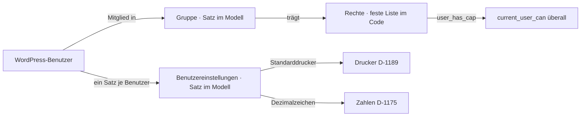

# Benutzer, Gruppen, Rechte und eigene Einstellungen — Konzeptentwurf

**Status:** Entwurf, nicht entschieden ([INF-112](../../neues-konzept-eingang.md#inf-112--benutzer-gruppen-rechte-und-eigene-einstellungen)).
**Anlass:** Stefan, 2026-11-06: *«default drucker im benutzer hinterlegen benutzer menü in den einstellungen, gruppen, rechte, benutzer und eigene benutzer einstellungen wie drucker dezimal anzeige»*.

## Wo was liegt

| Was | Wo | Warum |
|---|---|---|
| **Benutzer** | bleiben WordPress-Benutzer (Anmeldung, Passwort, E-Mail, Profil) | kein zweites Benutzerverzeichnis; die Liste im Taxmod zeigt nur, welche Gruppen jemand hat, und verlinkt aufs WP-Profil |
| **Rechte** | feste Liste im Code, je Recht eine WordPress-Fähigkeit `taxmod_*`; Module melden ihre über den Filter `taxmod_rights` | ein Recht ist, was die Software prüft — das ist Code, keine Daten ([D-431](../../NewConcept/90-decision-log.md): «a setting is the system's») |
| **Gruppen** | Sätze unter einem Knoten «Gruppen» (Name, Rechte 1..*, Mitglieder `user_ref` 0..*) | Daten vor Code (R8); rückgängig (V1), versioniert (V4), gleiche Liste und gleiches Formular wie alles andere |
| **Eigene Einstellungen** | Knoten «Benutzereinstellungen», ein Satz je Benutzer (Feld Benutzer `user_ref` gesperrt = angemeldeter Benutzer, [D-650](../../NewConcept/90-decision-log.md)) | eine neue Einstellung ist ein neues Feld, kein neuer Code außer dem Leser |

**Erste Felder:** Standarddrucker (Satzverweis → Drucker, 0..1), Dezimalzeichen (Website-Sprache · Komma · Punkt, 0..1).
**Auflösung:** Wert des Benutzers → Vorgabe der Installation ([D-079](../../NewConcept/90-decision-log.md)) → Website-Sprache ([D-1175](../../NewConcept/90-decision-log.md)).

## Erste Rechte (Vorschlag)

| Recht | Wer heute | Bereich |
|---|---|---|
| `taxmod_view` | alle mit `manage_options` | Modeller ansehen, eigene Einstellungen |
| `taxmod_write_data` | Rolle `taxmod_data_writer` ([D-936](../../NewConcept/90-decision-log.md)) | Sätze anlegen/ändern |
| `taxmod_model` | `manage_options` | Knoten, Felder, Modelländerungen |
| `taxmod_configure` | `manage_options` | Konfiguration, Cleanup, Backup, Gruppen |
| je Modul (z. B. `taxmod_stock_book`, `taxmod_purchase`, `taxmod_pick`) | `manage_options` | Lager, Einkauf, Kommissionieren … |

**Administrator hat immer alle Rechte** — niemand sperrt sich aus.

## Menü

Unter dem Modeller, Wartungsbereich ([S2](../../gestaltung-und-architektur.md)): **Benutzer** mit Übersicht aus Kacheln ([S3](../../gestaltung-und-architektur.md)) → *Benutzer* · *Gruppen* · *Rechte* (nur lesen: welches Recht, welche Gruppen) · *Meine Einstellungen* (für jeden mit `taxmod_view`). Listen aus `ListPage`, Bearbeiten im Satzformular des Modellers.

## Schritte

1. Menü, Rechte-Liste, Gruppen, Benutzereinstellungen (Dezimalzeichen wirkt sofort; Drucker, sobald der Drucker-Knoten live ist). Seiten prüfen weiter `manage_options`.
2. Seiten und Abilities im Modeller auf Rechte umstellen; Rolle `taxmod_data_writer` → Gruppe «Datenschreiber» (Mitglied `auto_einkauf`), Rolle fällt nach Prüfung.
3. Module (Lager, Fertigung, Verkauf, Anbindungen) melden ihre Rechte und prüfen sie.

## Angenommen / offen

- **G1** Gruppen als Sätze im Modell statt als WordPress-Rollen (Alternative: Rollen über eine Taxmod-Seite pflegen — dann ohne Rückgängig und Versionen).
- **G2** Etikettendruck: erst der Drucker des Benutzers, wenn er die Rollenbreite des Etiketts hat, sonst der Drucker der Etikettenvorlage.
- **G3** Dezimalzeichen gilt nur im Admin; Leser der Website sehen weiter die Website-Sprache.
- **G4** Rechte sind ein Satz je Gruppe, keine Verbote; mehrere Gruppen addieren sich.
