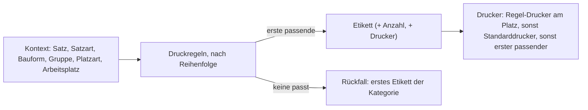

# Paket · Druckregeln — Konzeptentwurf

**Stand 2026-11-20. Entschieden als [D-1519](../../NewConcept/90-decision-log.md) (seine Karte 17:39, R1–R4; R3 17:44: der Standarddrucker bleibt). Gebaut: Etiketten 0.0.34, Lager 0.64.167; Modelländerung [`modellaenderung.json`](modellaenderung.json). Offen: das Entfernen der alten Wege (eigener Schritt).**

**Seine Worte (2026-11-20, 17:07):**

> *«Wir haben ja noch so eine Regelung, dass wir auch materialbezogen bzw. bauteilartbezogen Etiketten drucken können. … ob man das nicht mal genereller als Regelwerk aufbauen könnte, … wenn A gleich das und das, dann druck dies und jenes Etikett so als Regel. Und dann geht derjenige, der guckt, was er jetzt drucken soll, geht die Regeln durch und … druckt dann die erste, die passt.»*

## Heute (gemessen, nicht Konzept)

Die Vorwahl im Druckdialog ist an drei Stellen verteilt:

| Wo | Was | Beschluss |
|---|---|---|
| Bauform (Knoten) | Eigenschaft `stock_material_label` / `stock_lot_label`, vererbt nach unten | [D-1284](../../NewConcept/90-decision-log.md) |
| Materialgruppe (Knoten) | dieselben Eigenschaften | [D-1266](../../NewConcept/90-decision-log.md) |
| Platzart (Satz) | Etikett + Anzahl je Platzart | [D-1159](../../NewConcept/90-decision-log.md) |
| sonst | erstes Etikett der Kategorie | [D-1266](../../NewConcept/90-decision-log.md) |
| Drucker | Standarddrucker des Arbeitsplatzes, sonst der erste, dessen Rolle passt | [D-1502](../../NewConcept/90-decision-log.md) |

## Bild

Eine Regel ist ein Satz. Die Regeln werden von oben nach unten geprüft, die erste passende entscheidet. Der Dialog sagt, welche Regel gegriffen hat, und bleibt änderbar.

## Wo was liegt

| Was | Wo | Warum |
|---|---|---|
| **Druckregel** | Satz unter neuem Knoten «Druckregeln» (unter Druck, neben Etiketten/Drucker/Arbeitsplätze) | Daten, nicht Code; anlegen, umsortieren, rückgängig wie jeder Satz |
| Reihenfolge | `position` (vorhandenes Feld) | erste passende gewinnt |
| **Wofür** | Knotenverweis: Material, Posten, Platz, Kiste, Sendung … (passt samt Unterknoten) | welche Art Satz gedruckt wird |
| Bedingung Bauform | Knotenverweis, passt samt Vorfahren (wie D-1284: «SMD» gilt für «0603») | ersetzt die Bauform-Eigenschaft |
| Bedingung Materialgruppe | Knotenverweis, passt samt Unterknoten | ersetzt die Gruppen-Eigenschaft |
| Bedingung Platzart | Satzverweis | ersetzt Etikett an der Platzart |
| Bedingung Arbeitsplatz | Satzverweis | z. B. «im Keller immer 62×30» |
| **Etikett** | Satzverweis (Pflicht) | das Ergebnis |
| Anzahl | Zahl (optional) | ersetzt die Anzahl an der Platzart |
| Drucker | Satzverweis (optional) | sonst Arbeitsplatz-Regel D-1502 |

Leere Bedingung = passt immer. Mehrere Bedingungen = alle müssen passen.

## Auswertung

- **Ein Auswerter** im Kern des Etikettenmodells (`PrintRules::first(Kontext)`), ohne WordPress, mit Kerntests.
- Lager, Fertigung und Versand fragen über den vorhandenen Weg (`taxmod_label_catalog` / Etikettenknopf). Es gibt keinen zweiten Auswerter.
- Alle Regeln werden einmal gelesen (CD-7).

## Übernahme

1. Ein Akt (Undo) legt aus den heutigen Vorwahlen Regeln an. Die Reihenfolge folgt der heutigen Vorrangregel: Bauform vor Gruppe vor Kategorie, Platzarten getrennt.
2. Danach entfallen «Etiketten je Bauform», die Gruppen-Eigenschaften und das Etikett an der Platzart, in **einem** Schritt mit ihren Wächtern (PR-9). Kein Doppelweg.

## Offen (an Stefan)

- **R1** Jetzt feste Bedingungsarten (Wofür, Bauform, Gruppe, Platzart, Arbeitsplatz)? Freie «Feld = Wert»-Regeln erst, wenn ein Fall sie braucht. *Empfehlung: ja.*
- **R2** Die heutigen Vorwahlen automatisch übernehmen und die alten Einstellungen danach entfernen? *Empfehlung: ja.*
- **R3** Der Standarddrucker des Arbeitsplatzes bleibt nur Rückfall, wenn die Regel keinen Drucker nennt? *Empfehlung: ja.*
- **R4** Seite «Druckregeln» unter Stammdaten neben «Arbeitsplätze» oder unter Einstellungen › Druck? *Empfehlung: Einstellungen › Druck, weil es eine Regel ist und kein Bestand.*
