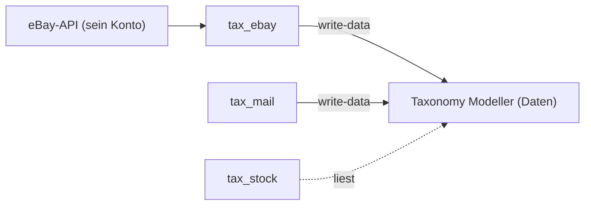
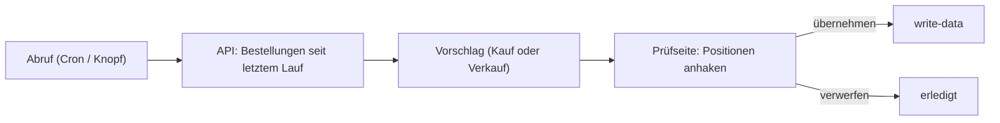

# Paket · eBay-Anbindung («tax_ebay») — Konzeptentwurf

**Stand 2026-10-20. E1–E7 entschieden: [D-943](../../NewConcept/90-decision-log.md). Gebaut: nein.** Aus [INF-074](../../neues-konzept-eingang.md#inf-074--angebote-bei-ebay-einstellen-verkaufstexte-link-zum-laufenden-angebot)
und [INF-075](../../neues-konzept-eingang.md#inf-075--prozesse-und-formulare-im-modell-anlegen). Was er entscheiden soll, steht in §9;
alles andere ist mein Vorschlag (`INFERRED`), bis es eine `D-<nnn>` hat (`PR-3`). Code des Moduls:
[`sfambach/wp_tax_ebay`](https://github.com/sfambach/wp_tax_ebay) (von ihm angelegt am 2026-10-20).

**Sein Wort, auf dem der Entwurf steht (2026-10-20):**

> *«wp_tax_ebay modul anbildung an ebay api»*

⚠️ **Nicht gemessen:** alles über die eBay-APIs in §3 stammt aus allgemeinem Wissen, nicht aus einem Aufruf. Ohne Entwicklerkonto
und Schlüssel lässt sich nichts davon prüfen. Erster Bauschritt ist darum nur «Verbindung testen» (§8).

---

## 1 · Was das Modul ist — und was nicht

- **tax_ebay holt seine eBay-Käufe und -Verkäufe über die API und schlägt Sätze vor.** Geschrieben wird erst, wenn er es auswählt —
  wie bei tax_mail ([`../mail/konzept.md`](../mail/konzept.md) M2).
- **Es besitzt keine Daten des Bestands.** Bestellungen/Käufe ([D-933](../../NewConcept/90-decision-log.md)) und Verkäufe
  ([D-934](../../NewConcept/90-decision-log.md)) bleiben Sätze im Modeller.
- **Später, nicht Teil des ersten Schritts:** Angebote einstellen, Link vom Satz auf das laufende Angebot, Verkaufstexte
  ([INF-074](../../neues-konzept-eingang.md#inf-074--angebote-bei-ebay-einstellen-verkaufstexte-link-zum-laufenden-angebot)).
- Eigenes Plugin wie tax_stock und tax_mail, setzt den Modeller voraus.

## 2 · Ablauf

1. **Abruf:** Bestellungen, die sich seit dem letzten Lauf geändert haben (Zeitstempel merken).
2. **Vorschlag:** in **derselben Form** wie bei tax_mail (Bestellung + Positionen), damit eine Prüfseite beide zeigen kann (E6).
3. **Doppelt:** gleiche Plattform «eBay» + gleiche Bestellnummer im Modell → am Vorschlag vermerkt, nicht neu angelegt. Gilt
   auch für die acht schon übernommenen Verkäufe ([D-934](../../NewConcept/90-decision-log.md)).
4. **Änderung an einer schon übernommenen Bestellung** (versendet, Sendungsnummer, zugestellt): Vorschlag «aktualisieren» mit
   den geänderten Feldern, `set_values` über `write-data`.
5. **Schreiben:** eine Änderungsliste an `taxmod/write-data` ([D-936](../../NewConcept/90-decision-log.md)), alles oder nichts.

## 3 · Welche eBay-Schnittstellen (nicht gemessen)

| Zweck | Schnittstelle | Anmerkung |
|---|---|---|
| **Verkäufe** | Sell **Fulfillment API** `getOrders` (REST) | Bestellnummer, Käufer-Name, Positionen, Preise, Versand, Sendungsnummer; reicht etwa 90 Tage zurück |
| **Gebühren** | Sell **Finances API** `getTransactions` | echte Gebühren statt der 0-€-Schätzung aus D-934 |
| **Käufe** | **Trading API** `GetOrders` mit Rolle «Käufer» (XML, älter) | für private Käufer gibt es keine REST-Schnittstelle; ⚠️ ob das für sein Konto geht, ist der grösste Unsicherheitspunkt |
| später: Angebote | Sell Inventory API oder Trading `AddItem` | INF-074 |

- **Anmeldung:** OAuth. Er legt einmal im eBay-Entwicklerportal eine App an (Client-ID, Client-Secret, RuName) und stimmt einmal
  mit seinem eBay-Konto zu. Der Refresh-Token hält etwa 18 Monate; danach einmal neu zustimmen.
- **Pflicht von eBay für Produktivschlüssel:** Benachrichtigung «Konto gelöscht» (Marketplace Account Deletion) — entweder ein
  Endpunkt, oder Befreiung, wenn keine Käuferdaten gespeichert werden. D-934 speichert nur den eBay-Namen; ob das für die
  Befreiung reicht, ist ungeprüft (E4).
- **Keine fremde Bibliothek nötig:** REST und XML über `wp_remote_request`. Reichen die Grenzen von eBay (Aufrufe je Tag) für
  tägliche Abrufe eines privaten Kontos? Vermutlich weit, ungeprüft.

## 4 · Zugangsdaten

- Client-ID, Client-Secret, RuName in **`wp-config.php`** als Konstanten, wie bei tax_mail M4.
- Der **Refresh-Token** entsteht erst bei der Zustimmung im Browser und muss gespeichert werden: in einer Option,
  **verschlüsselt** mit einem Schlüssel aus `wp-config.php` (sonst steht er im Klartext in jeder Sicherung). E3.

## 5 · Abbildung auf das Modell

| eBay | Modell |
|---|---|
| Verkauf (Fulfillment `order`) | Satz unter «Verkäufe» ([D-934](../../NewConcept/90-decision-log.md)): Bestellnummer, Plattform «eBay», Käufer (nur Name), Verkauft am, Versendet am, Versandkosten, Gebühren, Gesamtbetrag, Sendungsnummer |
| Verkaufsposition (`lineItem`) | «Verkaufte Artikel»: Artikelnummer, Anzahl, Verkaufspreis je Stück; Einstandspreis, Exemplar, Projekt **wählt er auf der Prüfseite** |
| Kauf (Trading `Order`, Käufer) | Satz unter «Bestellungen» mit Positionen «Käufe» ([D-933](../../NewConcept/90-decision-log.md)), Händler = eBay-Verkäufer |

- **Ziel-Knoten und Felder werden in den Einstellungen gewählt, nicht im Code fest** — der Baum wird umgebaut
  ([D-940](../../NewConcept/90-decision-log.md)), Namen können sich ändern ([D-939](../../NewConcept/90-decision-log.md)).
- Beträge als Einheitenwert ([D-929](../../NewConcept/90-decision-log.md)), Währung aus der API.
- Name und Anschrift des Käufers werden **nicht** gespeichert, auch nicht im Vorschlag (D-934).

## 6 · Abgrenzung zu tax_mail

- Vorschlag (mit tax_mail abgestimmt am 2026-10-20): **eBay kommt über die API, tax_mail lässt eBay-Mails aus.** Doppelte
  erkennen beide über Plattform + Bestellnummer im Modell. Berührt dort M7 («eBay zuerst»).
- Vorbehalt: liefert die API seine **Käufe** nicht (§3), bleibt der eBay-Parser für Käufe bei tax_mail; Verkäufe trotzdem hier.
- **Sein Wort im Mail-Thread, 2026-10-20:** *«jede neue mail anbindung ist eine art plugin oder parser den ich in den einstellungen aktivieren kann, parser ebay ist aus wenn tax_ebay aktiv ist»* — der eBay-Parser bleibt also in tax_mail, abschaltbar, und ist aus, solange tax_ebay aktiv ist. Entschieden in [D-942](../../NewConcept/90-decision-log.md); tax_ebay meldet sich über den Filter `taxmail_blocked_parsers` (Schlüssel `ebay`) an. Gemeinsames Vorschlagsformat: `OrderProposal` in wp_tax_mail; seit wp_tax_mail 6fbd6ad mit `fees`, `shipped_date`, `tracking` (optional); eBay-Artikelnummer = `article_number`. Wo das Format künftig liegt, ist offen.
- Übergang von Earth wie bei tax_mail §8: der Python-Importer schreibt eBay weiter, bis tax_ebay dasselbe liefert; nie beide
  gleichzeitig.

## 7 · Schnittstellen zu den anderen Modulen

- **Modeller:** nur `taxmod/write-data` schreiben, `read-tree`/`read-node` lesen.
- **tax_stock:** WordPress-Actions nach dem Schreiben (z. B. `taxebay_sale_written`, `taxebay_purchase_written`); tax_stock
  kann daraus Abgang bzw. Wareneingang vorschlagen. tax_ebay ruft tax_stock nie direkt auf.
- **tax_form:** Prüfseite erst eigene Admin-Seite, später Formular (wie tax_mail M6).
- **Menüpunkt «Module»** ([INF-078](../../neues-konzept-eingang.md#inf-078--model-in-module-umbenennen)): tax_ebay reiht sich dort ein, sobald es ihn gibt.

## 8 · Bauschritte

1. Plugin-Gerüst, Einstellungsseite, Knopf **«Mit eBay verbinden»** (OAuth) und **«Verbindung testen»** — sonst nichts.
2. Verkäufe lesen → Vorschläge → Prüfseite → `write-data`.
3. Gebühren aus der Finances API.
4. Käufe über die Trading API (wenn §3 trägt).
5. Später: Angebote, Link zum laufenden Angebot (INF-074).

## 9 · Was er entscheiden soll

| | Frage | Mein Vorschlag |
|---|---|---|
| **E1** | tax_ebay als eigenes Plugin, schreibt nur über `write-data`, erst Vorschläge | **ja** |
| **E2** | Erster Schritt nur Verbindung + Test, dann Verkäufe, dann Käufe | **ja** |
| **E3** | Schlüssel in `wp-config.php`, Refresh-Token verschlüsselt als Option | **ja** |
| **E4** | Kontolöschungs-Pflicht von eBay: Befreiung beantragen (nur eBay-Name gespeichert) | **ja**, Endpunkt nur wenn eBay ablehnt |
| **E5** | eBay nur über die API; tax_mail schaltet seinen eBay-Parser ab, solange tax_ebay aktiv ist (§6) | **entschieden: [D-942](../../NewConcept/90-decision-log.md)** |
| **E6** | Gleiches Vorschlagsformat wie tax_mail, damit später eine gemeinsame Prüfseite geht | **ja** |
| **E7** | Abrufintervall **in den Einstellungen des Moduls wählbar**, Standard einmal täglich, dazu Knopf «Jetzt abrufen» | **ja** — aus seinen Worten zum Mail-Modul (*«einmal täglich reicht eigentlich und per knopf manuell auslösbar»*, *«ich würde sagen das machen wir einstellbar in der admin config zum modul»*, 2026-10-20); für eBay meine Annahme (INFERRED) |

**Was er dafür tun muss:** ein Konto unter developer.ebay.com anlegen und dort eine App (Produktiv-Schlüssel) erzeugen. Die
Schlüssel kommen nicht in den Chat, sondern direkt in `wp-config.php`.

## 10 · Annahmen, die das Konzept nicht sagt

- Ein eBay-Konto (seins), eBay.de, Währung meist EUR.
- Nachgeholt wird so weit, wie die API zurückreicht (etwa 90 Tage); ältere Bestellungen bleiben beim Python-Importer.
- Er ist privater Verkäufer (D-934); gewerbliche Besonderheiten (Rechnungen, Steuer) sind nicht vorgesehen.
