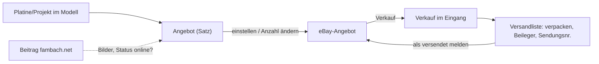

# Paket · eBay-Verkauf (tax_ebay, Teil 2): Angebote einstellen, Verkäufe versenden — Konzeptentwurf

**Stand 2026-10-23. Nichts entschieden, nichts gebaut.** Aus [INF-074](../../neues-konzept-eingang.md#inf-074--angebote-bei-ebay-einstellen-verkaufstexte-link-zum-laufenden-angebot).
Teil 1 (Käufe holen) steht in [`konzept.md`](konzept.md). Was er entscheiden soll, steht in §8 (V1–V9); alles andere ist mein
Vorschlag (`INFERRED`), bis es eine `D-<nnn>` hat (`PR-3`).

**Sein Wort, auf dem der Entwurf steht (2026-10-23):**

> *«untersuche mal bitte was wir machen müssen um beiträge in ebay einzustellen, idee ist es zum beispiel nach we einen teil der
> Platinen gleich bei EBAY einzustellen, hierzu soll ein besonderrer footer text, bilder und ein angebot bei ebay erstellt werden.
> die anzahl soll manuelle gewählt werden und angepasst werden können wenn ich welche verbrauche oder wo anders verkaufe, auch soll
> der status, mit eigenen projekt geprüft oder ungegeprüft von mir reinkommen. ein hinweis auf das github aber nicht als url und
> auf fambach beitrag. natürlich muss der Beitrag online sin um darauf zu verweisen ansonsten nur auf meine websit verweisen»*
>
> *«acuh möchte ich sehen wenn käufe reinkommen die verpacken und versenden können, mach erstmal ein konzept»*
>
> *«Evtl könnte man die bilder aus den beitrag nehmen.»*

⚠️ **Nicht gemessen:** die API-Aufrufe in §3 stammen aus eBays Entwicklerdoku, nicht aus einem Aufruf mit seinem Konto.
Gemessen ist nur Teil 1 (Käufe, 2026-10-21).

---

## 1 · Das Wichtigste vorweg: eBay verbietet Verweise nach draussen

eBays Link-Regel (Stand 2026-10-23, [Richtlinie](https://www.ebay.ie/pages/help/policies/listing-links.html)), wörtlich:

> *«listings can't contain links that direct customers to a site other than eBay, even if the link is not clickable.»*

Erlaubt sind nur Versanddienst-Infos, Produktvideos (YouTube/Vimeo, **ohne Webadresse im Video**) und gesetzlich vorgeschriebene
Angaben. **Damit ist «fambach.net» oder «github.com/…» im Angebotstext auch als nicht klickbarer Text verboten.** Folgen laut
Richtlinie: Angebote werden entfernt, im Wiederholungsfall alle.

**Vorschlag, wie sein Wunsch trotzdem ankommt:**

| Wunsch | im Angebot (eBay) | im Paket (Beileger) |
|---|---|---|
| Hinweis auf GitHub | nur der **Projektname** und «Open-Source-Projekt von …», ohne Adresse | Adresse + QR-Code |
| Hinweis auf den Beitrag | nichts | Adresse + QR-Code, **nur wenn der Beitrag veröffentlicht ist**, sonst die Startseite |
| Video (später) | YouTube-Link erlaubt | — |

Der Beileger ist ein A6-Zettel, den der Modeller beim Verpacken druckt (§5). Ob schon der Projektname als «Verweis» gilt, ist
nicht klar geregelt — `V2`.

## 2 · Ablauf

1. **Angebot anlegen** im Modeller: Platine/Projekt wählen, Anzahl, Preis, Status «geprüft / ungeprüft», Bilder.
2. **Einstellen** per Knopf: tax_ebay baut Text (Vorlage + Footer) und stellt das Angebot ein; die eBay-Angebotsnummer kommt zurück
   in den Satz.
3. **Anzahl ändern** im Satz (verbraucht, woanders verkauft) → tax_ebay schickt die neue Anzahl an eBay. 0 = Angebot beenden.
4. **Verkauf** kommt über die Verkäufe-Quelle (Teil 1, Fulfillment API — schon gebaut, nicht verdrahtet) in den Eingang.
5. **Versandliste** zeigt alle bezahlten, nicht versendeten Verkäufe; dort Beileger drucken, Sendungsnummer eintragen,
   «versendet» → eBay erfährt Sendungsnummer.

## 3 · Was eBay dafür braucht (Inventory API)

| Schritt | Aufruf | Bemerkung |
|---|---|---|
| einmalig | Geschäftsrichtlinien (Versand, Zahlung, Rücknahme) im eBay-Konto | Pflicht für die Inventory API; anlegen in «Mein eBay» oder per Account API |
| einmalig | Artikelstandort (`createInventoryLocation`) | nur Ort/PLZ |
| je Angebot | `createOrReplaceInventoryItem` (SKU) | Titel, Beschreibung, Bilder (HTTPS-URLs), Zustand, Anzahl, Merkmale |
| je Angebot | `createOffer` → `publishOffer` | Kategorie, Preis, Richtlinien → liefert die Angebotsnummer |
| Anzahl | `bulkUpdatePriceQuantity` | ein Aufruf für mehrere SKUs |
| Kategorie | Taxonomy API `getCategorySuggestions`, `getItemAspectsForCategory` | Pflichtmerkmale je Kategorie |
| Versand melden | Fulfillment API `createShippingFulfillment` | Sendungsnummer + Versanddienst |

**Neue Berechtigungen:** `sell.inventory`, `sell.account`, `sell.fulfillment` (schreibend). Er muss einmal **«Connect again»**
drücken. Call-Limits: Inventory API 2 Mio./Tag — kein Engpass; die Kappe in tax_ebay (1/10) gilt weiter.

**SKU** = Satz-Id des Angebots im Modeller (`taxmod-<id>`). Damit gehört jedes eBay-Angebot genau einem Satz.

## 4 · Daten im Modell (Vorschlag)

Neuer Knoten **«Angebote»** unter «Stock», ein Satz je eBay-Angebot (später auch andere Plattformen):

| Feld | Art | Herkunft |
|---|---|---|
| Bezeichnung | Text | er / vom Projekt vorgeschlagen |
| Projekt bzw. Material | Satzverweis | er wählt — daher Beitrag, GitHub-Repo, Bilder |
| Status | Auswahl «geprüft» / «ungeprüft» | er |
| Anzahl angeboten | Zahl | er, jederzeit änderbar |
| Preis | Einheitenwert (EUR) | er |
| Bilder | Medien 0..* | **vorgeschlagen aus dem Beitrag, wenn einer da ist** (sein Wort), abwählbar; sonst wählt er aus der Mediathek |
| Plattform, Angebotsnummer, Angebot seit, Zustand bei eBay | Text/Datum | tax_ebay schreibt zurück |

- **Anzahl bleibt Handarbeit** (sein Wort). Später kann sie aus dem Lager kommen ([`../lager/konzept.md`](../lager/konzept.md),
  Bestandsposten) — dann zeigt der Satz «Lager sagt 7, angeboten 5».
- **Bilder aus dem Beitrag:** tax_ebay liest das Beitragsbild und die Galerie des verknüpften Beitrags (WordPress, auch als
  Entwurf) und schlägt sie vor. eBay lädt die Bilder selbst von fambach.net (HTTPS) und hält eigene Kopien — die URLs stehen nicht
  sichtbar im Angebot, die Link-Regel ist dadurch nicht verletzt.
- **Verkäufe** landen in den vorhandenen Knoten «Verkäufe» / «Verkaufte Artikel» ([D-934](../../NewConcept/90-decision-log.md));
  der Eingang braucht dafür noch Ziel-Felder (bekannte Lücke aus Teil 1).

## 5 · Text des Angebots

Aufbau, Vorlage im eBay-Reiter einstellbar:

1. **Kopf:** Bezeichnung, kurze Beschreibung (aus dem Beitrag-Auszug vorgeschlagen, editierbar).
2. **Status-Block:** *geprüft* → «Von mir aufgebaut und in einem eigenen Projekt getestet.» / *ungeprüft* → «Unbestückt bzw. nicht
   getestet, Verkauf als Bastlerware.» (Wortlaut `V4`).
3. **Lieferumfang** (aus dem Satz).
4. **Footer** (einmal im Reiter gepflegt): Projektname, «Open-Source-Hardware, Dokumentation und Quellen liegen im Paket bei»,
   Lizenzhinweis (Hardware-Lizenz des Projekts, Markenhinweis), Versand/Abholung.

Keine Adresse, kein «fambach», kein «github.com» (§1). tax_ebay prüft den fertigen Text vor dem Einstellen auf `http`, `www.`,
`.net`, `.com`, `github` und verweigert sonst.

**Beileger (Paket):** Bezeichnung, Status, Beitrags-Adresse **nur wenn der Beitrag veröffentlicht ist**, sonst
`https://www.fambach.net`; GitHub-Adresse; je ein QR-Code. Gedruckt aus der Versandliste.

## 6 · Versandliste

Eigene Seite im Modeller (oder Teil des Eingangs, `V7`): je bezahltem, offenem eBay-Verkauf eine Zeile mit Käufername, Artikeln,
Anzahl, Versandart, Bezahlt am. Knöpfe: **Beileger drucken**, **Sendungsnummer + Versanddienst → «versendet»**. Die Lieferadresse
liest tax_ebay **nur für diese Seite** aus eBay und speichert sie nicht im Modell (wie in Teil 1: keine Adressen).
Paketschein selbst bleibt bei eBay/DHL — eBay-Versandetiketten gibt es nicht über die öffentliche API für .de (`INFERRED`, ungeprüft).

## 7 · Was er rechtlich klären sollte (keine Rechtsberatung)

- **Gewerblich oder privat:** Wer regelmäßig selbst gebaute Platinen verkauft, gilt schnell als Unternehmer. Dann gelten
  Impressum im eBay-Konto, Widerrufsbelehrung, Gewährleistung, Umsatzsteuer/Kleinunternehmer.
- **ElektroG/WEEE:** **bestückte** Platinen können Elektrogeräte bzw. -bauteile sein → Registrierung bei stiftung ear prüfen.
  Leere Platinen sind keine Elektrogeräte.
- **VerpackG:** gewerblicher Versand → Registrierung im LUCID-Register.
- **GPSR (EU-Produktsicherheit):** gewerbliche Angebote brauchen Hersteller-/Verantwortlichen-Angaben; die Inventory API hat dafür
  eigene Felder.

Davon hängt ab, welche Pflichtfelder das Angebot bekommt (`V1`).

## 8 · Fragen an ihn

| | Frage | Mein Vorschlag |
|---|---|---|
| **V1** | Verkaufst du privat oder gewerblich bei eBay? | **entschieden: privat, vorerst ([D-975](../../NewConcept/90-decision-log.md))** |
| **V2** | Nur Projektname im Angebot, Adressen nur im Beileger? | ja |
| **V3** | Knoten «Angebote» unter «Stock» wie §4? | ja |
| **V4** | Wortlaut geprüft/ungeprüft (bestückt? getestet?) | er formuliert |
| **V5** | Bilder aus dem Beitrag vorschlagen, abwählbar? | ja |
| **V6** | Festpreis oder auch Auktion? | erst nur Festpreis |
| **V7** | Versandliste als eigene Seite oder im Eingang? | eigene Seite «Versand» |
| **V8** | Versand an eBay melden (Sendungsnummer) aus dem Modeller? | ja |
| **V9** | Reihenfolge | 1. Verkäufe holen + Versandliste, 2. Angebote einstellen, 3. Anzahl nachführen |

## 9 · Bauschritte (nach Entscheidung)

1. Verkäufe in den Eingang (Ziel-Felder «Verkäufe»), Versandliste lesend.
2. Versand melden (`createShippingFulfillment`), Beileger drucken.
3. Knoten «Angebote», Einstellen mit Vorlage + Footer + Bildern + Text-Prüfung (§5).
4. Anzahl ändern → `bulkUpdatePriceQuantity`, 0 beendet.
