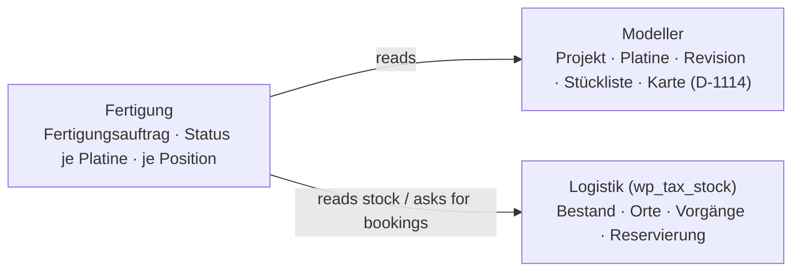

# Package · Manufacturing («Fertigung», `wp_tax_manufacturing`) — concept draft

**Status 2026-11-04.** Decided: [D-1142](../../NewConcept/90-decision-log.md) (own module, build status per board **and** per
parts-list position). Everything else below is my proposal (`INFERRED`) until it has a `D-<nnn>` (`PR-3`). Built: nothing.

**His words (2026-11-04):**

> *«beim s7vrm projekt sind alle platinen bis auf die spule aufgebaut, das könne wir glaube ich aktuelle noch nicht abbilden ich glaube
> wir sollten das manufacturing als eigenes modul behandeln das sich in tax und tax logistik integriert»*

His choice on the card «Fertigung als eigenes Modul so bauen?»: *«Eigenes Modul, je Platine + Position»*.

## 1 · Who owns what

- **Modeller** stays data structure: project, board, revision, parts list, finished card ([D-1114](../../NewConcept/90-decision-log.md)).
- **Logistik** keeps quantities, places, transactions and reservations ([D-1083](../../NewConcept/90-decision-log.md),
  [D-1088](../../NewConcept/90-decision-log.md)). It offers a read interface (stock per place/material, today
  `StockService::presentIn()`) and books withdrawal/receipt when the manufacturing module asks.
- **Fertigung** owns the build: orders, build status, demand vs. stock.

## 2 · Data (INFERRED)

The «Bauläufe» of the stock draft ([`../lager/konzept.md`](../lager/konzept.md) §3.7, never built) move here and become:

| Node | Field | Type | Mult. |
|---|---|---|---|
| Fertigungsaufträge | Projekt | → Projekte | 1..1 |
| | Stückzahl | Ganzzahl | 1..1 |
| | Gebinde | → Lagerort (project box, D-1030) | 0..1 |
| | Status | Konstante: geplant · in Bau · fertig · abgebrochen | 1..1 |
| | Begonnen am / Fertig am | Datum | 0..1 |
| | Baugruppen | → Fertigung Baugruppe (composition, D-498) | 0..* |
| Fertigung Baugruppe | Revision | → Revision | 1..1 |
| | Status | Konstante: offen · Teile da · bestückt · geprüft · fertig | 1..1 |
| | Offene Positionen | → Part List Item | 0..* |
| | Exemplar | → finished card (D-1114) | 0..1 |

- **Per position = exceptions only:** a board marked «bestückt» lists the parts-list positions still missing (s7vrm: the coil).
  The parts list is never copied.
- Status «fertig» on the order asks (dialog) to book the withdrawal at the logistics module and to create the card.
- Every step undoable, dialogs, shared table template (project rules).

## 3 · Migration

- *Logistik › Fertigung › Projekt-Gebinde* ([D-1139](../../NewConcept/90-decision-log.md), stock 0.29.0) moves into the module:
  `Core/ProjectBill.php`, `StockService::projectBoxes()/projectBill()`, `StockPage::projectBoxList()`, the «production» area of
  `LogisticsShell::navigation()`. The stock keeps `presentIn()` as read interface.
- No data migration: there are no manufacturing records yet.

## 4 · Open

1. s7vrm: is the coil a board of its own or a part? (decides the first order's data)
2. Menu: own top-level entry «Fertigung» or a tab under Logistik?
3. Repository `sfambach/wp_tax_manufacturing` must be created by the owner.
