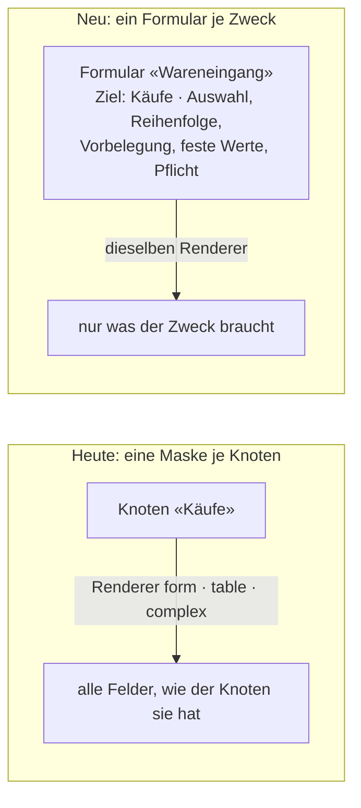
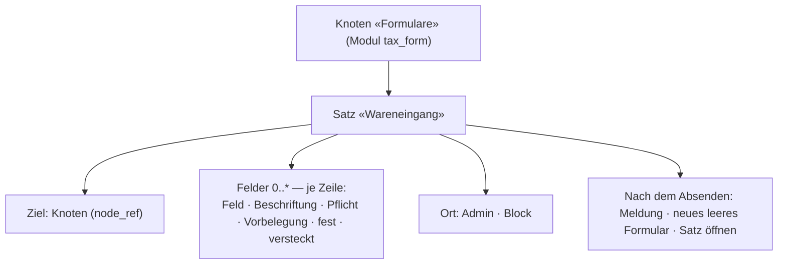
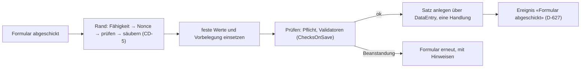
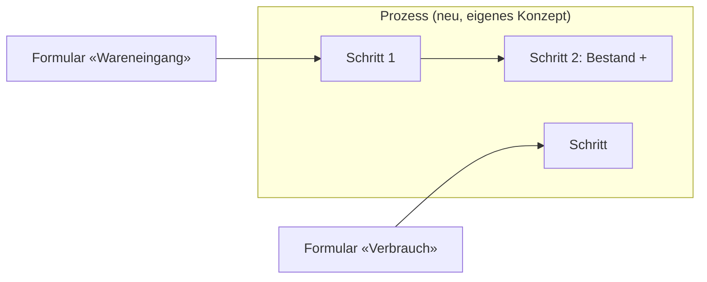

# Paket · Formulare («tax_form») — Konzeptentwurf

**Stand 2026-10-20. Entwurf, nichts entschieden, nichts gebaut.** Aus [INF-075](../../neues-konzept-eingang.md#inf-075--prozesse-und-formulare-im-modell-anlegen)
und [INF-078](../../neues-konzept-eingang.md#inf-078--model-in-module-umbenennen). Was er entscheiden soll, steht in §8; alles andere ist
mein Vorschlag (`INFERRED`), bis es eine `D-<nnn>` hat (`PR-3`).

**Seine Worte, auf denen der Entwurf steht (alle 2026-10-20):**

> *«für formulare und prozesser bräuchten wir glaube ich erstmal ein konzept formulare bauen sollte mit den richtigen renderen ja schon
> möglich sein prozesse ist was neues»* — *«verwendet aber formulare»*

> *«im grunde muss ich ein formular anlegen können, formulare erfassen daten, hierfür bräuchten wir ein neue modul tax_form. generell
> denke ich das wir in tax admin ein menüpunkt module vorsehen sollten und da reihen sich alle module ein»*

---

## 1 · Was ein Formular ist — und was es heute schon gibt

- **Heute** hat jeder Knoten **eine** Eingabe: der gewählte Renderer (`form`, `table`, `complex`, [D-758](../../NewConcept/90-decision-log.md))
  zeichnet **alle** Felder des Knotens. Vorbelegung gibt es je Knoten, nicht je Zweck ([D-654](../../NewConcept/90-decision-log.md),
  [D-844](../../NewConcept/90-decision-log.md)).
- **Ein Formular** ist eine **gespeicherte Auswahl** über einem Zielknoten: welche Felder, in welcher Reihenfolge, mit welcher
  Beschriftung, was vorbelegt, was fest und versteckt, was Pflicht ist — und wo es erscheint.
- **Es zeichnet nichts selbst.** Die Felder kommen aus den vorhandenen Renderern, wie er sagt: *«mit den richtigen renderen ja schon möglich»*.
  Das Formular wählt nur aus und gibt vor.
- **Es erfasst Daten:** Absenden legt einen Satz am Zielknoten an (samt Teilen, [D-759](../../NewConcept/90-decision-log.md)) — über
  denselben Weg wie jede andere Änderung ([D-911](../../NewConcept/90-decision-log.md): eine Handlung, alles oder nichts).

## 2 · Wie ein Formular gespeichert wird — als Satz im Modell

- **Vorschlag: Formulare sind Sätze**, keine eigene Tabelle und kein Code je Formular. Dann gelten Sicherung
  ([D-908](../../NewConcept/90-decision-log.md)), Änderungsbuch, Connector und die Eingabemaske ohne neuen Code — er legt ein Formular
  an wie jeden anderen Satz. *Erst Daten, dann Code* (sein Wort vom 2026-10-17: *«immer auch einwenige das große ganze im auge behalten»*).
- **Ziel** ist ein Knotenverweis; den Typ `node_ref` gibt es (gelesen: `src/Core/Model/Type/NodeRefType.php`).
- ⚠️ **Lücke: ein Verweis auf ein Feld.** «Feld» in der Feldzeile muss eine **Kante des Zielknotens** benennen. Einen Typ dafür gibt es
  nicht (gelesen 2026-10-20, nur `node_ref`). Über den Namen darf es nicht gehen — *«Special-casing by display name»* ist verboten
  (Code-Standard). **Vorschlag:** ein Typ `edge_ref`, dessen Auswahl nur die Kanten des gewählten Ziels anbietet — das ist die Art
  «bedingt …» der Zusatzfunktionen ([D-845](../../NewConcept/90-decision-log.md)).
- **Nicht ausgewählte Felder** bleiben leer oder bekommen die Vorbelegung des Knotens; ein Pflichtfeld des Knotens (`1..1`), das das
  Formular weglässt, braucht einen festen Wert — sonst kann das Formular nie speichern. Der Wächter beim Speichern des Formulars sagt das.

## 3 · Absenden — derselbe Weg wie jede Änderung

- **Kein zweiter Schreibweg.** Das Modul übersetzt das Formular in dieselben Schritte wie `taxmod/write-data`
  ([D-936](../../NewConcept/90-decision-log.md): `create_record`, `set_values`) — also nur Benutzersätze, nie Modell oder Einstellungen.
- **Feste Werte setzt der Server**, nicht das Formular im Browser: ein versteckter Wert im HTML liesse sich ändern.
- **Das Ereignis** ist der Andockpunkt für Prozesse (§6).

## 4 · Wo ein Formular erscheint

| Ort | Was | Offen |
|---|---|---|
| **Admin, Menü «Module» → «Formulare»** | Liste der Formulare, jedes als eigene Seite zum Ausfüllen | Menüpunkt «Module» ist [INF-078](../../neues-konzept-eingang.md#inf-078--model-in-module-umbenennen) |
| **Block `taxmod/form`** (CD-12) | Formular in einem Beitrag oder einer Seite | ⚠️ widerspricht [D-253](../../NewConcept/90-decision-log.md) (§5) |
| **Connector** | nicht nötig — dort schreibt `write-data` schon | — |

## 5 · Der Widerspruch zu D-253

[D-253](../../NewConcept/90-decision-log.md): *«Three surfaces, three jobs: the admin configures the model, the block composes a page,
the front end only draws.»* Ein Formular im Beitrag **schreibt** vom Front end aus. Das ist eine Konzeptänderung und braucht seinen
Beschluss (`PR-2`), nicht eine stille Ausnahme.

- **Vorschlag:** D-253 bleibt für das Zeichnen; ein Formular-Block ist die **eine** benannte Ausnahme, und er schreibt nur für
  angemeldete Benutzer mit `taxmod_write_data` ([D-936](../../NewConcept/90-decision-log.md)).
- **Anonyme Besucher** (z. B. ein Kontaktformular) erst, wenn es einen Fall gibt — dann mit Spam-Schutz und eigener Entscheidung.

## 6 · Formulare und Prozesse

- Sein Wort: Prozesse sind neu und *«verwenden aber formulare»*. Also kommt **das Formular zuerst** und ist für sich nützlich: es legt
  einen Satz an.
- Ein Prozess hängt sich später an das Ereignis «Formular abgeschickt» und macht daraus Schritte — das Formular selbst weiss nichts
  vom Prozess.
- Das Lager ([`../lager/konzept.md`](../lager/konzept.md) §9) wäre der erste Nutzer: Wareneingang, Verbrauch, Inventur als Formulare.

## 7 · Das Modul

- **Name `tax_form`**, eingereiht unter dem Menüpunkt «Module» im Tax-Admin (sein Wunsch, INF-078).
- **Vorschlag: ein Ordner im Modeller-Repo, nicht ein eigenes Plugin** — anders als das Lager. Ein Formular braucht die Renderer,
  `DataEntry` und die Prüfungen des Kerns direkt; ein getrenntes Plugin müsste sie über eine öffentliche Schnittstelle erreichen,
  die es noch nicht gibt. Abtrennen geht später, wenn «Module» eine Form hat.
- **Was das Modul mitbringt:** den Knoten «Formulare» mit seinen Feldern (gesät, wie andere gelieferte Knoten), die Admin-Seite,
  den Block, den Absende-Weg. Kein neuer Renderer.

## 8 · Was er entscheiden soll

| | Frage | Mein Vorschlag |
|---|---|---|
| **F1** | Ein Formular = gespeicherte Auswahl über **einem** Zielknoten, gezeichnet von den vorhandenen Renderern? | **ja** |
| **F2** | Formulare als **Sätze** unter einem Knoten «Formulare»? | **ja** |
| **F3** | Neuer Typ `edge_ref` für «welches Feld»? | **ja**, Auswahl nur aus den Kanten des Ziels |
| **F4** | Formular-Block im Beitrag, als benannte Ausnahme zu D-253, nur für Benutzer mit `taxmod_write_data`? | **ja**; anonym später |
| **F5** | `tax_form` als Ordner im Modeller-Repo statt eigenes Plugin? | **ja**, vorerst |
| **F6** | Reihenfolge | **1** Knoten «Formulare», `edge_ref`, Admin-Seite unter «Module», Absenden · **2** Block · **3** Ereignis für Prozesse |

## 9 · Annahmen, die das Konzept nicht sagt

- Ein Formular legt **neue** Sätze an; einen vorhandenen Satz über ein Formular **ändern** kommt erst mit einem Fall.
- Mehrere Zielknoten in einem Formular (z. B. Bestellung **und** Kauf) gehen nur über die Kanten des Ziels — Teile und Positionen
  ([D-937](../../NewConcept/90-decision-log.md)) —, nicht über zwei unverbundene Ziele.
- Beschriftungen im Formular sind Labels je Sprache wie alle Namen im Modell (`AR-2`).
- Gebaut: nein.
