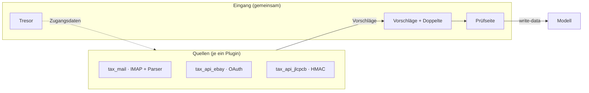
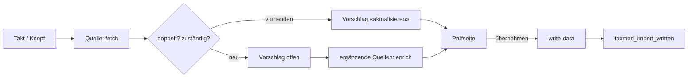

# Paket · Gemeinsame Schnittstelle der Import-Module («Eingang») — Konzeptentwurf

**Stand 2026-10-21. Entschieden: Verschlüsselung ([D-951](../../NewConcept/90-decision-log.md)) und Ort im Modeller ([D-952](../../NewConcept/90-decision-log.md)), S3–S7 ([D-953](../../NewConcept/90-decision-log.md)). Gebaut: Schritt 1 (§6) im Modeller 0.1.31; Schritt 3 im Modeller (Fassung in §10) — `Taxmod\Core\Import\SecretBox`, `OrderProposal`/`ProposalLine`/`ProposalKind`, `Taxmod\WordPress\Import\Vault`.**
Eingang: [INF-083](../../neues-konzept-eingang.md#inf-083--gemeinsame-schnittstelle-für-import-module). Was er entscheiden
soll, steht in §8; alles andere ist mein Vorschlag (`INFERRED`), bis es eine `D-<nnn>` hat (`PR-3`).
Betrifft: [`../mail/konzept.md`](../mail/konzept.md), [`../ebay/konzept.md`](../ebay/konzept.md), [`../jlc/konzept.md`](../jlc/konzept.md).

**Seine Worte, auf denen der Entwurf steht (alle 2026-10-21):**

> *«irgendwie sollten wir dafür einen standard etablieren um andere apis mit einzubinden gemeinsames interface»*

> *«keys und passwörter immer verschlüsselt speichern»*

> *«sollten wir das ins haupprojekt aufnehmen in den modeller ?»* — und auf der Karte «Wo soll das gemeinsame Interface für Import-Module liegen?» seine Wahl *«In den Modeller (Kern)»* (S1, [D-952](../../NewConcept/90-decision-log.md)).

---

## 0 · Bestand — was es heute schon zweimal gibt (gelesen am 2026-10-21)

| Baustein | tax_mail (`799229b`) | tax_ebay (`7082647`) | tax_api_jlcpcb (Entwurf) |
|---|---|---|---|
| Geheimnisse versiegeln | `Core/Secret/SecretBox` — libsodium secretbox, Schlüssel `generichash('taxmail-secret\|' . wp_salt('auth'))` | `Core/Secret/TokenVault` — dasselbe Verfahren, `'taxebay-token\|'` | «wie tax_ebay» ⇒ dritte Kopie |
| Vorschlagsformat | `OrderProposal`, `ProposalLine`, `ProposalKind` | `SaleMapper` baut dasselbe als Array nach («Format shared with tax_mail») | «gleiches Format» |
| Vorschlagstabelle | `wp_taxmail_proposals` mit Mail-Spalten (Message-ID, UID, Absender, Betreff) | keine — Ort der Prüfseite offen | keine |
| Prüfseite | `ReviewScreen` «Eingang prüfen» | offen (Karte) | offen |
| Schreiben | `ChangeListBuilder`, `ModelGateway`, `Targets` (Option `taxmail_targets`) | — | — |
| Doppelte | Plattform + Bestellnummer, im eigenen Code | Plattform + Bestellnummer, geplant | Plattform + Bestellnummer, geplant |
| Wer ist zuständig | Filter `taxmail_blocked_parsers`, `taxmail_status_only_parsers` ([D-942](../../NewConcept/90-decision-log.md), [D-950](../../NewConcept/90-decision-log.md)) | meldet sich dort an | «ergänzt», neuer Filter (Name offen) |
| Einstellungen | eigene Seite | Reiter «eBay» über `taxmod_config_tabs` ([D-945](../../NewConcept/90-decision-log.md)) | Reiter «JLC» geplant |
| Abruf | eigener Cron-Hook, Intervall wählbar | geplant (E7) | geplant |

**Befund:** jede neue Quelle kopiert Tresor, Format, Doppelte und Prüfseite. Das ist der verbotene Fall «ein Fakt an zwei
Stellen» (CLAUDE.md, *Prohibited*) — beim Vorschlagsformat schon eingetreten: tax_ebay hängt am Array-Schlüssel von tax_mail,
ohne dass ein Test beide verbindet.

## 1 · Bild



- **Eine Quelle weiss, wie man mit *einem* Gegenüber spricht** (Postfach, eBay, JLC) und übersetzt dessen Antwort in Vorschläge.
- **Der Eingang weiss alles, was für jede Quelle gleich ist:** Geheimnisse, Vorschlag, Doppelte, Zuständigkeit, Prüfen, Schreiben, Takt.
- **Der Eingang wohnt im Modeller** ([D-952](../../NewConcept/90-decision-log.md)): Vertrag und Vorschlag im Kern (ohne WordPress, `CD-1`), Tresor, Tabelle, Prüfseite, Takt und Reiter an der Grenze.

## 2 · Vertrag einer Quelle

```php
// SKETCH — Namen vorläufig
interface ImportSource
{
    public function key(): string;                 // 'mail', 'ebay', 'jlcpcb' — Slug des Reiters (D-945)
    public function label(): string;               // übersetzbar (AR-2)
    /** @return list<CredentialField> */
    public function credentials(): array;          // welche Zugangsdaten, welche davon geheim, welche Konstante geht vor
    public function testConnection(Credentials $c): ConnectionResult;
}

interface FetchingSource extends ImportSource    // Mail, eBay: findet selbst neue Bestellungen
{
    public function fetch(Credentials $c, Cursor $since): FetchBatch;   // Vorschläge + neuer Cursor
}

interface EnrichingSource extends ImportSource   // JLC: ergänzt Vorschläge anderer Quellen
{
    /** @return list<string> Plattformen, deren Vorschläge sie ergänzt, z. B. ['JLCPCB'] */
    public function enriches(): array;
    public function enrich(Proposal $p, Credentials $c): ?Proposal;
}
```

- **Abrufen und Ergänzen sind getrennte Rollen** (Rückmeldung aus dem JLC-Thread, 2026-10-21): die PCB-API von JLC hat keine
  Bestellliste, nur Details je Batch-Nummer — sie kann kein `fetch()`. Der Eingang reicht ihr jeden Vorschlag einer *fremden*
  Quelle (tax_mail, Plattform JLCPCB, Bestellnummer `W…`) und jede Bestellung im Modell ohne Preis; sie darf Preise und
  Versandkosten an Positionen und Bestellung ergänzen, nichts anlegen. Eine Quelle darf beide Rollen haben.

- Angemeldet wird eine Quelle über einen Filter (`taxmod_import_sources`), wie Parser in tax_mail ([D-942](../../NewConcept/90-decision-log.md)) und Reiter ([D-945](../../NewConcept/90-decision-log.md)).
- **Was in der Quelle bleibt:** Protokoll (IMAP, REST, Signatur), Anmeldeablauf (eBay-OAuth mit Rückleitung), Abbildung der Antwort
  auf den Vorschlag, Parser, Sortierregeln und Ordner von tax_mail, eigene Einstellungen unter dem gemeinsamen Teil des Reiters.
- **Was die Quelle nie tut:** selbst ins Modell schreiben, selbst Geheimnisse speichern, selbst Doppelte suchen.

## 3 · Was der Eingang liefert

### 3.1 Tresor — Geheimnisse immer verschlüsselt ([D-951](../../NewConcept/90-decision-log.md))

- **Jeder Schlüssel, jedes Passwort, jeder Token** (Refresh-Token, Secret, IMAP-Passwort) wird versiegelt gespeichert: libsodium
  secretbox, Schlüssel aus `wp_salt('auth')` mit Kontext je Quelle — das Verfahren, das tax_mail und tax_ebay heute schon nutzen,
  einmal statt zweimal.
- Ein Geheimnis wird im Formular **nie wieder angezeigt**, nie geloggt, steht nie in einem Vorschlag und nie in einer Fehlermeldung.
- **Konstanten in `wp-config.php` gehen vor** ([D-944](../../NewConcept/90-decision-log.md)); Name `TAX<QUELLE>_<FELD>`, wie heute.
- Ändern sich die Salts, lässt sich nichts mehr öffnen: der Reiter sagt das und fragt neu ab ([D-944](../../NewConcept/90-decision-log.md)).
- Die Sicherung ([D-908](../../NewConcept/90-decision-log.md)) trägt versiegelte Werte mit; auf einer anderen Site (anderes Salt)
  müssen sie neu eingegeben werden. *Gewollt — ein Backup-ZIP ist kein Schlüsselbund.*

### 3.2 Vorschlag

- **Das Format von tax_mail wird das gemeinsame** (`OrderProposal` + `ProposalLine` + `ProposalKind`), ergänzt um
  `source` (welche Quelle) und `external_id` (Message-ID, eBay-orderId, JLC-Batch). Quellenspezifisches (Absender, Betreff,
  Mail-UID) wandert in ein freies Feld `evidence`, das nur die Quelle und die Prüfseite lesen.
- Neue Felder kommen **an einer Stelle** dazu und gelten für alle — keine zweite Fassung im Array einer Quelle.

### 3.3 Vorschlagstabelle

- **Eine Tabelle für alle Quellen**: Quelle, externe Id, Plattform, Bestellnummer, Art, Status (offen / übernommen / verworfen /
  nicht erkannt / Fehler), Vorschlag (JSON), `evidence` (JSON), Ids der geschriebenen Sätze. Ein Vorschlag ist Eingang, kein
  Bestand (tax_mail M5) — AR-1 betrifft das Modell, nicht den Eingang.
- Die Zeilen von `wp_taxmail_proposals` ziehen einmal um; die Mail-Spalten werden `evidence`.

### 3.4 Doppelte und Zuständigkeit

- **Doppelt = gleiche Plattform + gleiche Bestellnummer**, im Modell oder im Eingang. Einmal gebaut, ein Lesezugriff je Lauf (`CD-7`).
- **Zuständigkeit je Plattform als Tabelle im Reiter «General» statt Filter zwischen Modulen:**

| Plattform | neue Bestellungen | Status (versandt, zugestellt) | Preise ergänzen |
|---|---|---|---|
| eBay | eBay-API ([D-950](../../NewConcept/90-decision-log.md)) | Mail | — |
| JLCPCB | Mail | Mail | JLC-API (J2) |
| Reichelt, Mouser … | Mail | Mail | — |

- Die heutigen Filter `taxmail_blocked_parsers` und `taxmail_status_only_parsers` werden zu Zeilen dieser Tabelle. *Grund:*
  heute weiss nur der Code, wer wofür zuständig ist; die Tabelle kann er lesen und ändern (`PR-13`).
- Ist die zuständige Quelle nicht aktiv, fällt die Rolle an die nächste, die die Plattform kennt — wie heute: ohne tax_ebay
  liest der eBay-Parser von tax_mail auch Käufe ([D-950](../../NewConcept/90-decision-log.md)).

### 3.5 Prüfseite «Eingang»

- **Eine Seite für alle Quellen**, filterbar nach Quelle; je Vorschlag die Positionen mit Haken, wie heute in tax_mail (M2).
  Erst Admin-Seite, später Formular aus tax_form (M6).
- Erledigt er einen Vorschlag, meldet der Eingang das der Quelle zurück (tax_mail verschiebt dann die Mail, §3a dort).

### 3.6 Schreiben

- **Nur über `taxmod/write-data`** ([D-936](../../NewConcept/90-decision-log.md)), eine Liste, alles oder nichts.
- **Ziel-Knoten und -Felder einmal im Reiter «General»** gewählt, nicht je Quelle (heute `taxmail_targets`) — Bestellungen,
  Käufe, Verkäufe sind für alle Quellen dieselben ([D-933](../../NewConcept/90-decision-log.md), [D-934](../../NewConcept/90-decision-log.md), Baum im Umbau [D-940](../../NewConcept/90-decision-log.md)).
- Beträge als Einheitenwert ([D-929](../../NewConcept/90-decision-log.md)).
- Danach **ein** Ereignis für alle: `taxmod_import_written` (Quelle, Plattform, Satz-Id, Art). tax_stock hört darauf, statt auf
  `taxmail_order_written`, `taxebay_*` und `taxapijlcpcb_*` einzeln.

### 3.7 Takt und Einstellungen

- Ein Cron-Hook für alle; **Intervall je Quelle** im Reiter (aus, stündlich, 2× täglich, täglich; Standard täglich), dazu Knopf
  «Jetzt abrufen» je Quelle und «Alle abrufen» auf der Prüfseite. Sperre gegen doppelte Läufe, Zeitgrenze je Lauf (Strato).
- **Reiter je Quelle** ([D-945](../../NewConcept/90-decision-log.md)) mit gemeinsamem Kopf: aktiv, Zugangsdaten (Tresor),
  «Verbindung testen», Intervall, letzter Lauf + Fehler. Darunter, was nur die Quelle braucht.

### 3.8 Was tax_mail vom Eingang braucht (Rückmeldung aus dem Mail-Thread, 2026-10-21)

| | Bedarf | Antwort im Vertrag |
|---|---|---|
| 1 | Beim Erledigen die Mail verschieben (Importiert / Verworfen) | Rückruf `resolved(Gruppe, Status)` an die Quelle, mit Zeilen-Ids und `evidence` (Mail-UID, UIDVALIDITY, Message-ID) |
| 2 | Eine Bestellung aus mehreren Mails (Bestätigung, Versand, Zustellung) zusammenführen (`ProposalMerger`); weitergeleitete Kopien erkennen | **Gruppe** = Plattform + Bestellnummer; Zusammenführen im Eingang. Kopien erkennt die Quelle (Plattform, Nr., Art, Empfangszeit), bevor sie liefert |
| 3 | eBay ohne Bestellnummer: Schlüssel «ohne-Nr:…» plus `WonAuctionMatch` (Verkäufer oder Titel, 14 Tage) | Gruppenschlüssel darf von der Quelle kommen; der Abgleich ohne Nummer bleibt Sache der Quelle, über die Abfrage aus Zeile 5 |
| 4 | Status-Zeilen ändern nur Vorhandenes, legen nichts an (D-950) | Rolle «Status» der Zuständigkeitstabelle (§3.4) |
| 5 | Altbestand gegen das Modell abgleichen, ohne Zeile anzulegen | Abfrage «gibt es diese Bestellung schon?» (`findOrder`) als Dienst des Eingangs |
| 6 | Fatal-Text auf der Fehlerseite (debug.log ist live aus) | gilt für die Prüfseite im Kern genauso |

## 4 · Ablauf



## 5 · Namen

- Module, die eine fremde API anbinden: **`tax_api_<name>`**, Repo `sfambach/wp_tax_api_<name>` (so schon gewählt für eBay und
  JLC). tax_mail bleibt `tax_mail` — es spricht IMAP, keine API eines Händlers.
- Optionen `taxmod_<quelle>_*` ([D-945](../../NewConcept/90-decision-log.md)).

## 6 · Umzug in Schritten

1. **Tresor in den Eingang**, tax_mail und tax_ebay nutzen ihn. Einmaliges Umsiegeln beim Upgrade (mit altem Kontext öffnen, mit
   neuem versiegeln) — er muss nichts neu eingeben.
2. **Vorschlagsformat in den Eingang**; tax_mail und tax_ebay bauen damit. Ein Test liest einen Vorschlag jeder Quelle.
3. **Tabelle, Doppelte, Prüfseite**; Zeilen aus `wp_taxmail_proposals` ziehen um.
4. **Zuständigkeitstabelle** ersetzt die beiden Filter.
5. **tax_api_jlcpcb** entsteht gleich auf dem Vertrag (erste Quelle ohne Altlast).

Jeder Schritt endet mit etwas, das er bedienen kann (`PR-2`), und die Module verlangen ab dann eine Mindestversion des Eingangs.

## 7 · Abgrenzung

- **Kein Ersatz für `write-data`**, keine eigene Rechte-Rolle: wer übernimmt, braucht `taxmod_write_data` ([D-936](../../NewConcept/90-decision-log.md)).
- **Kein Lager:** Wareneingang, Exemplare, Quanten bleiben bei tax_stock; der Eingang meldet nur.
- **Nicht für Angebote/Verkaufen** (INF-074): Schreiben *nach* eBay ist eine andere Richtung; der Tresor darf es später tragen.

## 8 · Was er entscheiden soll

| | Frage | Mein Vorschlag |
|---|---|---|
| **S1** | Wo wohnt der Eingang: im Modeller, als eigenes Plugin `tax_import`, oder nur als Vertrag ohne gemeinsamen Code? | **entschieden: im Modeller ([D-952](../../NewConcept/90-decision-log.md))** |
| **S2** | Geheimnisse immer verschlüsselt | **entschieden: [D-951](../../NewConcept/90-decision-log.md)** |
| **S3** | Ein Vorschlagsformat, eine Tabelle, eine Prüfseite für alle Quellen | **entschieden: [D-953](../../NewConcept/90-decision-log.md)** |
| **S4** | Zuständigkeit je Plattform als sichtbare Tabelle statt Filter | **entschieden: [D-953](../../NewConcept/90-decision-log.md)** |
| **S5** | Ziel-Knoten einmal im Reiter «General», nicht je Quelle | **entschieden: [D-953](../../NewConcept/90-decision-log.md)** |
| **S6** | Namen `tax_api_<name>` für API-Module | **entschieden: [D-953](../../NewConcept/90-decision-log.md)** |
| **S7** | Reihenfolge §6: erst Tresor + Format, dann Tabelle/Prüfseite, JLC gleich auf dem Vertrag | **entschieden: [D-953](../../NewConcept/90-decision-log.md)** |

## 9 · Annahmen, die das Konzept nicht sagt

- Ein Benutzer prüft (er); Vorschläge sind nicht nach Benutzer getrennt.
- «Keys und Passwörter» schliesst Tokens und Secrets ein; App-IDs, RuName, Server, Benutzernamen sind keine Geheimnisse und
  bleiben lesbar.
- **Gebaut anders als oben in §6 Schritt 1 (INFERRED):** kein Umsiegeln. Der Tresor nimmt den Kontext als Parameter; tax_mail und tax_ebay behalten ihre Kontexte `taxmail-secret` / `taxebay-token`, also öffnet alles Gespeicherte unverändert. Der Tresor liest Text mit und ohne Präfix `sb1:` (tax_ebay schrieb keins) und schreibt immer mit.
- Ein Modul prüft `class_exists(Taxmod\WordPress\Import\Vault::class)` und `Vault::API`; fehlt der Modeller oder ist er älter, zeigt das Modul einen Hinweis «Taxonomy Modeller ≥ 0.1.31 nötig» und tut nichts — die eigene Klasse ist gestrichen, nicht als Rückfall behalten.
- Quellen dürfen weiter eigene Tabellen halten, wenn es nur ihr Protokoll betrifft (tax_mail: Startpunkt, Ordner).
- Status-Updates an übernommenen Bestellungen sind Vorschläge der Art «aktualisieren» und gehen über dieselbe Prüfseite; ob sie
  ohne Prüfen geschrieben werden dürfen (z. B. Sendungsnummer), ist offen.

## 10 · Gebaut: Schritt 3 im Modeller, und was dabei angenommen wurde

- **Gebaut:** Vertrag `ImportSource` mit den Rollen `FetchingSource`, `EnrichingSource`, `ResolvingSource`; `DutyTable` und
  `Intake` (Doppelte über Plattform + Bestellnummer, Zuständigkeit); `ProposalGroup` (eine Bestellung einmal);
  `ChangeListBuilder`, `Money`, `TargetModel` aus tax_mail übernommen. An der Grenze: Tabelle `taxmod_inbox` mit eigener
  Schemafassung, Seite «Inbox» (Übernehmen je Position, Verwerfen, «Jetzt abrufen» je Quelle), Reiter «Import»,
  stündlicher Takt, der jede abrufende Quelle nach ihrem eigenen Intervall laufen lässt.
- **Geprüft:** Kern-Tests; `import-inbox-check` gegen eine frische WordPress-Datenbank (MariaDB). **Nicht geprüft:** Übernehmen
  ins Modell — die frische Datenbank hat die Knoten «Bestellungen»/«Käufe» nicht; der Schreibweg ist der von tax_mail.
- **Annahmen (`INFERRED`):**
  - **Reiter «Import» statt «General»** für Zuständigkeitstabelle und Ziel-Knoten (S4, S5 sagten «General»): «General» ist
    die feste Einstellungstabelle des Modellers, ein eigener Reiter folgt dem Muster aus D-945. Wenn er «General» will,
    ziehen die zwei Blöcke um.
  - Ob ein Vorschlag neu oder ein Status-Update ist, entscheidet die **Prüfseite**, nicht der Abruf: ein Cron-Lauf hat
    keinen Benutzer und darf das Modell nicht lesen (D-936). Beim Abruf gilt nur «schon gesehen?» und die Zuständigkeit.
  - Ziel-Ids: Startwerte sind die von tax_mail auf fambach.net gemessenen; eine von tax_mail gespeicherte Option
    `taxmail_targets` wird übernommen. Geändert wird im Reiter als JSON — eine Auswahl im Baum wäre besser, ist aber nicht gebaut.
  - **Verkäufe** (Art «sold») werden angezeigt, aber noch nicht übernommen: es gibt noch keine Ziel-Felder für «Verkäufe».
  - Ergänzende Quellen (JLC) laufen beim Ablegen eines fremden Vorschlags, nicht nachträglich über Bestellungen im Modell.
  - tax_mail behält bis zu seinem Umzug Tabelle und Prüfseite; beide Seiten laufen nebeneinander, bis tax_mail sich als Quelle anmeldet.

### 10.1 · Nachtrag für den Umzug von tax_mail (Modeller 0.1.36)

Auf die Liste aus dem Mail-Thread (§3.8, zweite Rückmeldung vom 2026-10-21):

| | Bedarf | Gebaut |
|---|---|---|
| 1 | Vorschlag ohne Bestellnummer | `OrderProposal::$numberMissing` statt Präfix `ohne-Nr:`; `LooseMatch` (Verkäufer oder Titelanfang, 14 Tage, ohne Datum beides) im Kern; `ExistingOrder` trägt Verkäufer, Datum, Titel; `ModelGateway::findLoose()` |
| 2 | Zusammenführen wie `ProposalMerger` | `ProposalGroup` übernimmt dessen Regeln samt Tests (Artikelnummern als Gleichstand-Brecher, Bestätigung → Art «bestellt», nummerierte Basis, Positionen vereinigen über `LineUnion`) |
| 3 | dieselbe Mail unter anderer Id | Spalte `received_at` (Schemafassung 2), Abgleich Plattform + Nr. + Art + Empfangszeit; die Quelle liefert `received_at` im Beleg |
| 4 | Übernehmen | Herkunftsnotiz aus dem Beleg (`origin`), sonst «aus dem Eingang (Quelle) am …»; Eingangsdatum aus der Zustellmeldung; Status-Update = Sendungsnummer und Zustellung zusammen |
| 5 | Altbestand | Rolle `BacklogSource::backlog(?cursor, ModelLookup)`; Knopf auf der Seite «Inbox», 20 s je Klick; `ModelLookup` nur mit angemeldetem Benutzer |
| 6 | «Bestellung holen» | Rolle `SearchingSource::search(text)`, Feld auf der Seite «Inbox» |
| 7 | Neu beginnen | Knopf je Quelle: vergisst offene Vorschläge und Cursor, dann `RestartingSource::restart()` |

- **Annahme (`INFERRED`):** die Knöpfe Altbestand, Suchen, Neu beginnen stehen auf der Seite «Inbox» bei der Quelle, nicht im Reiter «Import» — sie lösen einen Lauf aus, sie stellen nichts ein.
- Die Seite «Inbox» zeigt einen Absturz als Text statt als weisse Seite (debug.log ist live aus).

