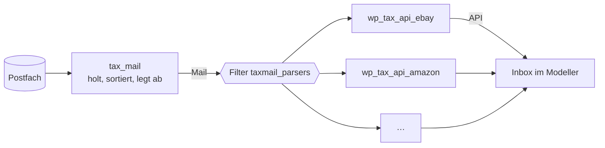

# Paket · Eingang — jede Anbindung ein eigenes Modul

**Stand 2026-10-28. Entschieden: [D-1006](../../NewConcept/90-decision-log.md), [D-1007](../../NewConcept/90-decision-log.md). Gebaut: §2a im Modeller 0.1.79, Bereich «Mail» und §3 in 0.1.81; §2/§4 siehe dort.**
Betrifft: [`konzept.md`](konzept.md), [`../mail/konzept.md`](../mail/konzept.md).

**Sein Wort (2026-10-28):**

> *«Die konfiguration hätte ich gerne noch etwas aufgeräumter jede anbindung wird ein api modul egal ob mail anbindundung oder api. in mail bleibt nur noch mail und postfach einstellungen»*

---

## 1 · Bild



`tax_mail` ist nur noch der Briefträger: Postfach, Ordner, Sortierregeln, Absender-Statistik, Musterbriefe, Abruftakt.
Welche Mail zu welchem Shop gehört und was drinsteht, weiß allein das Modul des Shops. Ein Shop mit API und Mail
(eBay, JLCPCB) hat **ein** Modul mit beiden Wegen.

## 2 · Wer was bekommt

| Heute in tax_mail | Kommt nach | Repo |
|---|---|---|
| Parser eBay | eBay-Modul | `wp_tax_api_ebay` (gibt es) |
| Parser JLCPCB | JLCPCB-Modul | `wp_tax_api_jlcpcb` (gibt es) |
| DHL-Etikettenmail (`Label/DhlLabelMail`) | DHL-Modul | `wp_tax_api_dhl` (gibt es) |
| Parser Amazon + «Amazon order history» (CSV) | Amazon-Modul | **`wp_tax_api_amazon` (neu)** |
| Parser AliExpress | AliExpress-Modul | **`wp_tax_api_aliexpress` (neu)** |
| Parser Conrad | Conrad-Modul | **`wp_tax_api_conrad` (neu)** |
| Parser Mouser | Mouser-Modul | **`wp_tax_api_mouser` (neu)** |
| Parser Reichelt | Reichelt-Modul | **`wp_tax_api_reichelt` (neu)** |
| Tabelle «Mail connections» (Häkchen je Shop) | entfällt — ein Modul ist an, wenn es aktiv ist; im Modul-Reiter «Mail lesen» an/aus | — |
| Zugang, Ordner, Sortierregeln, Absender, Musterbriefe, Abruftakt | bleibt | `wp_tax_mail` |

## 2a · Jede Modulseite gleich ([D-1007](../../NewConcept/90-decision-log.md))

> *«der aufbau der module seiten soll möglicht gleich sein für alle also gleiche breiche»* — *«das müsste man dann auch auf die die module verteieln»* (Wartung) — *«Mail modul implementation (vielleicht noch welche mails )»*

| Bereich | Inhalt | gebaut |
|---|---|---|
| Zugang | Zugangsdaten, Speichern, «Test connection», «Delete access data» | ja |
| Abruf | Abruftakt (Modeller) | ja |
| **Mail** | Welche Mails das Modul erkennt (Bestellung, Versand, Zustellung, Storno, Rechnung …), aus `kinds()` seines Lesers; Hinweis, wenn das Mail-Modul fehlt. Ein/aus ist das Modul selbst (aktivieren/deaktivieren). | ja (0.1.81), Reiter-Schlüssel `reader` |
| Einstellungen | was nur das Modul hat (z. B. Amazon-Bestellhistorie) | ja |
| Wartung | «Start over from now», «Sort the backlog» — nur noch im Reiter des eigenen Moduls | ja |

Ein Bereich, für den das Modul nichts hat, steht trotzdem da, mit «Nothing to set here for this module.».

Welche Mails die Leser heute erkennen (gelesen in tax_mail am 2026-10-28):

| Shop | Mails |
|---|---|
| Amazon | Bestellung, Versand, Zustellung, Storno |
| AliExpress | Bestellung, Versand, Zustellung |
| Conrad | Bestellung, Versand, Zustellung, Rechnung |
| eBay | Kauf, Verkauf, Versand, Zustellung, Rechnung, Erstattung |
| JLCPCB | Bestellung, Versand |
| Mouser | Bestellung, Versand, Storno |
| Reichelt | Bestellung, Versand |

## 3 · Vertrag

Der Mail-Vertrag zieht in den Modeller (Kern, [D-952](../../NewConcept/90-decision-log.md)), damit ein Shop-Modul nur vom
Modeller abhängt, wie jedes andere Modul:

```php
// CONTRACT — Taxmod\Core\Import\Mail
interface OrderMailParser       // Name aus tax_mail behalten, damit der Umzug nur den Namensraum ändert
{
    public function key(): string;          // = Schlüssel des Moduls
    public function shopName(): string;
    public function recognises(MailMessage $mail): bool;
    public function parse(MailMessage $mail): OrderProposal; // mehrere Bestellungen: MultiOrderMailParser
    /** @return list<ProposalKind> welche Mails es erkennt — für den Bereich «Mail» */
    public function kinds(): array;
    /** Version des Moduls — ein neues Modul lässt «Nicht erkannt» neu lesen (§4a) */
    public function version(): string;
}
```

Mit ihm ziehen `MailMessage`, `MimeParser`, `Text`, `LineCollector` und `ParserException` um — `MimeParser` auch, weil jedes Modul seine Musterbriefe (`.eml`) in den Tests lesen muss. IMAP bleibt in tax_mail.
Ein Modul meldet seinen Leser über den Filter `taxmail_parsers` an (gibt es schon).

**Die Quelle bleibt «mail».** Ein Vorschlag aus einer Mail trägt weiter `source = 'mail'`; die Zuständigkeit
(eBay: Bestellungen = API, Status = Mail, [D-950](../../NewConcept/90-decision-log.md)) ändert sich dadurch nicht, und
[D-994](../../NewConcept/90-decision-log.md) gilt weiter.

## 4 · Umzug in Schritten

1. Modeller: Vertrag + Hilfsklassen (§3), tax_mail nimmt ihn statt des eigenen (alte Namen als Alias, bis alle umgezogen sind).
2. Je Shop: Leser + Tests ins Modul, aus tax_mail löschen, Musterbriefe der Tests mitnehmen. Reihenfolge: eBay, JLCPCB, DHL (Repos da), dann die neuen.
3. tax_mail: «Mail connections» und Amazon-Upload raus; Reiter = Zugang · Abruf · Ordner · Sortierregeln.
4. Je Schritt eine Version, eingespielt über die Upload-Warteschlange.

### 4a · Was mitmuss (Mail-Thread, 2026-10-28, tax_mail 0.5.2)

- **Nachprüfen von «Nicht erkannt»** (`MailSource::recheckUnrecognised`) hängt heute an tax_mails Version und den eingeschalteten Parsern. Künftig: Schlüssel **und Version** jedes über `taxmail_parsers` angemeldeten Lesers, sonst löst ein neues Modul kein Nachprüfen aus.
- **`CarrierNotice`** (Paketdienst-Hinweise → «Verworfen») ist Postfach-Sortierung und bleibt in tax_mail.
- **Amazon-Bestellhistorie** (`AmazonOrderHistory` + `ExportQueue`, 100 je Lauf, `restart()` spult zurück) wird im Amazon-Modul eine eigene Quelle bzw. ein eigener Abruf. Geschlossene Bestellungen bleiben `Shipped`, damit kein «Eingegangen am» erfunden wird.
- **Ids bleiben:** Vorschläge aus der Historie tragen `source = 'mail'`, `external_id = 'amazon-export:<nr>'`. Das bleibt nach dem Umzug so, sonst wird doppelt abgelegt.

## 5 · Annahmen, die er nicht gesagt hat

- Ein Repo je Shop, Schema `wp_tax_api_<shop>` — auch für Shops, die heute nur Mails haben.
- Die Quelle der Mail-Vorschläge bleibt «mail» (§3), nicht der Shop.
- Ein Shop-Modul ohne tax_mail lädt, liest aber keine Mails; ohne Modul bleibt eine Shop-Mail «Nicht erkannt».
