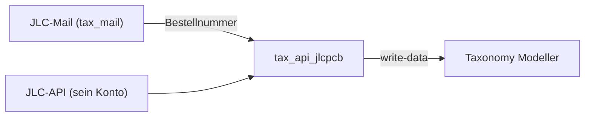
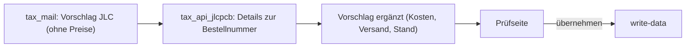

# Paket · JLCPCB-Anbindung («tax_api_jlcpcb») — Konzeptentwurf

**Stand 2026-10-21. Nichts entschieden, nichts gebaut.** Was er entscheiden soll, steht in §8; alles andere ist mein Vorschlag
(`INFERRED`), bis es eine `D-<nnn>` hat (`PR-3`). Eingang: [INF-082](../../neues-konzept-eingang.md#inf-082--jlcpcb-über-die-api-anbinden).
Vorbild: [`../ebay/konzept.md`](../ebay/konzept.md) und [`../mail/konzept.md`](../mail/konzept.md).

**Sein Wort, auf dem der Entwurf steht (2026-10-21):**

> *«habe jetzt jlc api key»*

⚠️ **Gelesen, nicht gemessen:** §3 stammt aus der öffentlichen Doku unter `api.jlcpcb.com/docs` (Basic Rules, API List, API
Request Signature, IP Whitelist, SDK Usage), gelesen am 2026-10-21. Die Beschreibung der einzelnen Aufrufe (Felder, Pfade) steht
dort nicht; sie liegt vermutlich in der Konsole hinter seiner Anmeldung. Kein einziger Aufruf ist gemacht.

---

## 1 · Was das Modul ist — und was nicht

- **tax_api_jlcpcb holt zu seinen JLCPCB-Bestellungen Preise, Kosten und Fertigungsstand über die API** und schlägt sie als Ergänzung
  vor. Geschrieben wird erst nach seiner Auswahl, nur über `taxmod/write-data` ([D-936](../../NewConcept/90-decision-log.md)).
- **Lücke, die es schliesst:** der JLCPCB-Parser in tax_mail liest Bestellnummer, Platinen, Anzahl und Sendungsnummer, aber
  **keine Mail nennt Preise** (Docblock von `Jlcpcb.php` in wp_tax_mail).
- **Es bestellt nichts.** Bestellen, Angebote, Gerber hochladen bietet die API, das Modul nutzt es nicht (J5).
- Eigenes Plugin wie tax_mail und tax_ebay, setzt den Modeller voraus.

## 2 · Ablauf

1. **Bestellnummer kommt aus der Mail** (oder von Hand im Reiter). Grund: die PCB-API hat **keine Bestellliste**, nur
   «Details zu einer Batch-Nummer» (§3). Anders als bei eBay ([D-950](../../NewConcept/90-decision-log.md)) kann die API
   hier nicht die Wahrheit über *welche* Bestellungen es gibt sein, nur über ihren Inhalt.
2. **Ergänzen:** zu jeder JLC-Bestellung im Vorschlag oder im Modell ohne Preis die Details abrufen: Kosten je Posten, Versand,
   Gesamt; dazu der Fertigungsstand, solange nicht versendet.
3. **Abruf:** einmal täglich + Knopf «Jetzt abrufen», wie E7 bei eBay (INFERRED).

## 3 · Was die JLC-API bietet (gelesen, nicht gemessen)

| Bereich | Aufruf (Name aus der API List) | Nutzen fürs Modell |
|---|---|---|
| PCB | **Query order details by batch number** — Bestellung, Lieferadresse, Kosten | Preise der Bestellung ⇒ Kern dieses Moduls |
| PCB | Get PCB production process information (nach Order-ID, erst ab Fertigung) | Status «in Fertigung» |
| PCB | Create order, Online quote, Upload gerber … | nicht genutzt (J5) |
| 3D-Druck | Order list, Order details, Progress | einzige Bestellliste; nur falls er bei JLC3DP druckt |
| Components | Query Component Detail Data (nach C-Nummer) | Katalog: Daten, Preis, Bestand eines Bauteils per LCSC-/C-Nummer (später, J6) |
| Components | Query Private Component Library | seine bei JLC gelagerten Teile (für Bestückung) ⇒ tax_stock, später |
| Balance | Get Available Balance | **Verbindungstest** ohne Nebenwirkung (Schritt 1) |

- **Technik:** nur HTTPS + `POST` mit JSON; Datumsangaben in China-Zeit (GMT+8), `yyyy-MM-dd HH:mm:ss`.
- **Anmeldung:** keine Zustimmung im Browser wie bei eBay. Jede Anfrage wird mit HMAC-SHA256 über fünf Zeilen (Methode, Pfad,
  Zeitstempel, 32-Zeichen-Nonce, Body) signiert und als `Authorization: JOP appid=…, accesskey=…, nonce=…, timestamp=…,
  signature=…` gesendet. Geht mit `hash_hmac` und `wp_remote_post`, **keine fremde Bibliothek** (SDK gibt es nur für Java).
- **Ungeklärt, prüfbar erst mit seinem Schlüssel:** ob «batch number» die Nummer `W…` aus den Mails ist, und ob Bestellungen
  sichtbar sind, die er **auf der Website** aufgegeben hat (die API ist für Firmenkunden gebaut, die über sie bestellen).
  ⚠️ **Davon hängt das ganze Modul ab** — deshalb ist Schritt 2 genau dieser Test.

## 4 · Zugangsdaten — wohin der Schlüssel gehört

- Drei Werte: **App-ID**, **AccessKey**, **SecretKey** (in der Konsole «tokenizationKey» genannt). Nie in den Chat, nie ins Repo.
- **Wie bei tax_ebay 0.0.2 (INFERRED):** Reiter «JLC» unter Configuration ([D-945](../../NewConcept/90-decision-log.md)),
  SecretKey mit libsodium versiegelt (Schlüssel aus dem Auth-Salt). Konstanten in `wp-config.php` haben Vorrang:
  `TAXJLC_APP_ID`, `TAXJLC_ACCESS_KEY`, `TAXJLC_SECRET_KEY`.
- **Bis das Modul läuft:** Schlüssel nur im Passwortmanager bzw. in der JLC-Konsole lassen; er kann ihn jederzeit neu erzeugen
  (zwei Schlüssel je App für Wechsel).
- **IP-Whitelist:** erst leer lassen; wenn die Verbindung steht, die ausgehende IP des Strato-Servers eintragen (sie zeigt der
  Verbindungstest an).

## 5 · Abbildung auf das Modell

| JLC | Modell |
|---|---|
| Bestellung (Batch) | vorhandener Satz unter «Bestellungen» ([D-933](../../NewConcept/90-decision-log.md)), Händler JLCPCB, gefunden über Plattform + Bestellnummer |
| Kostenposten (Platine, Bestückung, Versand) | Preise an den Positionen «Käufe» bzw. Versandkosten der Bestellung, Beträge als Einheitenwert ([D-929](../../NewConcept/90-decision-log.md)), Währung aus der API (meist USD) |
| Platine der Bestellung | **wählt er auf der Prüfseite:** «Platinenversion» ([D-791](../../NewConcept/90-decision-log.md)), Fertiger JLCPCB; nichts wird automatisch verknüpft |

- Ziel-Knoten und Felder in den Einstellungen, nicht im Code (wie eBay §5; Baum im Umbau, [D-940](../../NewConcept/90-decision-log.md)).
- Lieferadresse wird nicht gespeichert.

## 6 · Abgrenzung

- **tax_mail bleibt für JLC zuständig, was es *gibt*** (Bestellnummer, Platinen, Sendung); tax_api_jlcpcb ergänzt, was es *kostet*.
  Kein Abschalten des JLC-Parsers, anders als bei eBay ([D-942](../../NewConcept/90-decision-log.md)).
- Anknüpfung: Filter in tax_mail beim Bauen des Vorschlags (Name offen), oder tax_api_jlcpcb liest die Vorschlagstabelle. tax_api_jlcpcb ruft
  tax_mail nicht direkt auf.
- tax_stock: Action nach dem Schreiben (`taxapijlcpcb_order_updated`), wie bei eBay §7.

## 7 · Bauschritte

1. Gerüst, Reiter «JLC», Schlüssel speichern, **«Verbindung testen»** (Balance) — sonst nichts.
2. Eine bekannte Bestellnummer von Hand abfragen und die Antwort zeigen ⇒ klärt §3 «ungeklärt».
3. Ergänzung der JLC-Vorschläge von tax_mail → Prüfseite → `write-data`.
4. Später: Fertigungsstand; Bauteildaten per C-Nummer (J6); private Teile → tax_stock.

## 8 · Was er entscheiden soll

| | Frage | Mein Vorschlag |
|---|---|---|
| **J1** | tax_api_jlcpcb als eigenes Plugin (Repo `sfambach/wp_tax_api_jlcpcb`, legt er an), schreibt nur über `write-data`, erst Vorschläge | **ja** |
| **J2** | Zweck zuerst: **Preise/Kosten zu Bestellungen ergänzen**, Bestellnummer aus tax_mail | **ja** |
| **J3** | Schlüssel im Reiter «JLC», SecretKey verschlüsselt; Konstanten in `wp-config.php` gehen vor | **ja** |
| **J4** | Erst Verbindung + Test, dann Probe mit einer Bestellnummer, dann Ergänzung | **ja** |
| **J5** | Nicht über die API bestellen | **ja** |
| **J6** | Bauteildaten per C-Nummer in den Katalog — später, eigener Eingang | **später** |

## 9 · Annahmen, die das Konzept nicht sagt

- Ein JLCPCB-Konto (seins), Bestellungen über die Website; Währung USD.
- «API-Key» heisst: er hat in der Konsole eine App mit Schlüsselpaar; die Freigabe der App (Partner-Antrag) ist durch.
- Abrufintervall und Prüfseite wie bei tax_mail/tax_ebay; eine gemeinsame Prüfseite ist weiter offen.
