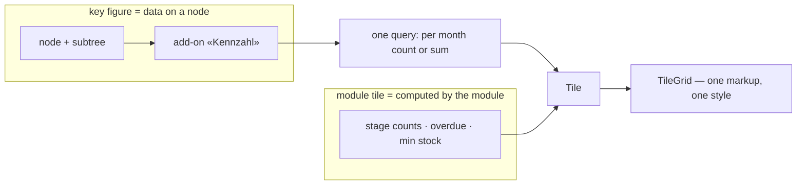
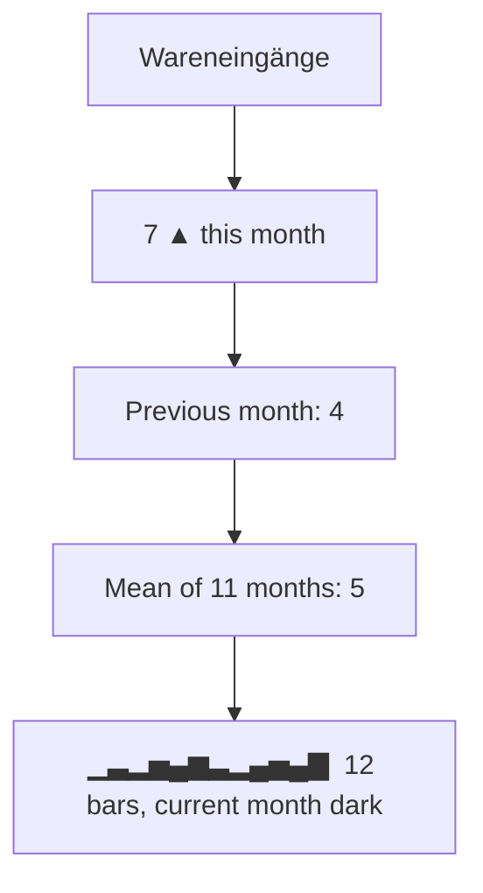
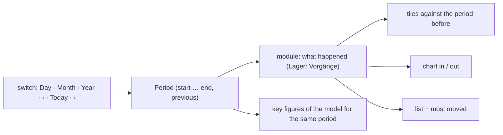

# Package · Tiles and key figures («Kacheln», «Kennzahlen») — concept

**Status 2026-11-04.** Decided: [D-1149](../../NewConcept/90-decision-log.md) (one tile look for every module, key figures as
data on nodes). Builds on [D-1048](../../NewConcept/90-decision-log.md) (structural renderers «Kachel/Cockpit», «Kennzahl»),
[D-1128](../../NewConcept/90-decision-log.md) and [D-1134](../../NewConcept/90-decision-log.md) (overview tiles with counts) and the
design document «Taxmod Lager – Design», sections 4.20 (Auswertungen), 6 (Cockpit) and 7.7 (everything a renderer). Everything
marked `INFERRED` is my form, not his word (`PR-3`). Built: modeller 0.1.153, stock 0.35.0.

**His words (2026-11-04):**

> *«wir haben noch wirklich nicht so ein allgemeines Design, also das in diese Teils, die sind zwar schon überall so ein bisschen
> angedacht, aber ja, irgendwie sind die nur halbherzig dort. Manchmal steht da nur ein Name drinne und da sollte man überlegen, was
> man in so eine Teils reinmachen kann und was vielleicht noch sinnvoll ist, so ein Lagerdurchsatz oder Eingangsstatistik über die
> Monate und all sowas. … Und damit man das nicht immer alles hart kodieren muss, wäre irgendwie was Generisches, das dann auf Basis
> von Knoten oder so aufbaut, irgendwie ganz nett.»*

## 1 · What was there (measured 2026-11-04)

Three tile implementations, each with its own markup and inline style:

| Where | What it showed | Problem |
|---|---|---|
| Logistik › Cockpit and overviews (`wp_tax_stock` `CockpitPage`) | count + name, «Zuletzt angelegt» on two tiles | most overview tiles: only the name |
| Material › Bestand (`StockPage`) | Menge, Reserviert, Verfügbar, Wert, Mindestbestand | own coloured boxes |
| Inbox sources (`InboxScreen`) | last run, counts, buttons | a `postbox` look |

No key figure over time existed anywhere; D-1048 «Kennzahl» was decided, not built.

## 2 · Two kinds of tile, one look

- **Key figure** — anything that is *records of a node, counted or summed per month*. Chosen in the node's mask as the add-on
  function «Kennzahl (Kachel)», so a new figure needs **no code**: node, optional filter field = value, date field, count or
  sum of a field, months shown. Also via the `taxmod/apply` op `set_addons` with name `metric`.
- **Module tile** — what only a module can compute (an order's stage from the DHL answer, stock below minimum, the inbox run).
  The module builds a `Tile` and hands it to the same grid.
- **One look** (`Taxmod\Core\Tile\TileGrid`, used through `Taxmod\WordPress\Admin\Tiles`): label on top, the big figure,
  short lines, optional bars, actions at the foot on the right. `0` is the shrunk grey tile (design 6.3), something to act on
  is the red tile (design 7.5). A change there reaches every module.

## 3 · A key figure on a tile

Rules of the query (`INFERRED`, my form):

- Records of the node **and every node below it**, parts of a composition included (an amount of money is a record of «Geldbetrag»).
- The month comes from the date field; if that field is a **reference**, its record's earliest date is taken (a purchase
  → its order's date). Without a date field: when the record was created.
- A **sum** takes the field's number; if the field holds a **part** (an amount of money), the part's first number. Amounts in
  different currencies are added as they stand — no conversion yet.
- A single-valued field written twice counts with its **last** value (as D-1022, 0.1.93).
- The filter compares one field with one value: text, number, or the id of a chosen record or constant. The full
  and/or condition tree of design 6.2 comes with the process engine.
- One query per figure; MySQL 5.7, no `WITH RECURSIVE` (D-910).

Where they stand today: the Logistik cockpit shows **all** key figures of the model under «Kennzahlen», below the due tiles.
A module can show only those of its nodes with `Tiles::metricsGrid([nodeIds])`.

## 4 · Proposed key figures (`INFERRED`, to be chosen by him)

**Generic** = can be set up as data today. **Module** = needs a module tile.

| Area | Figure | How | Kind |
|---|---|---|---|
| Einkauf | Bestellungen je Monat | node Bestellung, date «Bestelldatum», count | generic |
| Einkauf | Ausgaben je Monat | node Käufe, sum «Preis gesamt» (part «Geldbetrag»), date via «Bestellung» | generic |
| Einkauf | Offene Bedarfe | orders «Entwurf» without supplier | module |
| Wareneingang | Wareneingänge je Monat | node Vorgang, filter «Art» = Wareneingang, date «Datum», count | generic |
| Wareneingang | Überfällige Lieferungen | 14 days without tracking, 21 days on the way (exists as filter) | module, red |
| Wareneingang | Durchlaufzeit Bestellung → Eingang | mean days between two dates | later (needs «difference of two dates») |
| Wareneingang | Defektquote beim Test | lots tested «defekt» / tested, per month | later (needs a ratio) |
| Bestand | Lagerdurchsatz | Vorgänge Zugang vs. Abgang per month (two figures side by side) | generic (as two figures) |
| Bestand | Verbrauch je Monat | node Vorgang, filter «Art» = Verbrauch, count | generic |
| Bestand | Bestandswert | sum of value × rest over lots, today | module |
| Bestand | Unter Mindestbestand | design 3.8, cockpit tile «Nachbestellen» | module, red |
| Bestand | Ladenhüter | material without a movement for 12 months | module |
| Lager | Plätze belegt / frei | per place type | module |
| Warenausgang | Verkäufe, Umsatz je Monat | node Verkauf (when it exists), count / sum | generic |
| Auswertungen | Einnahmen, Ausgaben, Ergebnis je Monat | design 4.20 | later (needs «difference of two figures») |
| Fertigung | Platinen bestückt je Monat | node Fertigungsauftrag positions | generic once the module writes dates |
| Inbox | Belege je Quelle je Monat | node Bestellung, filter «Plattform» | generic |

## 5 · Open (`neues-konzept-eingang.md`, INF-108)

- Which figures he wants as starters, and where (cockpit only, or also on each area's overview).
- Thresholds and traffic lights per figure (design 4.20 «Schwellen und Ampeln»).
- Sums over positions with the head's date (e.g. quantities of receipt lines) — needs «date from the holding record».
- Ratios and differences (Defektquote, Ergebnis), and currency conversion of sums.
- Tiles per role and own selections (design 6.2).

## 6 · The period view («Zeitraum», D-1167)

His word, 2026-11-04: *«eine Zeitraumübersicht und dann macht man einen Umschalter über den Zeitraum und einen einzelnen
Tag, kann ich die Tage vor- und zurückwählen. Oder einen Monat oder ein Jahr»* — the sketch was approved with *«ok sieht gut aus»*.

- **Shared, in the modeller:** `Period` (day, month, year; previous, next, steps of its chart), the switch
  (`Tiles::periodBar`, plain links with `span` and `day`, so every view has its own address), the chart (`PeriodChart`,
  inline SVG, two series) and every key figure for a period (`Tiles::metrics($under, $period)`: the figure of the period,
  the one before as a line, a bar per step). Any module can build a period view from these.
- **In the stock module:** Logistik › Cockpit › «Zeitraum». Tiles per kind of Vorgang and for the quantity in and out,
  orders by their date, each against the period before; the chart «Zugang / Abgang»; the Vorgänge of the period (newest
  first, at most 50) and the ten things moved most; then the key figures.
- ⚠️ `INFERRED`, not in the sketch's words: a day is charted as **the fourteen days ending on it**, not by hour — a Vorgang
  carries a date without a time, so hours would put everything at midnight. An Umbuchung or a Box-Umlagerung counts as a
  Vorgang but neither in nor out (it moves between places); reservation lines and a Storno with what it cancels are left out,
  as in the stock itself.
- Not built from the sketch (open, INF-108): spending per merchant, «Neues Material», the list «Auffällig».
