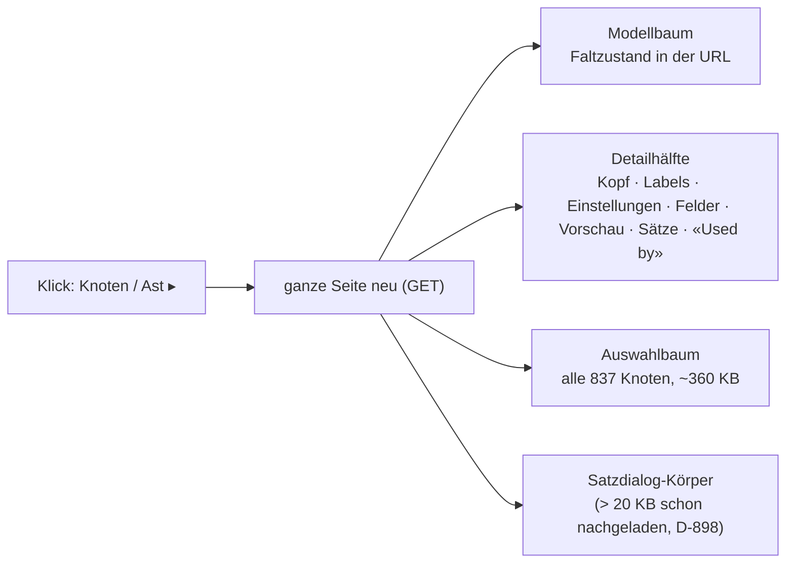
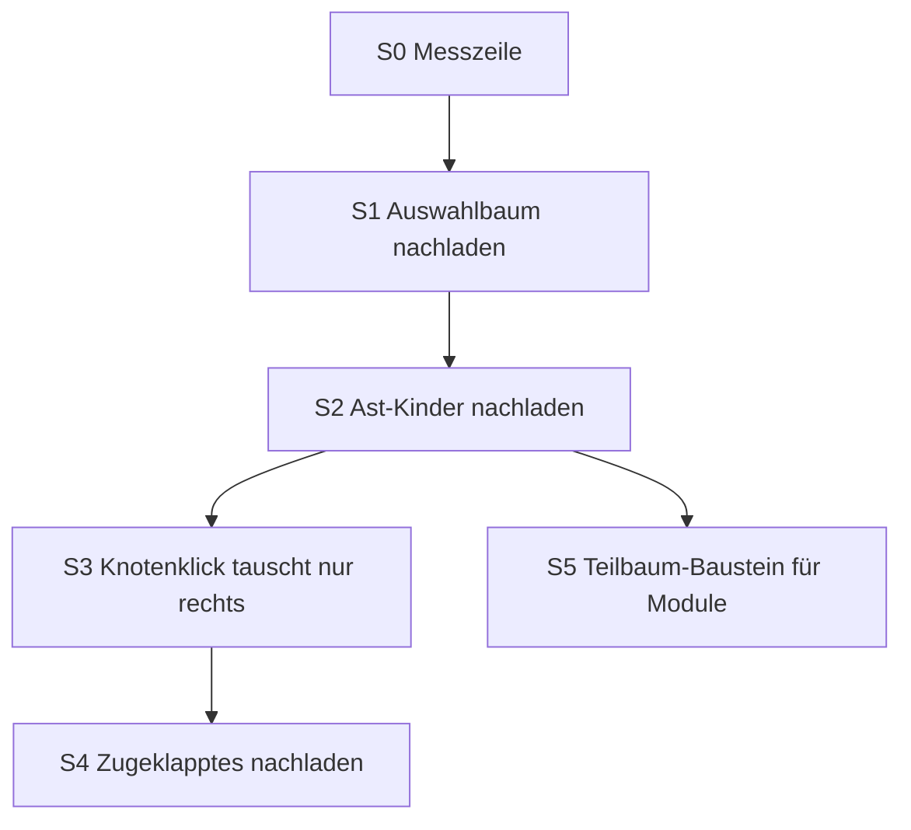
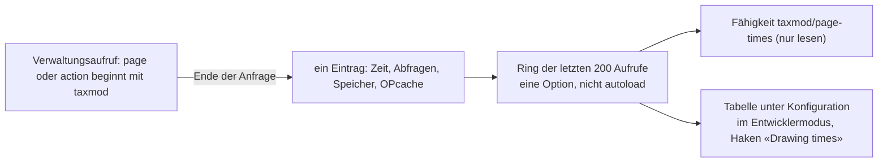
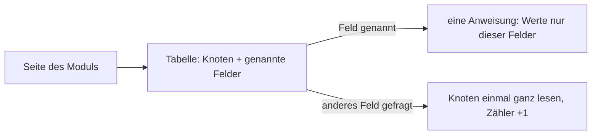
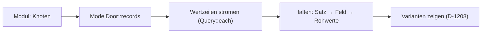

# Paket · Ladezeit — Baum nur teilweise laden

**Stand 2026-11-17.** Freigegeben vom Architektur-Thread (17.11.): F1 — die URL bleibt Träger des Faltzustands, nachgeführt per `history.replaceState`; F3 — S0+S1, dann S2+S3, dann S4+S5. **Gebaut: S0+S1** ([D-1416](../../NewConcept/90-decision-log.md), live als Modeller 0.2.124), **S2+S3** ([D-1417](../../NewConcept/90-decision-log.md), Modeller 0.2.125), **S4+S5** ([D-1418](../../NewConcept/90-decision-log.md), Branch). Nach S1–S4 zeichnet ein Knotenklick nur noch Baum (zugeklappt, wenige KB), Detailhälfte und deren Satzdialoge; was davon später kommen soll, zeigt die Messzeile je Block live.

Sein Wort (17.11.): *«besonders das initiale Laden dauert sehr lange, der Baum wird einmal komplett bei jedem
Seitenaufbau geladen; evtl. könnte man nur die Teile laden, die gebraucht werden, und updaten, wenn sich was ändert»*.

---

## 0 · Kurzfassung

| | |
|---|---|
| **Hauptbefund** | Jeder Klick im Modellbaum (Knoten wählen, Ast auf-/zuklappen) ist ein **voller Seitenaufbau**: Baum, Detailhälfte, gemeinsamer Auswahlbaum, Satzdialog-Körper — alles neu. |
| **Grösster Einzelposten** | Der gemeinsame Auswahlbaum ([D-815](../../NewConcept/90-decision-log.md)) steht mit **allen** Knoten in jeder Knotenseite: gemessen **~360 KB HTML** bei 837 Knoten, obwohl er meist nie geöffnet wird. |
| **Vorschlag** | 6 Schritte, jeder einzeln lieferbar. Erst Messzeile (S0), dann nachladen statt mitschicken (S1–S4), dann ein gemeinsamer Teilbaum-Baustein für die Module (S5). |
| **Bleibt** | Der Server zeichnet ([D-623](../../NewConcept/90-decision-log.md)); das Skript holt nur fertige Stücke und setzt sie ein — wie [D-898](../../NewConcept/90-decision-log.md), [D-1147](../../NewConcept/90-decision-log.md), [D-1340](../../NewConcept/90-decision-log.md), [D-1408](../../NewConcept/90-decision-log.md). |
| **Fragen an Architektur** | §5 |

---

## 1 · Gemessen (17.11.)

**Modellgrösse live** (über `taxmod/read-tree`, `taxmod/query`): 837 Knoten, 124 davon mit Kindern, Tiefe bis 7;
3396 Sätze unter «Material», 146 Lagerorte.

**Kern-Messung** (PHPUnit, In-Memory-Repositories mit dem Live-Baum nachgebaut, ohne Datenbank, Cloud-Rechner):

| Teil | Zeilen | Zeit | HTML |
|---|---|---|---|
| Lauf über den ganzen Baum (`Tree::rowsUnder`) | 839 | 5 ms | — |
| Modellbaum zugeklappt zeichnen | 7 | 3 ms | 3 KB |
| Modellbaum ganz offen (Suche) | 839 | 15 ms | 320 KB |
| **Gemeinsamer Auswahlbaum (jede Knotenseite)** | 839 | 16 ms | **363 KB** |

⚠️ **Nicht gemessen:** die echte Seite auf Strato (Abfragen, Gesamtzeit, Browser). Kein Browserzugang und kein
WordPress in diesem Container. Frühere Messungen im Code: ~130–165 Abfragen je Knotenseite ([D-814](../../NewConcept/90-decision-log.md)),
REST-Grundlast Strato ~1,8 s. Darum ist **S0 die Messzeile**, damit die Zahlen live entstehen.

---

## 2 · Was heute bei jedem Seitenaufbau passiert

- **Ast auf-/zuklappen** ist ein Link (`TreeRenderer`, `taxmod-tree-fold-box`) — der Faltzustand reist in `taxmod_collapsed`
  ([D-345](../../NewConcept/90-decision-log.md), [D-612](../../NewConcept/90-decision-log.md)). Ein Dreieck kostet also eine ganze Seite.
- **Knoten wählen** ist ebenfalls ein Link → ganze Seite, obwohl links fast nichts anders aussieht.
- **«Used by»** steht in einem zugeklappten `
`, wird aber immer gezeichnet.
- **Nach dem Speichern** holt die Projektion ([D-1408](../../NewConcept/90-decision-log.md)) die ganze Seite im Hintergrund — also wieder alles inkl. Auswahlbaum.

---

## 3 · Vorschlag — sechs Schritte

| | Was | Wie (bestehende Bausteine) | Erwartung |
|---|---|---|---|
| **S0** | **Messzeile** im Entwicklermodus: Zeit je Teil (Baum, Detail, Auswahlbaum, Körper), Anzahl Abfragen, KB | eigener Haken unter dem Entwicklermodus ([D-705](../../NewConcept/90-decision-log.md)); dasselbe wie «Drawn in … ms» der Listen | echte Live-Zahlen vor/nach |
| **S1** | **Gemeinsamer Auswahlbaum** steht nicht mehr in der Seite: leere Vorlage mit Adresse, Skript holt ihn beim ersten Öffnen | genau das Muster von [D-898](../../NewConcept/90-decision-log.md) (Hash-Schlüssel, Transient, «bitte neu laden» bei Ablauf) | −360 KB je Knotenseite, −1 Baumlauf mit Einstellungen |
| **S2** | **Ast aufklappen ohne Seitenaufbau**: das Dreieck holt die Kindzeilen (vom Server gezeichnet, gleicher `TreeNodeRenderer`) und setzt sie ein; zuklappen nur im Browser | ein admin-ajax-Akt «Kinder eines Knotens»; Faltzustand siehe Frage F1 | Dreieck: statt ganzer Seite ein paar KB |
| **S3** | **Knoten wählen tauscht nur die rechte Hälfte**; der Baum bleibt stehen, Adresse per `history.pushState` | `assets/live.js` ([D-1340](../../NewConcept/90-decision-log.md)): Bereich `taxmod-detail-pane` statt `.wrap`; ohne Skript Link wie bisher | Klick: Baum nicht neu, Scroll bleibt |
| **S4** | **Zugeklapptes erst beim Öffnen**: «Used by», später weitere eingeklappte Blöcke | `ListPage::lazyDetails` ([D-1147](../../NewConcept/90-decision-log.md)) | weniger Abfragen je Knotenseite |
| **S5** | **Ein Teilbaum-Baustein für alle Bäume**: Knotenbaum und Satzbaum (Lagerorte, Materialgruppen) holen Kinder über denselben Akt, falten über **ein** Skript, merken den Zustand an **einer** Stelle | aus S2; Module (Lager `placeTree`, `MaterialPicker`) stellt der Code-Review-Thread um | Dubletten weg (s. §4) |

Jeder Schritt: Kern- und Grenzlauf grün (PR-9), eigener Wächter (z. B. «kein Auswahlbaum im Seiten-HTML», «Dreieck ist kein Link mehr»).

---

## 4 · Dubletten rund um den Baum (Befund, Code-Review-Thread informiert)

Vier Faltmechanismen für dieselbe Sache:

| Wo | Wie gefaltet | Zustand gemerkt |
|---|---|---|
| Modellbaum (`NodesScreen`, `TreeRenderer`) | Link → ganze Seite | URL `taxmod_collapsed` |
| Auswahlbaum-Dialog (`admin.js`, `.taxmod-tree-fold`) | im Browser | nicht |
| Seitenbaum der Module (`side-tree.js`, `ListPage::sideTree`) | im Browser, «Alle auf/zu» | Benutzer-Meta |
| Satzbaum (`admin.js`, `is-open`) | im Browser | nicht |

Dazu laden die Ajax-Akte `handleRecordNodes` und `handleRecordBranch` jedes Mal den **ganzen** Baum, um einen Ast zu finden.
S5 macht daraus einen Baustein. **Der Code-Review-Thread fasst den Baum-Code nicht an** (Absprache 17.11.); er stellt die
Module danach um.

---

## 5 · Fragen an den Architektur-Thread

- **F1 — Faltzustand des Modellbaums:** bisher in der URL (D-345/D-612). Mit S2 klappt das Dreieck ohne Seitenaufbau.
  Vorschlag: **wie der Seitenbaum der Module pro Benutzer merken** ([D-1186](../../NewConcept/90-decision-log.md), `ListPage::treeState`) —
  das war sein Wunsch («fortgeschrieben») und macht einen Mechanismus statt zwei. Alternative: URL per `history.replaceState`
  nachführen (bleibt teilbar, aber jeder Link der Seite trägt den Zustand weiter).
- **F2 — Suche im Modellbaum** klappt alles auf (320 KB). Bleibt vorerst so (Server sucht, [D-1340](../../NewConcept/90-decision-log.md)); nur Treffer + Weg werden gezeichnet. Kein Handlungsbedarf, nur zur Kenntnis.
- **F3 — Reihenfolge:** S0 und S1 zuerst als ein Release (klein, risikoarm, grösster Gewinn), dann S2+S3 zusammen.

## 6 · Annahmen, die das Konzept nicht sagt

- ⚠️ *Angenommen: der Auswahlbaum darf wie ein grosser Satzdialog-Körper behandelt werden (D-898 nennt nur Satzdialoge).*
- ⚠️ *Angenommen: «Used by» darf erst beim Aufklappen laden, weil es schon heute zugeklappt steht.*

---

## Seitenzeit-Protokoll ([D-1476](../../NewConcept/90-decision-log.md), 2026-11-19)

Sein Wort (19.11.): *«Das finde ich eigentlich ganz gut, dass du das mal mitloggst, vielleicht für jede Seite. Dann kann ich dir
das schicken, dann musst du nicht messen.»*

- **Eine Stelle für alle Module**: der Modeller schreibt mit, kein Modul tut etwas dazu.
- **Festgehalten wird nur** die Seite, ihr Reiter oder die Aktion. Kein Suchwort, keine Satz-Id, kein Benutzer.
- **Immer an**, abstellbar unter Konfiguration › Entwicklermodus › «Page time log».
- **Kein Modell, keine Tabelle, kein Schema**: Messwerte, nach denen keine Seite etwas entscheidet.
- **Ein Wächterlauf schreibt nicht mit** (`page-times-check.php`).
- ⚠️ Gemessen wird die Zeit **auf dem Server** bis zum Ende der Anfrage. Was der Browser danach braucht, steht nicht darin.
- **Wohin die Zeit ging** ([D-1482](../../NewConcept/90-decision-log.md)): je Eintrag die ms bis WordPress geladen ist, bis die Seite gezeichnet ist, und die Wartezeit auf fremde Server (nur ms). Die Fähigkeit nennt dazu, was eine leere Abfrage kostet; gemessen nur beim Lesen der Fähigkeit.
- **Datenbank oder Programm** ([D-1493](../../NewConcept/90-decision-log.md)): je Eintrag die ms in den Anweisungen des Modells und die ms in seinen gestreamten Lesungen (nur Zahlen).
- **Die Vorschau eines Satzes, Feld für Feld** ([D-1482, Nachtrag 2](../../NewConcept/90-decision-log.md)): die Fähigkeit `taxmod/preview-times` (nur lesen) zeichnet die bearbeitbare Vorschau eines Satzes und nennt je Schritt und je Feld ms, Abfragen und KB — Feldnamen und Zahlen, keine Werte. Seine Zeile (21.11.): *«Detail: Vorschau 15825 ms / 661 Abfragen»*; mit erfundenen Sätzen brauchte dieselbe Vorschau 0,3 s, gemessen wird also dort, wo seine Daten sind.

## Schmale Lesung ([D-1486](../../NewConcept/90-decision-log.md), 2026-11-19)

Ein Modul nennt die Felder, die es von einem Knoten liest; die Tür liefert dafür dasselbe wie die ganze Lesung. Ein nicht
genanntes Feld wird nie als leer beantwortet: der Knoten wird einmal ganz gelesen. Gemessen und Zahlen: D-1486. Bewacht von
`model-door-records-check` (gleiche Werte, eine Anweisung). Live ohne Wirkung; im Lager zurückgebaut (D-1491), die Tür-Methode entfernt (D-1489).

## Schlanker Lese-Weg ([D-1489](../../NewConcept/90-decision-log.md), 2026-11-19)

Die Tür faltet die Wertzeilen eines Knotens direkt; es gibt kein Wert-Objekt je Zeile und keine gehaltene Antwort. Was der
Rohwert einer Zeile ist, sagt eine Stelle (`TypedValue::rawOf`). Die schmale Lesung von D-1486 blieb live ohne Wirkung und
ist im Lager zurückgebaut (D-1491); Zahlen stehen in den Beschlüssen.

Die Datenbank ordnet dabei nur nach dem Satz; die Reihenfolge der Werte im Satz stellt die Lesung selbst her ([D-1492](../../NewConcept/90-decision-log.md)): ein Sortierlauf über alle Werte samt Text entfällt.
