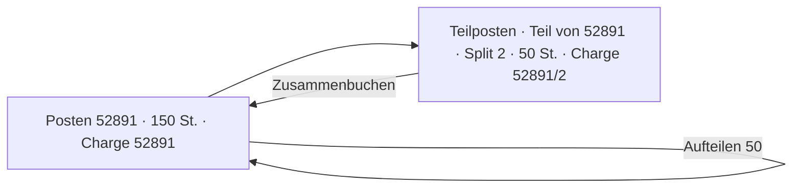

# Lager · Posten aufteilen und zusammenbuchen — Konzeptentwurf

**Stand 2026-11-08. Entwurf, nichts entschieden, nichts gebaut** ([INF-115](../../neues-konzept-eingang.md#inf-115--posten-aufteilen-und-zusammenbuchen-split-nummer-an-der-charge-2026-11-08)).
Alles ist mein Vorschlag (`INFERRED`), bis es eine `D-<nnn>` hat (`PR-3`).

**Seine Worte (2026-11-08, Thread «SMD-Box einbuchen», 4,7 kΩ 0805, Ali-Posten 52891, 150 St.):**

> *«Okay, die 150 sind aber auf 2 unterschiedlichen Positionen, einmal 50, einmal 100,»*

> *«Ja, check das mal mit dem Design-Thread. Dass das möglich sein muss. Da würde ich eine bei der Charge eine Split-Nummer einfügen, dass wir wissen, dass die gleiche Charge. Aber in unterschiedlicher Split und dass man die zusammenbuchen könnte wieder.»*

**Was gilt:** *«jeder Bestandsposten ist eine Charge, Standard-Chargennummer = Bestellnummer»* ([D-1043](../../NewConcept/90-decision-log.md)). Eine Teilmenge kann heute schon an einem anderen Ort liegen ([D-1039](../../NewConcept/90-decision-log.md)), aber am selben Ort lässt sich ein Posten nicht in zwei Einheiten trennen (zwei Magazine, zwei Tüten).

## Bild

## Wie es liegt

| Was | Wo | Warum |
|---|---|---|
| **Teilposten** | ein gewöhnlicher Posten mit zwei neuen Feldern: «Teil von» (Verweis → Posten, 0..1) und «Split» (Zahl, 0..1) | Ein Teilposten bekommt eigenes Etikett, eigenen Ort und eigene Abgänge, also ist er ein Posten. Herkunft (Kauf), Material, Datum und Zustand übernimmt er vom Ursprung |
| **Charge** | wird nicht gespeichert, sondern gerechnet: Charge des Ursprungs, beim Teilposten mit «/Split» dahinter (52891/2) | ein Fakt an einer Stelle; der Ursprung behält seine Nummer ohne Split (= Split 1) |
| **Split-Nummer** | die nächste freie Nummer unter demselben Ursprung, nie wiederverwendet | ein gedrucktes Etikett «52891/2» bleibt eindeutig, auch wenn 2 schon zusammengebucht ist |
| **Teil eines Teils** | hängt immer am Ursprung, nicht am Teilposten | keine Ketten 52891/2/1; die Charge bleibt einstufig |

## Vorgänge

| Vorgang | Zeilen | Regeln |
|---|---|---|
| **Aufteilen** (neue Art, eine Menge) | − Menge am Ursprung, + Menge am neuen Teilposten, beide am selben Ort; optional gleich ein anderer Ort für den Teilposten | Menge > 0 und kleiner als das, was dort liegt. Der Bestand des Materials ändert sich nicht |
| **Zusammenbuchen** (neue Art) | − alles am Teilposten, + dieselbe Menge am Ziel | nur gleiche Charge (Ursprung + seine Teile); Ziel ist der Ursprung oder ein anderer Teil, Ort des Ziels |

Beide sind Vorgänge wie jede Umbuchung: im Verlauf sichtbar und mit «Stornieren» rückgängig ([D-1036](../../NewConcept/90-decision-log.md)). Ein leerer Teilposten bleibt als Satz stehen, wird aber nicht mehr angezeigt.

## Oberfläche

- **Bestand-Tab des Materials:** pro Posten ein Icon «Aufteilen» (Menge, optional Ort); an einem Teilposten zusätzlich «Zusammenbuchen» (Ziel vorgewählt: Ursprung).
- **Liste:** Teilposten stehen direkt unter ihrem Ursprung, Spalte «Charge» zeigt 52891 · 52891/2.
- **Etikett pro Posten** ([D-1223](../../NewConcept/90-decision-log.md)) druckt die Charge mit Split.
- **FIFO und Verbrauch** zählen Teilposten wie Posten; Reihenfolge nach dem Datum des Ursprungs, dann Split.

## Angenommen / offen (an Stefan, nach Design-Prüfung)

- **S1** Teilposten als eigener Posten (Vorschlag), statt nur einer Unterteilung innerhalb des Postens. Grund: Ort, Etikett und Abgänge brauchen einen eigenen Satz.
- **S2** Der Ursprung zählt selbst als Split 1 und behält die Nummer ohne Zusatz.
- **S3** Zusammenbuchen auch zwischen zwei Teilen (2 → 3), nicht nur zurück zum Ursprung.
- **S4** Beim Aufteilen kann man gleich einen anderen Ort wählen (Aufteilen + Umbuchen in einem Vorgang).
