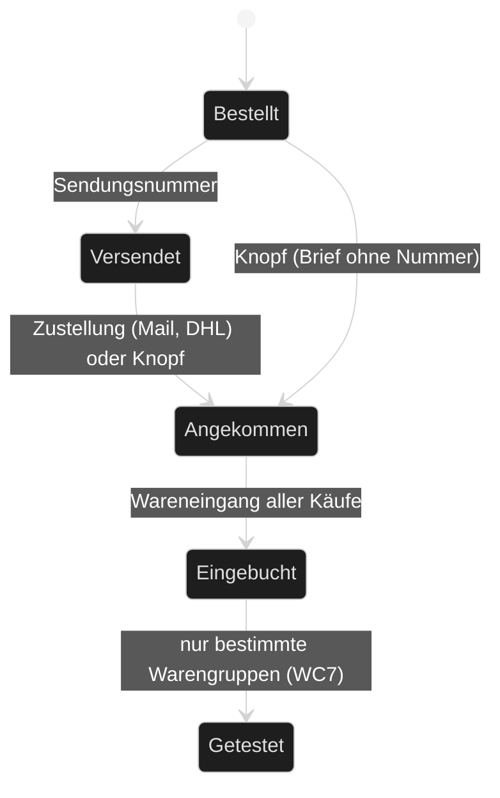
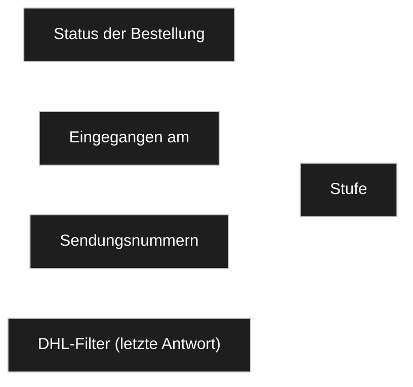
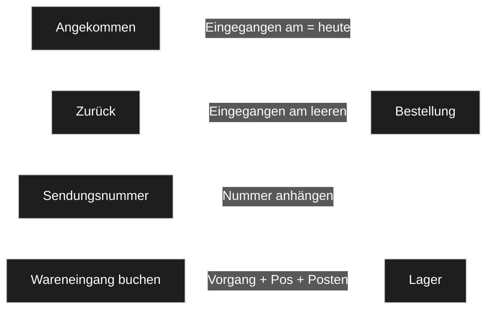
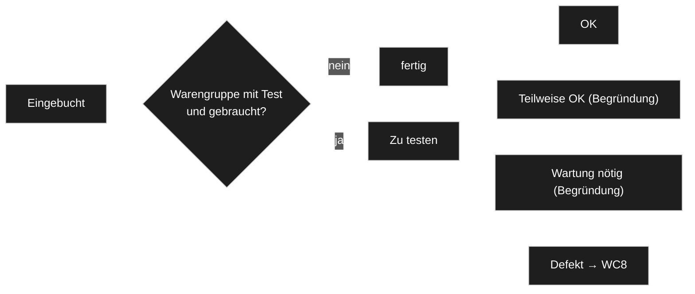
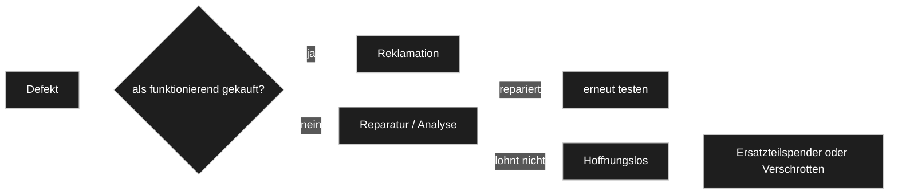

# Lager: Wareneingangs-Cockpit

*Entwurf vom 2026-10-28, Thread «Wareneingangs-Cockpit im Taxmod bauen». Gehört zu [`konzept.md`](konzept.md) und
[`prozesse.md`](prozesse.md). Entschieden ist nur, was eine `D-<nnn>` trägt; der Rest ist `INFERRED`.*

**Sein Auftrag** (2026-10-28, [D-1001](../../NewConcept/90-decision-log.md)):

> *«Wollen wir für den Wareneingang vielleicht auch sowas machen wie für das ankünftige eBay-Shipping? … vom Wareneingang, also
> über die Bestellung, Lieferung, also wenn es dort rausgegangen ist, ist zur Annahme hier und dann den Wareneingang, dass wir da
> genauso einen, ja, einen Punkt in der Konfiguration machen. … fangen wir mal mit dem Wareneingang von der Bestellung bis zur
> Ankunft vom Wareneingangsprüfung an.»*

**Sein Wort dazu** (2026-10-28, 12:28): *«stufe ergibt sich aus mails und api, zusätliche stufe nach we tests für bestimmte warengruppengruppen wie hardware einkäufe bei ebay»*.

**Der Kern in einem Satz:** Eine Seite «Wareneingang» im Menü «Logistik» zeigt jede Bestellung in genau einer Stufe —
**Bestellt → Versendet → Angekommen → Eingebucht** —, die Stufe wird aus Daten **gerechnet**, die es schon gibt, und gebucht
wird mit dem Wareneingang, den das Lager schon hat.

---

## WC1 — Die Stufen

Wie die eBay-Versandseite ([D-985](../../NewConcept/90-decision-log.md)), nur in die andere Richtung: je Stufe ein Reiter mit
Zähler, gleich aufgebaut, eine Zeile je Bestellung im gemeinsamen Tabellen-Template ([D-989](../../NewConcept/90-decision-log.md)).
«Angekommen» ist die **Wareneingangsprüfung**: der Karton ist da, die Käufe werden bestimmt (R1) und eingebucht. Ein
Teil-Wareneingang ([D-956](../../NewConcept/90-decision-log.md)) bleibt in «Angekommen», bis der letzte Kauf gebucht ist.
Entwürfe und stornierte Bestellungen stehen in keiner Stufe, nur unter «Alle».

## WC2 — Woher die Stufe kommt

Gerechnet, in dieser Reihenfolge — die erste Regel, die zutrifft, gewinnt:

| # | Bedingung | Stufe |
|---|---|---|
| 1 | Status «Entwurf» oder «storniert» | keine (nur «Alle») |
| 2 | Status «eingegangen» | Eingebucht |
| 3 | Status «teilweise eingegangen», oder «Eingegangen am» gesetzt, oder DHL meldet für eine Sendungsnummer «zugestellt» | Angekommen |
| 4 | mindestens eine Sendungsnummer | Versendet |
| 5 | sonst | Bestellt |

**Nichts davon wird neu gespeichert.** Status ([`prozesse.md`](prozesse.md) LP4), «Eingegangen am» und die Sendungsnummern
schreibt heute schon der Eingang ([D-980](../../NewConcept/90-decision-log.md)) aus Mail, eBay-API und JLC; der DHL-Filter
`taxmod_dhl_tracking` gibt seine **gespeicherte** letzte Antwort, ohne DHL zu fragen. Eine eigene Stufen-Option wie
`taxmod_ebay_stages` braucht es darum nicht — sonst stünde die Ankunft zweimal (Code-Standard: *«One place owns each piece of
state»*). Die Ids der Bestellfelder kommen aus den Ziel-Ids des Eingangs (`Targets`, [D-952](../../NewConcept/90-decision-log.md)),
nicht aus einer zweiten Liste im Lager.

⚠️ *Offen und hier **nicht** entschieden: ob «Versendet»/«Zugestellt» zusätzlich als Vorgänge ohne Positionen gespeichert werden
([INF-087](../../neues-konzept-eingang.md)) und ob der Status dafür neue Werte bekommt ([INF-088](../../neues-konzept-eingang.md)).
Das Cockpit braucht beides nicht; kommt es, liest das Cockpit es als weitere Quelle in WC2.*

## WC3 — Was die Knöpfe schreiben

| Knopf | Stufe | Schreibt |
|---|---|---|
| **Angekommen** (Zeile und Sammelaktion) | Bestellt, Versendet | «Eingegangen am» = heute, wenn leer |
| **Zurück** | Angekommen | «Eingegangen am» leeren — nur ohne gebuchten Kauf |
| **Sendungsnummer** (in den Details) | Bestellt, Versendet | hängt die Nummer an «Sendungsnummern» an |
| **DHL aktualisieren** (Zeile und Sammelaktion) | Versendet | nichts im Modell; fragt DHL im Modus `refresh` (5 s Abstand, Tagesbudget des DHL-Moduls) |
| **Wareneingang buchen** (in den Details) | Angekommen | der vorhandene Wareneingang des Lagers, unverändert: Sperren R1 und «schon eingegangen» (LP6), Lagerort-Vorschlag ([D-972](../../NewConcept/90-decision-log.md)) |

Jeder Knopf ist ein Schreibakt über `taxmod/write-data`, alles oder nichts — wie jede Buchung des Lagers.

## WC4 — Was eine Zeile zeigt

| Spalte | Inhalt |
|---|---|
| Bestellung | Titel; darunter Plattform · Händler · Nummer |
| Bestellt am | «Bestellt am» der Bestellung |
| Sendung | Sendungsnummern, je Nummer der letzte DHL-Stand (angekündigt, unterwegs, zugestellt, Problem) |
| Angekommen | «Eingegangen am» |
| Käufe | Zahl; davon unbestimmt (R1) und gebucht |

**Details** (aufklappbar): in Bestellt/Versendet die Käufe, die letzten DHL-Ereignisse und das Feld «Sendungsnummer»; in
Angekommen die Buchungsmaske des Lagers.

**Filter «überfällig»:** Bestellt seit mehr als 14 Tagen ohne Sendungsnummer, oder Versendet seit mehr als 21 Tagen und nicht
angekommen (gezählt ab «Bestellt am»). *INFERRED: die eBay-Seite nimmt 7 Tage für den eigenen Versand; eingehend kommt viel aus
China, darum länger.*

## WC5 — Wo es lebt

- **Modul:** `wp_tax_stock`, weil der Wareneingang dem Lager gehört ([`konzept.md`](konzept.md) §1). Eine neue Seite «Wareneingang» im Menü «Logistik» (WC9),
  neben «Lager»; der Reiter «Wareneingang» der Lagerseite bleibt vorerst und zeigt dieselbe Buchung.
- **Ohne DHL-Modul** fehlt nur die Spalte mit dem DHL-Stand; die Stufen kommen dann aus Status, Ankunft und Nummern.

## WC6 — Menü

Abgelöst durch WC9 ([D-1004](../../NewConcept/90-decision-log.md)).

## WC7 — Teststufe nach dem Wareneingang ([D-1002](../../NewConcept/90-decision-log.md))

**Seine Worte (2026-10-28, 12:33):** *«Die Idee mit der Warengruppe was getestet werden muss an der Grafikkarte, auszumachen, wenn da
einer reinkommt, das finde ich gut. Genauso wie Mainboards»* — *«Plattformen, nee, muss man nicht einschränken, wenn ich dieses
woanders kaufe, gebraucht, muss auch getestet werden»* — *«Testergebnis gehört zum Bestandsposten, können wir auch so machen»* —
*«Okay, aber Wartung nötig und defekt. Teilweise okay, bräuchte dann eine Begründung wieder, was geht nicht. Und bei Wartung genauso
zum Beispiel, Kondensatoren wechseln»*.

- **Wann getestet wird:** die Warengruppe ist im Lager-Reiter als «mit Test» eingestellt (ein Zweig des Baums, z. B. Grafikkarten,
  Mainboards; wie die Lagerorte nach Typ, [D-972](../../NewConcept/90-decision-log.md)), egal von welcher Plattform.
  *INFERRED: nur gebrauchte Ware; Neuware geht ohne Test durch.*
- **Wo das Ergebnis steht:** am Bestandsposten (ein Stück, eine Charge): das Ergebnis ist sein «Zustand» (dieselben Zustände wie am
  Exemplar, ergänzt um «teilweise OK» und «Wartung nötig»), dazu «Getestet am» und «Testbefund». Zu testen ist ein Posten mit leerem
  Zustand oder «ungetestet».
- **Ergebnisse:** OK · Teilweise OK (Begründung: was geht nicht) · Wartung nötig (Begründung: z. B. Kondensatoren wechseln) · Defekt.
- **Verkauf:** ungetestet nicht verkaufen (*«ungetestet sollte es nicht verkauft werden»*); defekt **nicht** sperren, aber der Zustand
  muss in die Verkaufsdaten (*«könnte man auch als Defekt verkaufen … wenn wir es zum Beispiel auf eBay stellen mit den Verkaufsdaten
  rein, wie der Zustand ist»*).

## WC8 — Was mit Defekten geschieht ([D-1003](../../NewConcept/90-decision-log.md))

**Seine Worte:** *«Wenn ich gekauft habe als funktionierend und es funktioniert nicht, dann müsste man das reklamieren. Wenn ich es
als Defekt gekauft habe und es funktioniert nicht, ist es erstmal okay … deswegen würde ich das erstmal auf Reparatur und dann
vielleicht, wenn es nicht reparabel ist, als hoffnungslos und hoffnungslose Geschichten können dann als Teil des Spender und oder
verschrottet werden.»*

- *INFERRED:* «als funktionierend gekauft» liest das Cockpit aus dem Kauf (eBay-Zustand bzw. Titel «defekt/Bastler»); wo es das
  nicht weiss, fragt die Maske.
- Ersatzteilspender ist die Zerlegung aus [`konzept.md`](konzept.md) §4; Verschrotten ist ein Abgang (Vorgang mit Pos −).

## WC9 — Menü

**Sein Wort:** *«ja menü für we/wa/lager»*. Ein eigener Menüpunkt (Arbeitstitel «Logistik») mit Wareneingang, Warenausgang
(heute eBay-Versand) und Lager; Modell und Konfiguration bleiben unter Taxmod. Löst [INF-097](../../neues-konzept-eingang.md) ([D-1004](../../NewConcept/90-decision-log.md)).

## WC10 — Archiv

[D-1008](../../NewConcept/90-decision-log.md). Reiter «Archiviert»: eingebuchte Bestellungen N Tage nach «Eingegangen am» (Vorgabe 30, Konfiguration › Lager), Bestellungen von vor dem Stichtag «Wareneingang ab» sofort. «Alle» = alles nicht Archivierte. Nichts wird gespeichert; die Stufe folgt aus den Daten wie WC2.

## Namen

**Sein Wort:** *«Du musst übrigens nicht meinen Vokabular hier für diese Taxonomie übernehmen. Also das Ding und so weiter. Das
sollten schon die richtigen Namen verwendet werden.»* Oberfläche und Dokumente nehmen die üblichen Begriffe der Lagerwirtschaft:
Material (statt Ding), Bestandsposten/Charge, Wareneingang (WE), Warenausgang (WA), Wareneingangsprüfung, Reklamation.

## Annahmen

- Die Stufe wird gerechnet, nicht gespeichert (WC2); «Angekommen» per Knopf setzt «Eingegangen am».
- DHL «zugestellt» zählt als angekommen, wie eine Zustellmail.
- «Zurück» aus Angekommen geht nur, solange kein Kauf gebucht ist.
- Überfällig nach 14 bzw. 21 Tagen.
- Sendungsnummern anderer Dienste zeigt die Zeile ohne Stand; DHL Unified kennt viele, nicht alle.
