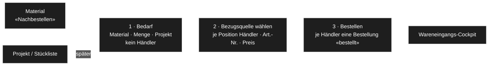
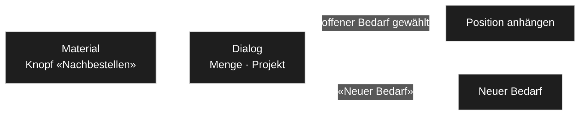
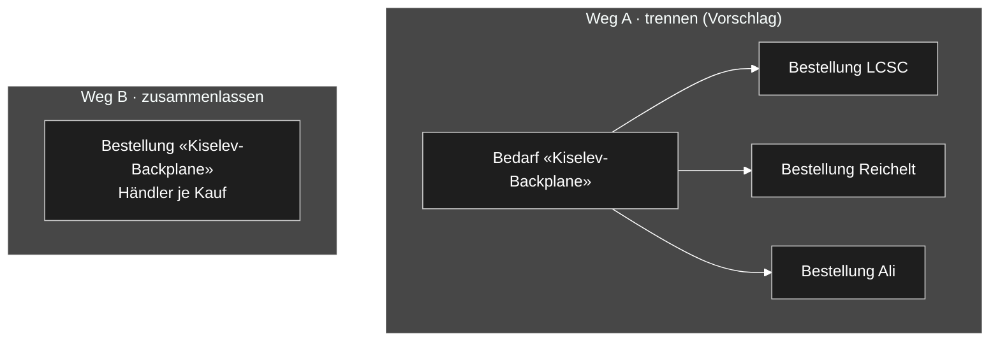

# Lager: Einkauf — Bedarf, Bezugsquelle, Bestellung

*Entwurf vom 2026-10-30, Thread «Bestellungen erstellen». Gehört zu [`konzept.md`](konzept.md),
[`prozesse.md`](prozesse.md) und [`cockpit-wareneingang.md`](cockpit-wareneingang.md). Entschieden ist nur, was eine
`D-<nnn>` trägt; der Rest ist `INFERRED` und wartet auf sein Wort ([INF-102](../../neues-konzept-eingang.md#inf-102--einkauf-bestellungen-anlegen-und-nachbestellen-2026-10-30)).*

**Sein Auftrag** (2026-10-30):

> *«es geht darum bestellungen zu erstellen»* — *«also selbst zu bestellen»* — *«auch wäre bei jedem material ein button
> nachbestellen nett, da drücke ich dann drauf und kann das einer offnen bestellung hinzufügen oder eine neue bestelllung
> anlegen»*

> *«Das soll eher so, ja, Bedarf sein, … das soll noch nicht feststehen, von wem ich das bestelle … Das wäre dann der nächste
> Schritt, dass ich mir eine Bestellung nehme und schaue, wo ich was bestellen kann.»* — *«muss man das vielleicht trennen
> nach Lieferant oder … lässt es so und wartet einfach, bis die einzelnen Teile reinkommen … so kann man zum Beispiel alle
> Teile von einem Projekt zusammenbestellen, aber bei unterschiedlichen Lieferanten.»*

**Was schon steht (gelesen):**

- [`konzept.md`](konzept.md) §3.4: Bestellstatus «Entwurf · bestellt · teilweise eingegangen · eingegangen · storniert» —
  *«ein Bestellvorschlag ist eine Bestellung «Entwurf»»*. Gebaut: Status-Feld ja.
- [`konzept.md`](konzept.md) §3.2: Material-Feld «Mindestbestand» — *«darunter «nachbestellen»»*. Gebaut: Feld ja, Filter nein.
- [`konzept.md`](konzept.md) §4: *«Bedarf / von Hand → Bestellung: Entwurf → Bestellung: bestellt»*.
- [D-933](../../NewConcept/90-decision-log.md): *der Kauf trägt die Artikelnummer, die Bestellung den Händler.*
- [D-1013](../../NewConcept/90-decision-log.md) («Lagersicht»): Bezugsquellen am Lager-Satz = Firma + Nummer + Packungsinhalt.
- [D-958](../../NewConcept/90-decision-log.md): Mindestbestand Stufe 4, Bauläufe/Bedarf Stufe 3.

---

## EK1 — Drei Schritte

1. **Bedarf (Bedarfsanforderung).** Ich sammle, *was* ich brauche: Material und Menge, optional ein Projekt. Kein Händler.
   Quelle: Knopf «Nachbestellen» am Material (EK2), später die Stückliste eines Projekts.
2. **Bezugsquelle wählen.** Ich nehme mir einen Bedarf vor und lege je Position fest, *wo* ich kaufe: Händler, Art.-Nr.,
   Preis. Vorschlag aus den Bezugsquellen des Materials ([D-1013](../../NewConcept/90-decision-log.md)) und dem letzten Kauf;
   später aus einer Teilesuche über die API-Module (LCSC, AliExpress, Mouser …), Prüfung läuft im API-Thread.
3. **Bestellen.** Ich bestelle beim Händler selbst (ggf. über einen vorbereiteten Warenkorb, falls die API das kann) und
   markiere danach «bestellt» mit der Bestellnummer des Händlers. Ab da übernimmt das Wareneingangs-Cockpit
   ([D-1001](../../NewConcept/90-decision-log.md)).

Jeder Schritt ist umkehrbar (Regel vom 2026-10-28): Position zurück in den Bedarf, «bestellt» → «Entwurf», Bedarf verwerfen
(→ «storniert», nichts wird gelöscht).

---

## EK2 — Knopf «Nachbestellen» am Material

Der Knopf steht in der Material-Ansicht und als Zeilen- und Sammelaktion in der Material-Liste. Der Dialog fragt nur:
**Menge** (Vorschlag: Mindestbestand − frei, sonst 1), **Projekt** (optional) und **Ziel** (einer der offenen Bedarfe oder
«Neuer Bedarf» mit Namen, z. B. «Kiselev-Backplane» oder «Lager auffüllen»). Steht das Material schon im Ziel, wird die
Menge erhöht statt einer zweiten Position.

---

## EK3 — Wie Bedarf und Bestellung zusammenhängen

Ein Bedarf mischt Händler (alle Teile eines Projekts), eine Bestellung hat genau einen
([D-933](../../NewConcept/90-decision-log.md)). Zwei Wege:

- **Weg A — trennen (Vorschlag).** Der Bedarf bleibt als Klammer bestehen. Beim Bestellen wandert jede Position als Kauf in
  eine Bestellung ihres Händlers; der Kauf behält den Verweis auf seinen Bedarf. Der Bedarf zeigt dann je Position:
  offen · bestellt bei … · eingegangen. Passt zu D-933, zum Cockpit (eine Sendung = eine Bestellung) und zu den API-Modulen,
  die je Händler-Bestellung schreiben.
- **Weg B — zusammenlassen.** Eine Bestellung mit Käufen bei mehreren Händlern. Einfacher anzulegen, aber Händler,
  Bestellnummer, Versand und Sendungsnummer stehen dann am Kauf statt an der Bestellung — widerspricht D-933 und dem Cockpit.

---

## EK4 — Seite «Einkauf» (unter «Logistik»)

Gemeinsames Tabellen-Template ([D-989](../../NewConcept/90-decision-log.md)), Reiter:

| Reiter | Inhalt | Aktionen |
|---|---|---|
| **Nachbestellen** | Material mit frei < Mindestbestand | Sammelaktion «In Bedarf übernehmen» |
| **Bedarf** | je Bedarf eine Zeile, Positionen aufklappbar mit Stand (offen · Händler gewählt · bestellt · eingegangen) | Menge ändern, Position entfernen, «Bezugsquelle wählen», «Bestellen», «Verwerfen» |
| **Bestellt** | Verweis auf das Wareneingangs-Cockpit | — |

«Bestellen» zeigt je Händler die Positionen als **Warenkorb-Liste** (Art.-Nr. + Menge zum Kopieren, oder Warenkorb per API,
falls ein Händler das anbietet) und danach «Als bestellt markieren» mit Feld «Bestellnummer».

---

## EK5 — Zu entscheiden

| | Frage | Vorschlag |
|---|---|---|
| **E1** | Bedarf und Bestellung: Weg A (trennen, Bedarf bleibt Klammer) oder Weg B (eine Bestellung, Händler je Kauf)? | **A** |
| **E2** | Wo liegt der Bedarf: als Bestellung «Entwurf» ohne Händler (vorhandener Knoten, §3.4) oder als eigener Knoten «Bedarf» mit Positionen? | Bestellung «Entwurf» ohne Händler — kein neuer Knoten; neu nur ein Feld «Bedarf» am Kauf (Verweis auf die Entwurfs-Bestellung) |
| **E3** | Menge im Knopf: aus Mindestbestand rechnen oder immer 1? | rechnen, wenn Mindestbestand gesetzt, sonst 1 |
| **E4** | Bedarf aus Stücklisten (Projekt × Stückzahl − frei) schon jetzt oder erst mit den Bauläufen (Stufe 3)? | Knopf zuerst; Stückliste als nächster Schritt |
| **E5** | Modul: `wp_tax_stock` oder eigenes? | `wp_tax_stock` — Material, Bestand und Bestellungen liegen dort |
| **E6** | Teilesuche und Warenkorb über die API-Module (EK6): welcher Händler zuerst? | Mouser (Suche + Warenkorb per API, Schlüssel aus «My Mouser»); LCSC, sobald der API-Antrag genehmigt ist |

---

## EK6 — Was die Händler per API können

*Recherche des API-Threads vom 2026-10-30 in den öffentlichen Dokumentationen, **nicht mit einem Schlüssel getestet**.*

| Händler | Teilesuche | Warenkorb | Voraussetzung |
|---|---|---|---|
| Mouser | ja (Search API) | ja (Cart API: anlegen, Art.-Nr. + Menge, ändern) | API-Schlüssel aus «My Mouser»; Bestellen danach auf mouser.com |
| LCSC | ja (KeywordSearch) | ja (Cart, sogar Bestellung aus Warenkorb) | API-Antrag mit Genehmigung; 1000 Suchen/Tag |
| Farnell | ja (Partner API) | vielleicht (Order API, eigener Zugang, evtl. nur Sandbox) | Partner-Schlüssel; Warenkorb unbestätigt |
| AliExpress | ja (Affiliate API) | nein | Affiliate-Zugang (tracking_id) |
| Conrad | nein | nein | nur auf Anfrage über Conrad Business |

**Rückfall überall:** die Warenkorb-Liste (Art.-Nr. + Menge) für die Schnellbestellung bzw. den Stücklisten-Upload der Shops
— Mouser, Farnell, Conrad und LCSC haben einen.

**gebaut:** nichts davon. Bis es steht, legt der Thread «Bestellungen erstellen» Bedarfe von Hand über den Connector an.
