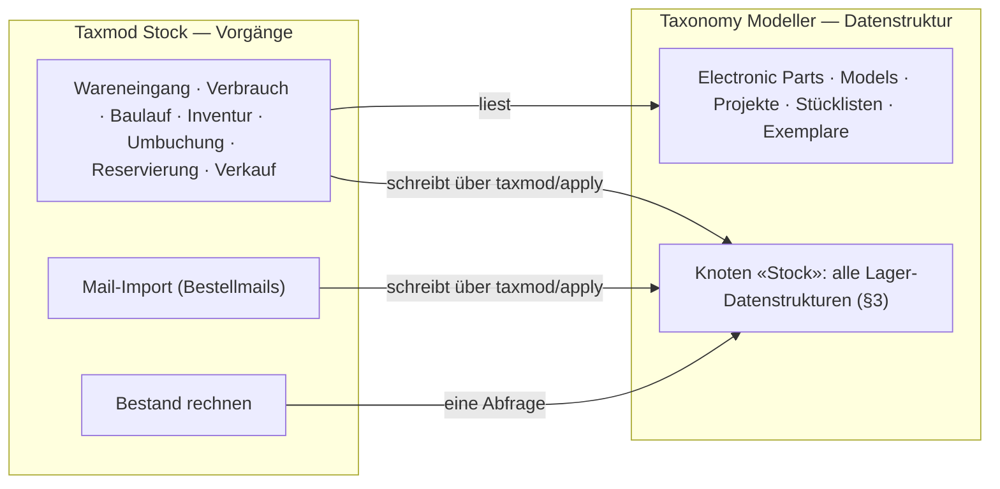
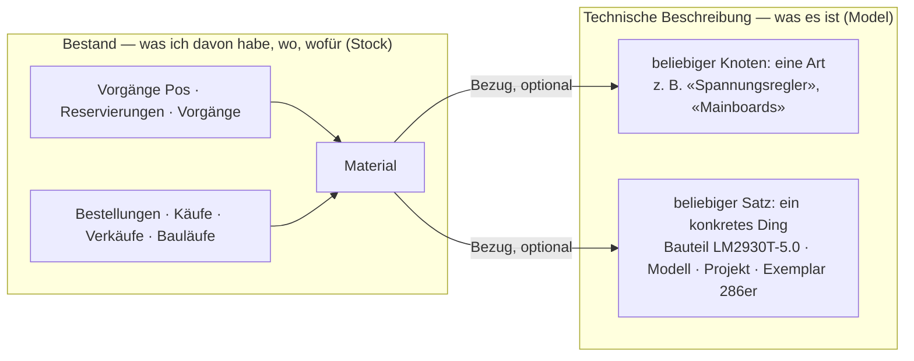
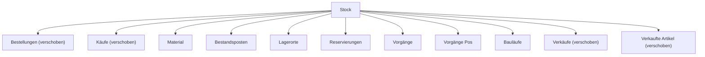
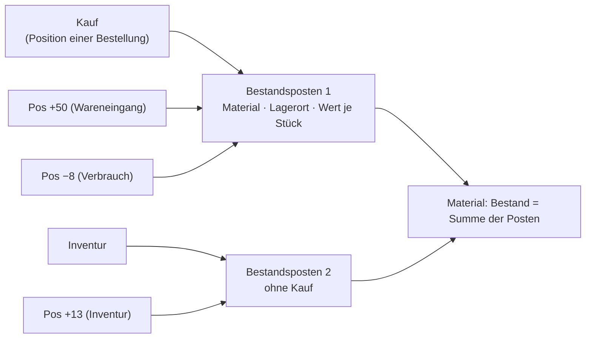
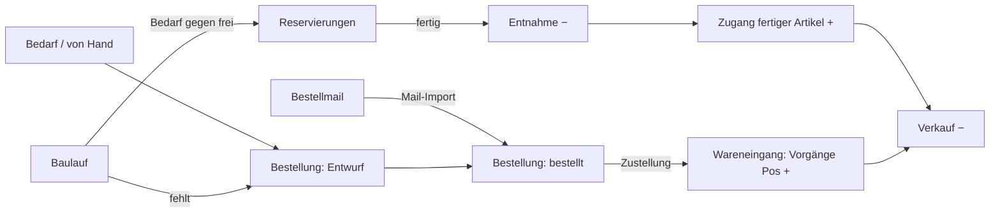

# Paket · Lager («Taxmod Stock») — Konzeptentwurf

**Stand 2026-10-21. Entwurf, nichts entschieden, nichts gebaut.** Neu am 2026-10-21: Bestandsposten (Quanten), §3.5a. Aus [INF-073](../../neues-konzept-eingang.md#inf-073--bestand-und-fertigung-vom-wareneingang-über-die-platine-zum-verkauf)
und [INF-075](../../neues-konzept-eingang.md#inf-075--prozesse-und-formulare-im-modell-anlegen). Was er entscheiden soll, steht in §10;
alles andere ist mein Vorschlag (`INFERRED`), bis es eine `D-<nnn>` hat (`PR-3`). Code des Moduls: [`sfambach/wp_tax_stock`](https://github.com/sfambach/wp_tax_stock).

**Seine Worte, auf denen der Entwurf steht (alle 2026-10-20):**

> *«habe mir das schon irgendwie mehr all umfassender vorgestellt. Verbrauchen und We als aktion prozess, ich überlege aber weil tax
> eigentlich nur datenstruktur ist ob es hier ein tax stock modul oder sowas braucht»*

> *«erstmal hier konzipieren was nötig ist welche datenstrukturen dazu gehören. samples für den eigenen gebrauch. produktion nutzt kann
> bauteil listen nutzen, eigener ast im baum stock alle datenstrukturen kommen darunter»*

> *«wir hatten schon ein modul das sich um wes überemail kümmert das muss mit hierein denke ich»*

> *«ja aber auch pcs und dandere sachen sind bestand die ich wieder verkaufen möchte»* — *«evtl müssen wir die strukturen dafür etwas aufräumen»*

> *«genaus geht produzierte ware in den bestand über»* — §3.7, Vorgang «Baulauf-Zugang»

> *«vielleicht kann man eine linie zeigehn zwischen technische beschreibeibung und ebstand aber nur wenn das sinnvoll ist»* — §2

> *«was mir aufgefallen ist wenn wir das we buchen verliert der bestand dann seine zuordnung zu dem we. wir müssten sowas wie quanten einfügen ein bestand mit bezug zum we/bestellung eindeutig zuorten barer bestand»* — *«die menge des bestandes würde sich dann aus den mengen der quanten ergeben bzw in den quanten»* (2026-10-21) — §3.5a

> *«ich weiss nicht wir haben ja knoten damit wir relativ frei sind wäre nicht eine materil das bezug zu einem knoten hat das richtige und ein material kann wiederum bestand haben sonst vermixen wi rhier dinge kannst du das mal untersuchen»* — *«war nur ne idee lass uns das est konzipieren»* — §2, §3.2

---

## 1 · Der Schnitt: Modell hält Daten, Modul hält Vorgänge

- **Der Modeller bleibt Datenstruktur.** Er rechnet nicht und kennt keine Abläufe.
- **Das Modul besitzt die Vorgänge:** Masken, Regeln, die Rechnung «Bestand» und den Mail-Import. Es schreibt **nur** über denselben
  Weg wie jede andere Änderung ([D-911](../../NewConcept/90-decision-log.md): eine Handlung, eine Änderungsnummer, alles oder nichts).
- **Alle Lagerdaten sind Sätze im Modell, unter «Stock».** Damit gelten Sicherung ([D-908](../../NewConcept/90-decision-log.md)),
  Änderungsbuch, Block `taxmod/record` ([D-912](../../NewConcept/90-decision-log.md)) und der Connector ohne neuen Code — und jede
  Tatsache hat **einen** Ort (Code-Standard: *«One place owns each piece of state»*).

⚠️ **«Eigener Ast» — zwei Wege, beide ohne neuen Code:**

| | Hauptast «Stock» neben `Model`, wie «Kontact» | Ast «Stock» unter `Model` |
|---|---|---|
| Vorbild | [D-884](../../NewConcept/90-decision-log.md): Kontact steht seit 2026-09-20 neben `Model`, «Verweise über Astgrenzen hinweg gehen weiter» | Hardware Project, PC, Messwesen |
| Geerbte Felder | **keine** — «Bezeichnung», «Beschreibung», «Herkunftshinweis» hängen an `Model` ([D-883](../../NewConcept/90-decision-log.md)) und müssten an «Stock» neu angelegt werden | erbt sie wie alles unter `Model` |
| Verschieben von Bestellungen, Käufen, Verkäufen | ihre Werte hängen an den Kanten von `Model`; nach dem Verschieben bleiben sie gespeichert, aber **ohne Feld** — unsichtbar, bis die Felder an «Stock» stehen ([INF-076](../../neues-konzept-eingang.md#inf-076--ein-knoten-verlässt-den-bereich-seiner-geerbten-felder)) | nichts ändert sich ausser dem Ort |

**Vorschlag: unter `Model`.** Es ist im Baum genauso ein eigener Ast, und nichts muss umgeschrieben werden. *Gemessen am 2026-10-20
(`taxmod/read-tree`): Hauptäste sind Model, Compositions, Primitives, Kontact; Bestellungen, Käufe, Verkäufe, Verkaufte Artikel liegen
direkt unter `Model`; die Käufe aus dem Auftrag vom 2026-10-19 schreiben «Bezeichnung» und «Herkunftshinweis». Gelesen in `ModelEditor::reparent()`: Verschieben ändert nur Vater und Pfad, kein Wert wird gelöscht — **berichtigt**, zuerst stand hier «gehen verloren». Nicht ausprobiert.*

## 2 · Die Linie und das Material

**Die Linie** (sein Gedanke, und er trägt): links steht, **was ein Ding ist** — gilt auch, wenn ich es nie besessen oder längst verkauft
habe. Rechts steht, **was ich damit tue** — Menge, Ort, Wert, wofür, wann rein, wann raus.

**Das Material** (sein zweiter Gedanke, er ersetzt meinen «Lagerartikel» mit vier festen Feldern Bauteil/Modell/Projekt/Exemplar —
das war die Vermischung: die Lagerseite hätte die Arten der Technikseite einzeln kennen müssen):

- **Ein Material ist ein eigenes Ding der Lagerseite** mit eigenem Namen. **Nur das Material hat Bestand.**
- **Es hat einen Bezug zur Technik — frei, nicht nach Art getrennt:** auf einen Knoten (eine Art, «Schrauben M3» → Knoten «Schrauben»)
  oder einen Satz (ein konkretes Ding, «LM2930T-5.0» → Bauteil-Satz, «dieser 286er» → Exemplar). Kommt morgen eine neue Art hinzu,
  ändert sich auf der Lagerseite nichts.
- **Der Bezug ist optional.** Lötzinn, Kabelbinder, Versandkartons sind Material ohne technische Beschreibung.
- **Verweise gehen nur von rechts nach links.** Technik weiss nichts vom Lager; der Bestand erscheint dort nur als gerechnete Anzeige.
  Prüfbar mit einem Wächter: kein Feld eines Knotens ausserhalb «Stock» zielt auf einen Knoten in «Stock».
- **Vorgänge Pos, Reservierungen, Käufe, Verkäufe nennen immer das Material**, nie die Technik direkt.
- **Mengenware und Einzelstück sind dasselbe Material**, nur die Menge ist anders: «LM2930T-5.0» hat 7, «dieser 286er» hat 0 oder 1.

**Was das Modell für den freien Bezug heute hergibt** (gelesen in `NodesScreen::barredTargets()` und [D-790](../../NewConcept/90-decision-log.md), nicht im Browser geprüft):

| Weg | Heute | Was fehlt |
|---|---|---|
| **Bezug auf einen Knoten** — Typ «Node reference» | vorhanden (Datentyp unter `Data Types`) | nichts; wählt eine Art, kein konkretes Ding |
| **Bezug auf einen Satz irgendwo unter `Model`** | **nicht möglich:** ein Satzverweis nennt **einen** Zielknoten und bietet dessen Sätze samt Unterknoten an; `Model` selbst ist als Ziel gesperrt, weil eine Astwurzel «keine **eine** Speicherantwort» hat ([D-678](../../NewConcept/90-decision-log.md), [D-238](../../NewConcept/90-decision-log.md)) | Code im Modeller: ein Satzverweis «jeder Satz unter Model» — gespeichert wird ohnehin die Satz-Id, die Speicherfrage stellt sich für Sätze also nicht. Dazu eine **Suche** statt Liste: unter `Model` liegen tausende Sätze, die Auswahlliste «Models» allein war schon 171 KB ([D-898](../../NewConcept/90-decision-log.md)) |
| **Knoten + Satz zusammen** — erst die Art, dann der Satz darin | nicht möglich | Code: Satzauswahl, gefiltert nach dem gewählten Knoten |

**Vorschlag:** zwei Felder am Material, **«Bezug Art»** (Knotenverweis, gibt es) und **«Bezug Ding»** (Satzverweis auf jeden Satz unter
`Model`, braucht Code). Bis der Code da ist, reicht «Bezug Art» plus Bezeichnung; der 286er bekommt «Bezug Ding» nachgetragen.

**Gebaut: 0.1.33** ([D-958](../../NewConcept/90-decision-log.md), F3a). Eine Aggregation darf auf die Wurzel `Model` zeigen («jeder Satz
unter Model»), eine Komposition dorthin wird abgewiesen. Der Wähler lädt nichts vorab, sondern sucht beim Server; Wächter
`bezug-ding-check`. *Annahmen (INFERRED): jedes Suchwort muss treffen — in einem Textwert des Satzes oder im Namen seines Knotens;
Einstellungssätze und Sätze einer Verwendungsstelle zählen nicht mit; Werte der Teile eines Satzes werden nicht durchsucht; höchstens 30
Treffer, neueste zuerst.*

## 3 · Die Datenstrukturen unter «Stock»

**Flach, ohne Gruppenknoten** ([D-957](../../NewConcept/90-decision-log.md)). *Sein Wort (2026-10-21), nach dem Vorschlag
Wareneingang · Bestand · Warenausgang: «hmm ok dann lassen wir die kategorien aber aus dem tax raus das ist später nur für die formulare
und prozesse wichtig».*

- **Die Einteilung Wareneingang · Bestand · Warenausgang · Fertigung gehört dem Modul**, nicht dem Baum: Menü und Masken des Lagermoduls
  ordnen danach. Im Modell steht jede Tabelle einmal direkt unter «Stock».
- **Vorgänge bleiben ein Knoten mit dem Feld «Art»** (§3.5) — ohne Unterknoten je Art (INFERRED: Unterknoten wären wieder Kategorien im Baum).

Jeder Satz erbt «Bezeichnung» und «Beschreibung» von `Model` ([D-883](../../NewConcept/90-decision-log.md)), wenn «Stock» unter
`Model` steht (F1). «Exemplare» bleiben links, wo sie sind, ohne neues Feld.

### 3.1 Lagerorte — zuerst nur einer

**Sein Wort:** *«zuerst nur ein block lagerplatz auf dem alles landet später vielleicht lagerplätze»*. Stufe 1 hat **einen** Lagerort-Satz «Lager»; alle Vorgänge Pos landen dort, die Masken fragen nicht danach. Die Felder unten und «Lagerort» an Vorgänge Pos und Material kommen erst, wenn er mehrere will — darum alle `0..1`, nichts muss umgebaut werden.

| Feld | Typ | Mult. | Zweck |
|---|---|---|---|
| Übergeordnet | Satzverweis → Lagerorte | 0..1 | Regal › Kiste › Fach |
| Kurzzeichen | Text | 0..1 | was auf dem Etikett steht, z. B. «S1-03» |

**Abgelöst durch [D-972](../../NewConcept/90-decision-log.md) (2026-10-22):** Orte nach Typ — «Bauteile» (der Satz «Lager», 43122), «Platinen», «PC-Teile», «Verbrauchsmaterial», «Werkstatt/Geräte». Der Wareneingang schlägt den Ort vor und lässt ihn ändern:

1. «Standard-Lagerort» des Materials, wenn gesetzt;
2. sonst der Ort des Zweigs unter `Model`, in dem das Ding des Kaufs liegt — der Lager-Reiter ordnet Zweige Orten zu (z. B. Platine → «Platinen», CPUs/Grafikkarten/Mainboards … → «PC-Teile»), der nächste eingetragene Zweig gewinnt;
3. ohne Bezug (Verbrauchsmaterial) der Ort für «ohne Bezug»;
4. sonst «Bauteile».

Bis die Kaufart ([D-969](../../NewConcept/90-decision-log.md)) gebaut ist, ist der Zweig von «Modell» bzw. «Bezug Ding» der Typ (INFERRED). Verbrauchsmaterial ist ein Material ohne Bezug; der Verbrauch sind Entnahmen. Geräte und Werkzeug werden Exemplare mit Kaufpreis, Kaufdatum und Garantie — gebaut: nein.

### 3.2 Material

| Feld | Typ | Mult. | Zweck |
|---|---|---|---|
| Bezeichnung | geerbt von `Model` | 1..1 | eigener Name der Lagerseite, z. B. «LM2930T-5.0», «Dupont-Kabel 30 cm rot», «286er Klassiker (eBay 2026-06)» |
| Bezug Art | Knotenverweis → unter `Model` | 0..1 | welche Art Ding (§2) |
| Bezug Ding | Satzverweis → jeder Satz unter `Model` | 0..1 | welches konkrete Ding — **braucht Code** (§2) |
| Einzelstück | Ja/Nein | 0..1 | Bestand nur 0 oder 1; die Maske bucht dann ±1 |
| Verwendung | Konstante: Lager · Eigenbedarf · zum Verkauf · Sammlung · Ersatzteilspender | 0..1 | was ich damit vorhabe |
| Einheit | Konstante → Einheiten | 0..1 | leer = Stück |
| Standard-Lagerort | Satzverweis → Lagerorte | 0..1 | Vorschlag beim Wareneingang; wo es wirklich liegt, sagen die Vorgänge Pos |
| Mindestbestand | Ganzzahl | 0..1 | darunter «nachbestellen» |

**Nicht gespeichert:** Bestand, reserviert, frei, Durchschnittswert — gerechnet aus §3.5 und §3.6.

### 3.3 Exemplare — unverändert

Sie bleiben technische Beschreibung. **Ob ein Exemplar im Bestand ist, wird gerechnet:** Summe der Vorgänge Pos des Materials, das auf es zeigt = 1.
Keine Spalte «verkauft» am Exemplar — sonst stünde die Tatsache zweimal und auf der falschen Seite der Linie.

### 3.4 Bestellungen und Käufe — verschoben, plus Felder

Bestellungen und Käufe ([D-933](../../NewConcept/90-decision-log.md)) wandern unter «Stock › Beschaffung»; Daten und Ids bleiben.

| Knoten | Feld | Typ | Mult. | Zweck |
|---|---|---|---|---|
| Bestellungen | Status | Konstante: Entwurf · bestellt · teilweise eingegangen · eingegangen · storniert | 0..1 | ein Bestellvorschlag ist eine Bestellung «Entwurf» |
| Käufe | Material | Satzverweis → Material | 0..* | Mengenware: einer; Einzelstücke: je Exemplar einer. Ersetzt Kauf → Exemplare ([D-897](../../NewConcept/90-decision-log.md), A6) |
| Käufe | Eingegangen | Dezimalzahl | 0..1 | bei Teillieferung; leer = alles |

### 3.5 Vorgänge und Vorgänge Pos — der Kern

Jeder Wareneingang, Verbrauch, Verkauf, jede Inventur ist ein **Vorgang** mit **Vorgänge Pos** als Positionen — wie Bestellung → Käufe.

**Vorgänge**

| Feld | Typ | Mult. | Zweck |
|---|---|---|---|
| Art | Konstante: Wareneingang · Verbrauch · Baulauf-Entnahme · Baulauf-Zugang · Verkauf · Zerlegung · Inventur · Umbuchung | 1..1 | |
| Datum | Datum | 1..1 | |
| Bestellung | Satzverweis → Bestellungen | 0..1 | Wareneingang |
| Baulauf | Satzverweis → Bauläufe | 0..1 | Fertigung |
| Verkauf | Satzverweis → Verkäufe | 0..1 | Verkauf |
| Projekt | Satzverweis → Projekte | 0..1 | freier Verbrauch («für BT2PS2») |
| Quelle | Konstante: von Hand · Mail-Import · Connector | 0..1 | wer gebucht hat |
| Positionen | Satzverweis → Vorgänge Pos | 0..* | |

**Vorgänge Pos** ([D-939](../../NewConcept/90-decision-log.md): Positionstabellen heissen wie ihre Tabelle mit «Pos»)

| Feld | Typ | Mult. | Zweck |
|---|---|---|---|
| Bestandsposten | Satzverweis → Bestandsposten | 1..1 | welcher Posten sich ändert (§3.5a); ein Zugang legt ihn an |
| Menge | Dezimalzahl mit Vorzeichen | 1..1 | + Zugang, − Abgang |
| Gezählt | Dezimalzahl | 0..1 | nur Inventur; Menge ist die Differenz |

*Geändert am 2026-10-21:* «Material», «Lagerort», «Wert je Stück» und «Kauf» stehen nicht mehr an der Pos-Zeile, sondern einmal am Bestandsposten — sonst stünde die Herkunft an jeder Zeile neu.

**Bestand = Summe «Menge»** je Bestandsposten, je Material die Summe seiner Posten — in **einer** Abfrage für eine ganze Liste (`CD-7`).

### 3.5a Bestandsposten (Quanten) — der Bestand behält seine Herkunft

**Sein Befund:** nach dem Wareneingang ist der Bestand nur noch eine Summe je Material; welcher Teil aus welchem Wareneingang, welcher
Bestellung, zu welchem Preis stammt, geht beim ersten Abgang verloren.

- **Ein Bestandsposten ist eine Menge eines Materials mit einer Herkunft.** Jeder Zugang legt einen an; jeder Abgang nennt den Posten,
  aus dem er kommt — nie eine anonyme Summe.
- **Seine Menge wird nicht gespeichert, sondern gerechnet:** Summe der Pos-Zeilen, die ihn nennen. Ein Feld «Restmenge» stünde neben den
  Bewegungen ein zweites Mal und liefe auseinander (Code-Standard: *«One place owns each piece of state»*). Das ist die Lesart von
  *«ergeben aus den mengen»*; *«bzw in den quanten»* als gespeichertes Feld schlage ich nicht vor.
- **Ein Einzelstück ist ein Posten mit Menge 1**; sein Material zeigt mit «Bezug Ding» auf das Exemplar (§2).
- **Den Rückweg vom Exemplar zum Kauf gibt es schon:** «Verwiesen von» am geöffneten Satz ([D-902](../../NewConcept/90-decision-log.md):
  *«Den Kauf sieht man am Exemplar über eine neue Zeile «Verwiesen von»»*). Ein eigenes Sprung-Feld am Exemplar braucht es nicht; der
  Weg Exemplar → Material → Bestandsposten → Kauf ist zwei Schritte länger und gehört in die gerechnete Anzeige des Moduls.
- **Die Bewertung wird einfacher:** ein Abgang trägt den «Wert je Stück» seines Postens. Der gleitende Durchschnitt (§8) entfällt.
- **Umbuchung:** ganzer Posten → «Lagerort» am Posten ändern; Teilmenge → − am alten Posten, + an einem neuen mit demselben Kauf.

**Bestandsposten**

| Feld | Typ | Mult. | Zweck |
|---|---|---|---|
| Material | Satzverweis → Material | 1..1 | was es ist |
| Kauf | Satzverweis → Käufe | 0..1 | Herkunft; leer bei Inventur, Baulauf-Zugang, Zerlegung |
| Baulauf | Satzverweis → Bauläufe | 0..1 | Herkunft gefertigter Ware |
| Lagerort | Satzverweis → Lagerorte | 0..1 | Stufe 1: leer = «Lager» (§3.1) |
| Wert je Stück | Einheitenwert, Währung ([D-929](../../NewConcept/90-decision-log.md)) | 0..1 | Einstandspreis; aus dem Kauf, beim Baulauf Selbstkosten |
| Zustand | Konstante, wie am Exemplar | 0..1 | für Mengenware («neu», «gebraucht») |
| Eingegangen am | Datum | 1..1 | |

**Gerechnet, nicht gespeichert:** Menge (Rest), reserviert, frei.

**Kauf «Material» und Bestandsposten «Material» sind keine Dublette:** der Kauf sagt, was bestellt wurde, der Posten, was eingegangen ist
— bei einer Falschlieferung weichen sie zu Recht ab. Der Wareneingang schlägt das Material des Kaufs vor.

**Inventur zuerst, Bestellung später — konsolidieren statt doppelt zählen.** *Sein Wort (2026-10-21, Transistor-Sortimentskasten):
«wenn die später auf einer bestelleung auftauschen sollten wir die menge konsolidieren»*. Altbestand wird als Inventur gebucht (Posten
ohne Kauf). Taucht derselbe Bestand später als importierter Kauf auf, ist das **kein Wareneingang**, sondern ein **Herkunft
nachtragen**: der Kauf wird an den vorhandenen Inventur-Posten gehängt («Kauf» und «Wert je Stück» gesetzt), die Menge bleibt. Ist der
Kauf grösser als der Posten, geht nur der Rest als Wareneingang. Die Maske Wareneingang zeigt je Kauf die Inventur-Posten ohne Kauf
desselben Materials als Vorschlag «zuordnen statt einbuchen». *Anhaltspunkt: Etiketten im Kasten tragen Nummern wie `7268875-412`,
vermutlich Bestellnummer und Position; das Fach notiert sie in der Inventurliste.*

**Seine Regeln für den Wareneingang** (aus dem Konzept vom 2026-10-21, `/mnt/project-files/konzept-wareneingang-quanten.md`):

| # | Regel | Im Entwurf |
|---|---|---|
| R1 | Ein Kauf mit «Noch nicht näher bestimmt = Ja» geht nicht in den Wareneingang — erst bestimmen | die Maske Wareneingang sperrt ihn; «bestimmt» heisst: der Kauf hat ein Material (§3.4) |
| R2 | Teil-Wareneingang (bestimmte Positionen buchen, andere noch offen)? | **erlaubt** ([D-956](../../NewConcept/90-decision-log.md)) |
| R3 | Konvolute werden flache Positionen, gleiche Teile mit Anzahl | je Position ein Kauf, beim Wareneingang je Kauf ein Posten |
| R4 | Später bestimmen heisst denselben Kauf ändern, nie einen neuen anlegen | passt: der Posten entsteht erst beim Wareneingang, also nach dem Bestimmen |

⚠️ **«Noch nicht näher bestimmt» gerechnet statt gesetzt** (sein Vorschlag: *= «Modell leer»*) und **«Bestand je Modell» als Summenfeld**
brauchen, wenn der Modeller sie zeigen soll, **gerechnete Felder im Modeller** — das widerspricht §1 («Der Modeller rechnet nicht»).
Mein Vorschlag: **das Modul rechnet beides** und zeigt es über seine Anzeige (wie §3.7); das Ja/Nein-Feld bleibt bis dahin gesetzt.
Ob der Modeller gerechnete Felder bekommt, ist eine eigene Frage: [INF-081](../../neues-konzept-eingang.md).

### 3.6 Reservierungen

| Feld | Typ | Mult. | Zweck |
|---|---|---|---|
| Material | Satzverweis → Material | 1..1 | auch ein Einzelstück: «diese Karte kommt in jenen PC» |
| Menge | Dezimalzahl | 1..1 | |
| Baulauf / Projekt | Satzverweis | 0..1 je | wofür |
| Status | Konstante: offen · entnommen · aufgehoben | 1..1 | |

**frei = Bestand − offene Reservierungen.** Aufteilen zwischen Projekten = zwei Reservierungen.

### 3.7 Bauläufe — Produktion nutzt die Stückliste

| Feld | Typ | Mult. | Zweck |
|---|---|---|---|
| Projekt | Satzverweis → Projekte | 1..1 | woher die Stückliste kommt |
| Platine | Satzverweis → Platine/Revision des Projekts | 0..1 | wenn es mehrere gibt |
| Stückzahl | Ganzzahl | 1..1 | |
| Status | Konstante: geplant · Teile reserviert · in Bau · fertig · abgebrochen | 1..1 | |
| Begonnen am / Fertig am | Datum | 0..1 | |
| Exemplare | Satzverweis → Exemplare | 0..* | wenn jedes gebaute Stück ein Einzelstück sein soll (je Stück ein Material) |

**Die Stückliste wird nicht kopiert.** Bedarf = je `Part List Item` des Projekts ([D-774](../../NewConcept/90-decision-log.md):
Bauteil, Anzahl, Bestückung) «Anzahl × Stückzahl», ohne «nicht bestücken»; das Bauteil führt über sein Material zum Bestand.
Abweichungen beim Bau stehen in den Vorgänge Pos der Entnahme.

**Bestand in der Stückliste** — *seine Frage: «die technik zeigt nie auf bestand das stimmt schon aber wie sieht es mit bauteillisten aus die den bestand einzeigen könnten ?»*
Ja, als **gerechnete Spalte**, nicht als Feld: je Zeile sucht das Modul das Material, dessen «Bezug Ding» auf das Bauteil zeigt, und zeigt
«Bestand · frei · fehlt für n Stück». Gespeichert wird nichts auf der Technikseite, die Linie bleibt. Dasselbe Muster wie «Verwiesen von»
am Exemplar ([D-902](../../NewConcept/90-decision-log.md)): die Anzeige liest rückwärts, der Verweis zeigt vorwärts. Ohne Lager-Modul fehlt
nur die Spalte. Gebaut: nein (INFERRED, wie die Spalte in die Stücklisten-Anzeige kommt: das Modul hängt sie über einen Filter an). **Selbstkosten je Stück = Wert der Entnahme ÷ Stückzahl**, als «Wert je
Stück» in der Zugangsbewegung.

### 3.8 Verkäufe — verschoben, plus ein Feld

Verkäufe und Verkaufte Artikel ([D-934](../../NewConcept/90-decision-log.md)) wandern unter «Stock › Verkauf». «Verkaufte Artikel» hat
schon «Exemplar» (0..1); neu **Material** (0..1), das «Exemplar» dort entfällt (A6). Gesetzt → der Verkauf bucht den Abgang, und «Einstandspreis je
Stück» kommt aus dem Bestand.

## 4 · Die Vorgänge als Ablauf

| Vorgang | Auslöser | Was entsteht |
|---|---|---|
| **Wareneingang** | Bestellung eingegangen — nur bestimmte Käufe (R1), ganz oder je Position (F9); oder frei | je Kauf ein Bestandsposten und seine Pos-Zeile + |
| **Verbrauch** | Material, Menge, optional Projekt; die Maske schlägt den ältesten Posten vor | Vorgänge Pos − am Posten |
| **Baulauf** | Projekt + Stückzahl → reservieren → fertig | Entnahme − aus der Stückliste, Zugang + des fertigen Artikels |
| **Verkauf** | Verkaufte Artikel | Pos-Zeile − |
| **Zerlegung** | Einzelstück wird Ersatzteilspender | Einzelstück −1, gewonnene Teile + |
| **Herkunft nachtragen** | Kauf, dessen Bestand schon als Inventur gebucht ist | Kauf und Wert am Inventur-Posten gesetzt, keine Pos-Zeile; Überschuss als Wareneingang |
| **Inventur** | gezählte Menge | Pos-Zeile = gezählt − Bestand; **der Anfangsbestand ist eine Inventur**, nach Bedarf ([INF-073](../../neues-konzept-eingang.md#inf-073--bestand-und-fertigung-vom-wareneingang-über-die-platine-zum-verkauf), Schritt 1) |
| **Umbuchung** | Lagerort wechseln | ganzer Posten: Lagerort ändern; Teilmenge: − am alten Posten, + an neuem Posten mit gleicher Herkunft |

## 5 · Mail-Import — liefert dem Lager zu

⚠️ **Überholt am 2026-10-21:** der Mail-Import ist ein eigenes Modul `tax_mail` ([D-942](../../NewConcept/90-decision-log.md)), alle
Import-Module teilen den «Eingang» im Modeller ([D-952](../../NewConcept/90-decision-log.md)). Das Lager holt ihn **nicht** zu sich (F5),
sondern bucht aus dessen Vorschlägen: Zustellung → Wareneingang, Verkauf → Abgang. Was unten steht, ist die Abbildung, nicht der Ort.

Der Import der Bestellmails (`einkauf@fambach.net`, Ordner `kaeufe-import` auf Earth, schreibt heute Bestellungen, Käufe und Verkäufe
über den Connector) wird **der Eingang von Beschaffung und Verkauf** im Modul:

- **Bestellbestätigung** → Bestellung «bestellt» mit Käufen, wie heute.
- **Versand-/Zustellmail** → Bestellung «eingegangen» und ein Vorgang Wareneingang, Quelle «Mail-Import».
- **eBay-Verkauf** → Verkauf mit Positionen, wie heute, plus Abgangsbewegung.
- **Zuordnung Kauf → Material/Exemplar** über Artikel- bzw. Teilenummer; was sich nicht zuordnen lässt, steht in einer Liste «zuordnen».
- Händler-Parser (eBay, Reichelt, JLCPCB …) bleiben je ein Modul im Import.

⚠️ *Nicht gelesen: den Code von `kaeufe-import` habe ich nicht gesehen, er liegt nur auf Earth. Ob er Zustellmails erkennt, weiss ich nicht.*

## 6 · Aufräumen der vorhandenen Strukturen

Was beim Lesen der Entscheidungen auffiel — Tatsachen an zwei Orten oder zwei Wege für dasselbe:

| # | Befund | Vorschlag |
|---|---|---|
| A1 | **Kaufdaten doppelt:** das Exemplar trägt eigene Kaufangaben (Datum, Preis, Währung, Händler — [D-867](../../NewConcept/90-decision-log.md)), der Kauf zeigt auch auf seine Exemplare ([D-897](../../NewConcept/90-decision-log.md)) | Kaufangaben am Exemplar entfernen, Werte in einen Kauf überführen, wo noch keiner ist |
| A2 | **Bestelldaten doppelt:** bei den 31 alten Käufen stehen Plattform, Händler, Datum an der Position, bei neuen an der Bestellung ([D-933](../../NewConcept/90-decision-log.md)) | je alter Kauf eine Bestellung anlegen, Felder am Kauf entfernen |
| A3 | **Zwei Kataloge:** Käufe zeigen auf «Models», Stücklisten auf «Electronic Parts» | über den Material zusammenführen (§3.2); «Modell» am Kauf bleibt für Sammlerkäufe | *2026-10-21: «Modell» am Kauf zeigt seit 0.1.33 auf jeden Satz unter `Model` — Bauteile eingeschlossen.*
| A4 | **Händler als Text** an Käufen und Verkäufen, «Lieferant» als Knoten an der Preisangabe ([D-927](../../NewConcept/90-decision-log.md)) | offen lassen bis Stufe 2 — eBay-Verkäufer sind keine Lieferanten |
| A6 | **Kauf → Exemplare** und **Verkaufte Artikel → Exemplar** greifen über die Linie direkt auf die Technik | durch den Material ersetzen (§3.4, §3.8) |
| A5 | **Bestellung «Bestand»** mit zehn gezählten Teilen (Auftrag vom 2026-10-19; live seit 2026-10-20: Bestellung 42549, Positionen 42499–42544, Bauteile 42459–42493). Die Positionen tragen Menge und Preis, aber **keinen Verweis auf das Bauteil** — «Modell» am Kauf zeigt nur auf «Models» (A3) | nach Stufe 1 in eine Inventur umbuchen, dabei je Position den Material auf das Bauteil anlegen; Bestellung entfernen |

## 7 · Beispieldaten aus seinem Bestand

Echt, ausser *(erfunden)*.

**Lagerort:** einer, «Lager».

**Inventur 2026-10-19 — Mengenware, seine gezählten Teile**

| Material (Bauteil) | Gezählt = Menge | Wert je Stück |
|---|---|---|
| LM2930T-5.0 | 7 | 1,80 € |
| LM2940T-5.0 | 7 | 2,10 € |
| L7805CV | 1 | 0,40 € |
| L7809CV | 10 | 0,33 € |
| MCP1700-3302E | 10 | 0,59 € |
| TL431 | 13 | 0,16 € |
| IRF5305 | 1 | 0,83 € |
| FQP27P06 | 11 | 2,15 € |
| 2N7000 | 40 | 0,09 € |
| BUZ11 | 9 | 1,05 € |

**Inventur Transistor-Sortimentskasten (2026-10-21, wartet aufs Modul)** — 24 Fächer, 19 Transistortypen, Mengen geschätzt; Liste mit
Fach, Menge, Etikettnummern und Satz-Ids: `/mnt/project-files/taxmod-we/transistor-sortimentskasten.md`. Wird als erste Inventur gebucht,
sobald Stufe 1 live ist; Etiketten wie `7268875-412` sind der Anker für das Konsolidieren (F10).

**Wareneingang Einzelstück, aus Mail** — Bestellung 27-14743-39156, eBay, «Retro PC Klassiker 286 … Bastlerware defekt», 96 € + 10,49 €
Versand: Material → Exemplar «286er Klassiker», Verwendung *zum Verkauf (erfunden)*; Pos-Zeile +1, Wert 106,49 €.

**Wareneingang Mengenware, aus Mail** — Bestellung 18-15212-31076, eBay, Dupont-Kabel 30 cm: sechs Käufe → ein Vorgang, sechs Vorgänge Pos
(Blau, Weiss, Grün, Gelb je +50; Schwarz, Rot je +100). ⚠️ *Gekauft je Beutel, verbraucht je Kabel — Einheit (F6).*

**Baulauf** — Kiselev-Backplane (18 Positionen, [D-912](../../NewConcept/90-decision-log.md)), Stückzahl 2 *(erfunden)*: Bedarf =
2 × jede Position; frei wird reserviert, was fehlt landet in einer Bestellung «Entwurf»; «fertig» bucht die Entnahme und «Kiselev-Backplane» +2.

**Verbrauch** — 1 × L7805CV für eine Reparatur *(erfunden)* → Bestand 0, bei Mindestbestand 2 unter «nachbestellen».

**Reservierung aufgeteilt** — 2N7000: 8 für BT2PS2, 4 für ein zweites Projekt *(erfunden)* → frei 28.

**Verkauf** — ein Greaseweazle ([D-934](../../NewConcept/90-decision-log.md)) −1, Einstandspreis aus dem Baulauf.

## 8 · Bewertung

~~Gleitender Durchschnitt~~ — *ersetzt am 2026-10-21 durch die Bestandsposten (§3.5a)*: jeder Abgang nennt seinen Posten und trägt
dessen «Wert je Stück». Nichts muss beim Buchen eingefroren werden, weil der Wert am Posten sich nicht ändert.

## 9 · Wo es läuft, und INF-075

- **Admin-Seite «Lager»:** Masken für §4, Bestandsliste (Filter: «nachbestellen», «fehlt für Baulauf», «zum Verkauf», «zuordnen»).
- **Connector:** dieselben Vorgänge als Abilities (`taxmod-stock/receive`, `…/consume`, `…/count`, `…/build`, `…/sell`).
- **Beitrag:** «Bestand» über den vorhandenen Block; ein eigener Block erst, wenn gebraucht.
- **INF-075:** das Lager ist der erste konkrete Prozess, gebaut als Code im Modul; «Prozesse als Daten» erst aus zwei, drei echten
  Fällen ableiten. Die Ereignisse (PSR-14, [D-631](../../NewConcept/90-decision-log.md)–[D-633](../../NewConcept/90-decision-log.md))
  sind später der Andockpunkt.

## 10 · Was er entscheiden soll

| | Frage | Mein Vorschlag |
|---|---|---|
| **F1** ✅ [D-958](../../NewConcept/90-decision-log.md) | «Stock» als Ast unter `Model` oder als Hauptast daneben wie «Kontact» ([D-884](../../NewConcept/90-decision-log.md))? | **unter `Model`** — sonst werden geerbte Werte beim Verschieben unsichtbar ([INF-076](../../neues-konzept-eingang.md)); passt auch zur Idee «Module» ([INF-078](../../neues-konzept-eingang.md)) |
| **F2** ✅ [D-957](../../NewConcept/90-decision-log.md) | Bestellungen, Käufe, Verkäufe unter «Stock» verschieben; flach, ohne Gruppenknoten — die Einteilung WE · Bestand · WA gehört den Masken | entschieden |
| **F3** ✅ [D-958](../../NewConcept/90-decision-log.md) | Material (§2): eigenes Ding mit Bestand, freier Bezug auf Art und/oder Ding, Technik verweist nie aufs Lager? | **ja**, mit Wächter |
| **F3a** ✅ [D-958](../../NewConcept/90-decision-log.md) | «Bezug Ding» auf jeden Satz unter `Model` — Code im Modeller mit Suche | **ja**, als erster Bauschritt im Modeller |
| **F4** ✅ [D-958](../../NewConcept/90-decision-log.md) | Aufräumen A1–A3 und A6 vor dem Bau? | **ja**, A4 später, A5 nach Stufe 1 |
| **F5** ✖ überholt | Mail-Import ins Repo `wp_tax_stock` holen? | **nein** — schon anders entschieden: eigenes Modul `tax_mail` ([D-942](../../NewConcept/90-decision-log.md)), gemeinsamer «Eingang» im Modeller ([D-952](../../NewConcept/90-decision-log.md)); das Lager liest dessen Vorschläge (§5) |
| **F6** ✅ [D-958](../../NewConcept/90-decision-log.md) | Einheiten (Beutel ↔ Stück) | **später**, Stufe 1 nur «Stück» |
| **F8** ✅ [D-956](../../NewConcept/90-decision-log.md) | Bestandsposten (§3.5a): Menge gerechnet aus den Pos-Zeilen, nicht als «Restmenge» gespeichert; Wert und Herkunft am Posten | **ja** |
| **F9** ✅ [D-956](../../NewConcept/90-decision-log.md) | Teil-Wareneingang (R2): bestimmte Käufe einer Bestellung buchen, während andere noch unbestimmt sind? | **ja** — sonst blockiert ein unbestimmtes Teil eines Konvoluts die ganze Bestellung; Status «teilweise eingegangen» gibt es schon (§3.4) |
| **F10** ✅ [D-958](../../NewConcept/90-decision-log.md) | Inventur-Posten nachträglich einem Kauf zuordnen statt die Menge doppelt einzubuchen (§3.5a, sein Wort) | **ja**, in Stufe 2 mit dem Mail-Import |
| **F7** ✅ [D-958](../../NewConcept/90-decision-log.md) | Reihenfolge | **1** Aufräumen, Knoten «Stock», Material, Inventur, Wareneingang, Verbrauch, Bestandsliste · **2** Mail-Import mit Wareneingang und Verkauf · **3** Reservierung, Bedarf, Bauläufe · **4** Mindestbestand, Umbuchung, Zerlegung |

## 11 · Annahmen, die das Konzept nicht sagt

- Der Verbrauch schlägt den ältesten Posten vor (FIFO); er kann einen anderen wählen.
- Mengen sind Dezimalzahlen (Meterware), angezeigt ohne Nachkommastellen, wenn ganz.
- Ein Abgang darf den Bestand unter 0 drücken; die Maske warnt, sperrt nicht — der Bestand ist am Anfang lückenhaft.
- Vorhandene Exemplare zählen als Bestand erst, wenn sie ein Material und eine Zugangsbewegung haben — Übernahme als Inventur, nur für Stücke, die er abgeben oder zählen will.

## 12 · Live seit 2026-10-21 (Stufe 1, Modell)

Eingespielt am 2026-10-21, Backup `vor-ability-20261021-122741-jERarnxV13lr.zip`, Änderungsliste `/mnt/project-files/wp/taxmod-lager/stufe1-stock.json`. Alle Ids mit Präfix `149000`; Knoten- und Feld-Ids teilen sich den Zahlenraum.

| Knoten | Id | Felder (Relation-Id) |
|---|---|---|
| Stock | 110120 | — |
| Lagerorte | 110146 | Übergeordnet 110110 · Kurzzeichen 110111 · Satz «Lager» = 43122 |
| Material | 110147 | Bezug Art 110112 · Bezug Ding 110113 · Einzelstück 110114 (Ja/Nein, 1..1 — der Modeller verlangt es) · Verwendung 110115 · Standard-Lagerort 110116 · Mindestbestand 110117 |
| Bestandsposten | 110148 | Material 110118 · Kauf 110119 · Lagerort 110120 · Wert je Stück 110121 · Zustand 110122 · Eingegangen am 110123 |
| Vorgänge | 110149 | Art 110124 · Datum 110125 · Bestellung 110126 · Verkauf 110127 · Projekt 110128 · Quelle 110129 · Positionen 110130 |
| Vorgänge Pos | 110150 | Bestandsposten 110131 · Menge 110132 · Gezählt 110133 |
| Bestellungen (verschoben) | 110051 | + Status 110134 |
| Käufe (verschoben) | 109585 | + Material 110135 |
| Konstanten | | Vorgangsarten 110121 (Wareneingang … Umbuchung = 110122–110129) · Verwendungen 110130 (110131–110135) · Bestellstatus 110136 (110137–110141) · Buchungsquellen 110142 (110143–110145) |

*Nicht angelegt (INFERRED): «Eingegangen» (Menge) am Kauf — die eingegangene Menge ist die Summe seiner Bestandsposten. Reservierungen und Bauläufe folgen mit Stufe 3.*
