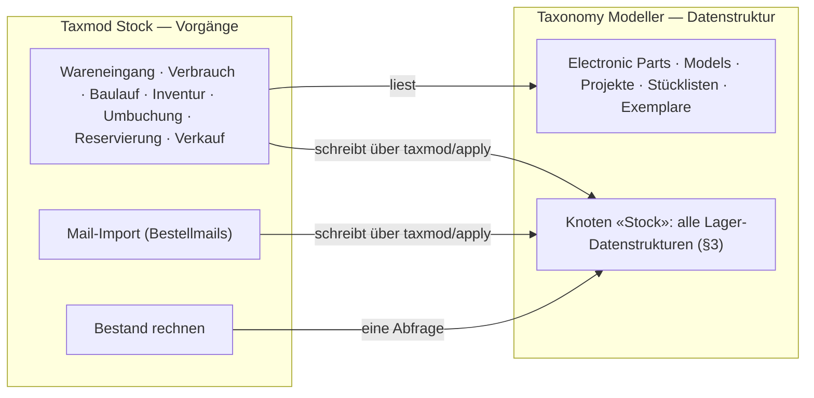
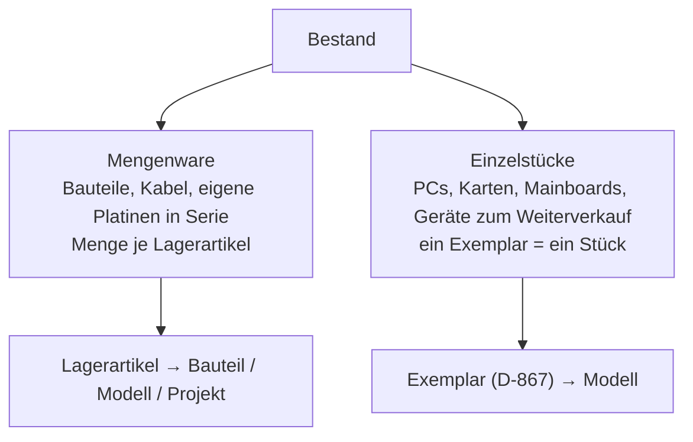
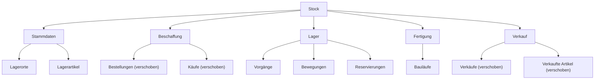
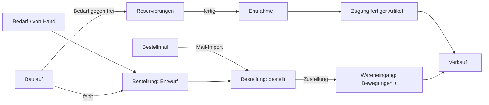

# Paket · Lager («Taxmod Stock») — Konzeptentwurf

**Stand 2026-10-20. Entwurf, nichts entschieden, nichts gebaut.** Aus [INF-073](../../neues-konzept-eingang.md#inf-073--bestand-und-fertigung-vom-wareneingang-über-die-platine-zum-verkauf)
und [INF-075](../../neues-konzept-eingang.md#inf-075--prozesse-und-formulare-im-modell-anlegen). Was er entscheiden soll, steht in §10;
alles andere ist mein Vorschlag (`INFERRED`), bis es eine `D-<nnn>` hat (`PR-3`). Code des Moduls: [`sfambach/wp_tax_stock`](https://github.com/sfambach/wp_tax_stock).

**Seine Worte, auf denen der Entwurf steht (alle 2026-10-20):**

> *«habe mir das schon irgendwie mehr all umfassender vorgestellt. Verbrauchen und We als aktion prozess, ich überlege aber weil tax
> eigentlich nur datenstruktur ist ob es hier ein tax stock modul oder sowas braucht»*

> *«erstmal hier konzipieren was nötig ist welche datenstrukturen dazu gehören. samples für den eigenen gebrauch. produktion nutzt kann
> bauteil listen nutzen, eigener ast im baum stock alle datenstrukturen kommen darunter»*

> *«wir hatten schon ein modul das sich um wes überemail kümmert das muss mit hierein denke ich»*

> *«ja aber auch pcs und dandere sachen sind bestand die ich wieder verkaufen möchte»* — *«evtl müssen wir die strukturen dafür etwas aufräumen»*

> *«genaus geht produzierte ware in den bestand über»* — §3.7, Vorgang «Baulauf-Zugang»

---

## 1 · Der Schnitt: Modell hält Daten, Modul hält Vorgänge

- **Der Modeller bleibt Datenstruktur.** Er rechnet nicht und kennt keine Abläufe.
- **Das Modul besitzt die Vorgänge:** Masken, Regeln, die Rechnung «Bestand» und den Mail-Import. Es schreibt **nur** über denselben
  Weg wie jede andere Änderung ([D-911](../../NewConcept/90-decision-log.md): eine Handlung, eine Änderungsnummer, alles oder nichts).
- **Alle Lagerdaten sind Sätze im Modell, unter «Stock».** Damit gelten Sicherung ([D-908](../../NewConcept/90-decision-log.md)),
  Änderungsbuch, Block `taxmod/record` ([D-912](../../NewConcept/90-decision-log.md)) und der Connector ohne neuen Code — und jede
  Tatsache hat **einen** Ort (Code-Standard: *«One place owns each piece of state»*).

⚠️ **«Eigener Ast» heisst hier ein Knoten «Stock» unter `Model`, kein neuer Wurzelast.** *Die Wurzeläste (`Model`, `Compositions`,
`Primitives`) stehen im Code und bestimmen, **wie** gespeichert wird (`src/Core/Model/Branch.php`, [D-161](../../NewConcept/90-decision-log.md),
[D-232](../../NewConcept/90-decision-log.md)) — ein vierter wäre Code im Modeller und eine neue Speicherregel. Ein Knoten «Stock» unter
`Model` braucht nichts davon. Das ist meine Lesart seines Wortes (F1).*

## 2 · Was Bestand ist — zwei Sorten

- **Mengenware:** «7 × LM2930T-5.0». Gezählt wird je Lagerartikel.
- **Einzelstück:** «dieser Escom-PC, Seriennummer …». Das Exemplar ([D-867](../../NewConcept/90-decision-log.md)) ist schon das Stück;
  es bekommt nur, was ihm für den Bestand fehlt (§3.3). **Beides läuft durch dieselben Vorgänge und Bewegungen** — eine Bewegung
  nennt entweder einen Lagerartikel mit Menge oder ein Exemplar mit ±1.

## 3 · Die Datenstrukturen unter «Stock»

Gruppenknoten (Stammdaten, Beschaffung, Lager, Fertigung, Verkauf) haben keine Felder. Jeder Satz hat «Bezeichnung» und «Beschreibung»
von `Model` ([D-883](../../NewConcept/90-decision-log.md)). «Exemplare» bleiben, wo sie sind — sie sind Sammlung **und** Bestand.

### 3.1 Lagerorte

| Feld | Typ | Mult. | Zweck |
|---|---|---|---|
| Übergeordnet | Satzverweis → Lagerorte | 0..1 | Regal › Kiste › Fach |
| Kurzzeichen | Text | 0..1 | was auf dem Etikett steht, z. B. «S1-03» |

### 3.2 Lagerartikel — Mengenware

Ein Ding wird erst durch einen Lagerartikel-Satz mengengeführt. **Daten-Lösung statt Schalter im Code**; Bauteile und Modelle bleiben unberührt.

| Feld | Typ | Mult. | Zweck |
|---|---|---|---|
| Bauteil | Satzverweis → Electronic Parts | 0..1 | Zukaufteil — genau eins der drei |
| Modell | Satzverweis → Models | 0..1 | Mengenware ohne Seriennummer: Kabel, Adapter, Lüfter |
| Projekt | Satzverweis → Projekte | 0..1 | Eigenbau in Serie (Platine, Gerät) |
| Einheit | Konstante → Einheiten | 0..1 | leer = Stück |
| Standard-Lagerort | Satzverweis → Lagerorte | 0..1 | Vorschlag beim Wareneingang |
| Mindestbestand | Ganzzahl | 0..1 | darunter «nachbestellen» |

**Nicht gespeichert:** Bestand, reserviert, frei, Durchschnittswert — gerechnet aus §3.5 und §3.6.

### 3.3 Exemplare — Einzelstücke, zwei Felder dazu

| Feld | Typ | Mult. | Zweck |
|---|---|---|---|
| Verwendung | Konstante: Sammlung · Eigenbedarf · zum Verkauf · Ersatzteilspender | 0..1 | was er damit vorhat — lässt sich aus nichts rechnen |
| Lagerort | Satzverweis → Lagerorte | 0..1 | wo es steht |

**Ob ein Exemplar im Bestand ist, wird gerechnet:** Summe seiner Bewegungen = 1 (gekauft und nicht verkauft, nicht zerlegt).
Keine Statusspalte «verkauft», sonst stünde die Tatsache zweimal.

### 3.4 Bestellungen und Käufe — verschoben, plus Felder

Bestellungen und Käufe ([D-933](../../NewConcept/90-decision-log.md)) wandern unter «Stock › Beschaffung»; Daten und Ids bleiben.

| Knoten | Feld | Typ | Mult. | Zweck |
|---|---|---|---|---|
| Bestellungen | Status | Konstante: Entwurf · bestellt · teilweise eingegangen · eingegangen · storniert | 0..1 | ein Bestellvorschlag ist eine Bestellung «Entwurf» |
| Käufe | Lagerartikel | Satzverweis → Lagerartikel | 0..1 | Mengenware; für Einzelstücke zeigt der Kauf schon auf seine Exemplare ([D-897](../../NewConcept/90-decision-log.md)) |
| Käufe | Eingegangen | Dezimalzahl | 0..1 | bei Teillieferung; leer = alles |

### 3.5 Vorgänge und Bewegungen — der Kern

Jeder Wareneingang, Verbrauch, Verkauf, jede Inventur ist ein **Vorgang** mit **Bewegungen** als Positionen — wie Bestellung → Käufe.

**Vorgänge**

| Feld | Typ | Mult. | Zweck |
|---|---|---|---|
| Art | Konstante: Wareneingang · Verbrauch · Baulauf-Entnahme · Baulauf-Zugang · Verkauf · Zerlegung · Inventur · Umbuchung | 1..1 | |
| Datum | Datum | 1..1 | |
| Bestellung | Satzverweis → Bestellungen | 0..1 | Wareneingang |
| Baulauf | Satzverweis → Bauläufe | 0..1 | Fertigung |
| Verkauf | Satzverweis → Verkäufe | 0..1 | Verkauf |
| Projekt | Satzverweis → Projekte | 0..1 | freier Verbrauch («für BT2PS2») |
| Quelle | Konstante: von Hand · Mail-Import · Connector | 0..1 | wer gebucht hat |
| Positionen | Satzverweis → Bewegungen | 0..* | |

**Bewegungen**

| Feld | Typ | Mult. | Zweck |
|---|---|---|---|
| Lagerartikel | Satzverweis → Lagerartikel | 0..1 | Mengenware — genau eins von beiden |
| Exemplar | Satzverweis → Exemplare | 0..1 | Einzelstück, Menge ist dann ±1 |
| Menge | Dezimalzahl mit Vorzeichen | 1..1 | + Zugang, − Abgang |
| Lagerort | Satzverweis → Lagerorte | 0..1 | |
| Wert je Stück | Einheitenwert, Währung ([D-929](../../NewConcept/90-decision-log.md)) | 0..1 | Zugang: Einstandspreis; Abgang: Durchschnitt zum Buchungszeitpunkt |
| Kauf | Satzverweis → Käufe | 0..1 | Herkunft eines Zugangs |
| Gezählt | Dezimalzahl | 0..1 | nur Inventur; Menge ist die Differenz |

**Bestand = Summe «Menge»** je Lagerartikel bzw. je Exemplar, in **einer** Abfrage für eine ganze Liste (`CD-7`).

### 3.6 Reservierungen

| Feld | Typ | Mult. | Zweck |
|---|---|---|---|
| Lagerartikel | Satzverweis → Lagerartikel | 0..1 | genau eins von beiden |
| Exemplar | Satzverweis → Exemplare | 0..1 | «diese Karte kommt in jenen PC» |
| Menge | Dezimalzahl | 1..1 | |
| Baulauf / Projekt | Satzverweis | 0..1 je | wofür |
| Status | Konstante: offen · entnommen · aufgehoben | 1..1 | |

**frei = Bestand − offene Reservierungen.** Aufteilen zwischen Projekten = zwei Reservierungen.

### 3.7 Bauläufe — Produktion nutzt die Stückliste

| Feld | Typ | Mult. | Zweck |
|---|---|---|---|
| Projekt | Satzverweis → Projekte | 1..1 | woher die Stückliste kommt |
| Platine | Satzverweis → Platine/Revision des Projekts | 0..1 | wenn es mehrere gibt |
| Stückzahl | Ganzzahl | 1..1 | |
| Status | Konstante: geplant · Teile reserviert · in Bau · fertig · abgebrochen | 1..1 | |
| Begonnen am / Fertig am | Datum | 0..1 | |
| Exemplare | Satzverweis → Exemplare | 0..* | wenn jedes gebaute Stück ein Einzelstück sein soll |

**Die Stückliste wird nicht kopiert.** Bedarf = je `Part List Item` des Projekts ([D-774](../../NewConcept/90-decision-log.md):
Bauteil, Anzahl, Bestückung) «Anzahl × Stückzahl», ohne «nicht bestücken»; das Bauteil führt über seinen Lagerartikel zum Bestand.
Abweichungen beim Bau stehen in den Bewegungen der Entnahme. **Selbstkosten je Stück = Wert der Entnahme ÷ Stückzahl**, als «Wert je
Stück» in der Zugangsbewegung.

### 3.8 Verkäufe — verschoben, plus ein Feld

Verkäufe und Verkaufte Artikel ([D-934](../../NewConcept/90-decision-log.md)) wandern unter «Stock › Verkauf». «Verkaufte Artikel» hat
schon «Exemplar» (0..1); neu **Lagerartikel** (0..1) für Mengenware. Gesetzt → der Verkauf bucht den Abgang, und «Einstandspreis je
Stück» kommt aus dem Bestand.

## 4 · Die Vorgänge als Ablauf

| Vorgang | Auslöser | Was entsteht |
|---|---|---|
| **Wareneingang** | Bestellung eingegangen — ganz oder je Position; oder frei | Bewegung je Kauf: Lagerartikel mit Menge, oder je Exemplar +1 |
| **Verbrauch** | Artikel, Menge, optional Projekt | Bewegungen − |
| **Baulauf** | Projekt + Stückzahl → reservieren → fertig | Entnahme − aus der Stückliste, Zugang + des fertigen Artikels |
| **Verkauf** | Verkaufte Artikel | Bewegung − (Exemplar −1 oder Lagerartikel −n) |
| **Zerlegung** | Exemplar wird Ersatzteilspender | Exemplar −1, gewonnene Teile + |
| **Inventur** | gezählte Menge | Bewegung = gezählt − Bestand; **der Anfangsbestand ist eine Inventur**, nach Bedarf ([INF-073](../../neues-konzept-eingang.md#inf-073--bestand-und-fertigung-vom-wareneingang-über-die-platine-zum-verkauf), Schritt 1) |
| **Umbuchung** | Lagerort wechseln | − am alten, + am neuen Ort |

## 5 · Mail-Import gehört ins Modul

Der Import der Bestellmails (`einkauf@fambach.net`, Ordner `kaeufe-import` auf Earth, schreibt heute Bestellungen, Käufe und Verkäufe
über den Connector) wird **der Eingang von Beschaffung und Verkauf** im Modul:

- **Bestellbestätigung** → Bestellung «bestellt» mit Käufen, wie heute.
- **Versand-/Zustellmail** → Bestellung «eingegangen» und ein Vorgang Wareneingang, Quelle «Mail-Import».
- **eBay-Verkauf** → Verkauf mit Positionen, wie heute, plus Abgangsbewegung.
- **Zuordnung Kauf → Lagerartikel/Exemplar** über Artikel- bzw. Teilenummer; was sich nicht zuordnen lässt, steht in einer Liste «zuordnen».
- Händler-Parser (eBay, Reichelt, JLCPCB …) bleiben je ein Modul im Import.

⚠️ *Nicht gelesen: den Code von `kaeufe-import` habe ich nicht gesehen, er liegt nur auf Earth. Ob er Zustellmails erkennt, weiss ich nicht.*

## 6 · Aufräumen der vorhandenen Strukturen

Was beim Lesen der Entscheidungen auffiel — Tatsachen an zwei Orten oder zwei Wege für dasselbe:

| # | Befund | Vorschlag |
|---|---|---|
| A1 | **Kaufdaten doppelt:** das Exemplar trägt eigene Kaufangaben (Datum, Preis, Währung, Händler — [D-867](../../NewConcept/90-decision-log.md)), der Kauf zeigt auch auf seine Exemplare ([D-897](../../NewConcept/90-decision-log.md)) | Kaufangaben am Exemplar entfernen, Werte in einen Kauf überführen, wo noch keiner ist |
| A2 | **Bestelldaten doppelt:** bei den 31 alten Käufen stehen Plattform, Händler, Datum an der Position, bei neuen an der Bestellung ([D-933](../../NewConcept/90-decision-log.md)) | je alter Kauf eine Bestellung anlegen, Felder am Kauf entfernen |
| A3 | **Zwei Kataloge:** Käufe zeigen auf «Models», Stücklisten auf «Electronic Parts» | über den Lagerartikel zusammenführen (§3.2); «Modell» am Kauf bleibt für Sammlerkäufe |
| A4 | **Händler als Text** an Käufen und Verkäufen, «Lieferant» als Knoten an der Preisangabe ([D-927](../../NewConcept/90-decision-log.md)) | offen lassen bis Stufe 2 — eBay-Verkäufer sind keine Lieferanten |
| A5 | **Bestellung «Bestand»** mit zehn gezählten Teilen (Auftrag vom 2026-10-19) | nach Stufe 1 in eine Inventur umbuchen, Bestellung entfernen |

## 7 · Beispieldaten aus seinem Bestand

Echt, ausser *(erfunden)*.

**Lagerorte** *(erfunden)*: «Bauteileschrank» S1 › «Spannungsregler» S1-03, «Transistoren» S1-04; «Keller-Regal» K1.

**Inventur 2026-10-19 — Mengenware, seine gezählten Teile**

| Lagerartikel (Bauteil) | Gezählt = Menge | Wert je Stück |
|---|---|---|
| LM2930T-5.0 | 7 | 1,80 € |
| LM2940T-5.0 | 7 | 2,10 € |
| L7805CV | 1 | 0,40 € |
| L7809CV | 10 | 0,33 € |
| MCP1700-3302E | 10 | 0,59 € |
| TL431 | 13 | 0,16 € |
| IRF5305 | 1 | 0,83 € |
| FQP27P06 | 11 | 2,15 € |
| 2N7000 | 40 | 0,09 € |
| BUZ11 | 9 | 1,05 € |

**Wareneingang Einzelstück, aus Mail** — Bestellung 27-14743-39156, eBay, «Retro PC Klassiker 286 … Bastlerware defekt», 96 € + 10,49 €
Versand: Exemplar «286er Klassiker» +1, Wert 106,49 €, Verwendung *zum Verkauf (erfunden)*, Lagerort K1.

**Wareneingang Mengenware, aus Mail** — Bestellung 18-15212-31076, eBay, Dupont-Kabel 30 cm: sechs Käufe → ein Vorgang, sechs Bewegungen
(Blau, Weiss, Grün, Gelb je +50; Schwarz, Rot je +100). ⚠️ *Gekauft je Beutel, verbraucht je Kabel — Einheit (F6).*

**Baulauf** — Kiselev-Backplane (18 Positionen, [D-912](../../NewConcept/90-decision-log.md)), Stückzahl 2 *(erfunden)*: Bedarf =
2 × jede Position; frei wird reserviert, was fehlt landet in einer Bestellung «Entwurf»; «fertig» bucht die Entnahme und «Kiselev-Backplane» +2.

**Verbrauch** — 1 × L7805CV für eine Reparatur *(erfunden)* → Bestand 0, bei Mindestbestand 2 unter «nachbestellen».

**Reservierung aufgeteilt** — 2N7000: 8 für BT2PS2, 4 für ein zweites Projekt *(erfunden)* → frei 28.

**Verkauf** — ein Greaseweazle ([D-934](../../NewConcept/90-decision-log.md)) −1, Einstandspreis aus dem Baulauf.

## 8 · Bewertung

**Gleitender Durchschnitt** für Mengenware: ein Abgang wird mit dem Durchschnitt zum Buchungszeitpunkt bewertet und dieser Wert in der
Bewegung **gespeichert**, weil er sich später nicht zurückrechnen lässt (wie der Einstandspreis, [D-933](../../NewConcept/90-decision-log.md)).
Einzelstücke tragen ihren eigenen Wert.

## 9 · Wo es läuft, und INF-075

- **Admin-Seite «Lager»:** Masken für §4, Bestandsliste (Filter: «nachbestellen», «fehlt für Baulauf», «zum Verkauf», «zuordnen»).
- **Connector:** dieselben Vorgänge als Abilities (`taxmod-stock/receive`, `…/consume`, `…/count`, `…/build`, `…/sell`).
- **Beitrag:** «Bestand» über den vorhandenen Block; ein eigener Block erst, wenn gebraucht.
- **INF-075:** das Lager ist der erste konkrete Prozess, gebaut als Code im Modul; «Prozesse als Daten» erst aus zwei, drei echten
  Fällen ableiten. Die Ereignisse (PSR-14, [D-631](../../NewConcept/90-decision-log.md)–[D-633](../../NewConcept/90-decision-log.md))
  sind später der Andockpunkt.

## 10 · Was er entscheiden soll

| | Frage | Mein Vorschlag |
|---|---|---|
| **F1** | «Stock» als Knoten unter `Model` oder als neuer Wurzelast (Code im Modeller)? | **unter `Model`** |
| **F2** | Bestellungen, Käufe, Verkäufe unter «Stock» verschieben? | **ja**, Ids bleiben |
| **F3** | Zwei Sorten Bestand: Lagerartikel (Menge) und Exemplar (Einzelstück)? | **ja** |
| **F4** | Aufräumen A1–A3 vor dem Bau? | **ja**, A4 später, A5 nach Stufe 1 |
| **F5** | Mail-Import ins Repo `wp_tax_stock` holen? | **ja**, eigener Ordner, läuft weiter auf Earth |
| **F6** | Einheiten (Beutel ↔ Stück) | **später**, Stufe 1 nur «Stück» |
| **F7** | Reihenfolge | **1** Aufräumen, Knoten «Stock», Lagerartikel, Inventur, Wareneingang, Verbrauch, Bestandsliste · **2** Mail-Import mit Wareneingang und Verkauf · **3** Reservierung, Bedarf, Bauläufe · **4** Mindestbestand, Umbuchung, Zerlegung |

## 11 · Annahmen, die das Konzept nicht sagt

- Mengen sind Dezimalzahlen (Meterware), angezeigt ohne Nachkommastellen, wenn ganz.
- Ein Abgang darf den Bestand unter 0 drücken; die Maske warnt, sperrt nicht — der Bestand ist am Anfang lückenhaft.
- Vorhandene Exemplare mit Kauf zählen als Bestand erst, wenn für sie eine Zugangsbewegung gebucht ist (Übernahme als Inventur in Stufe 1).
