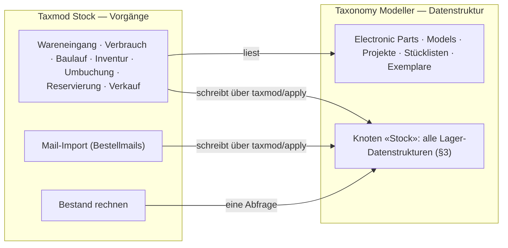
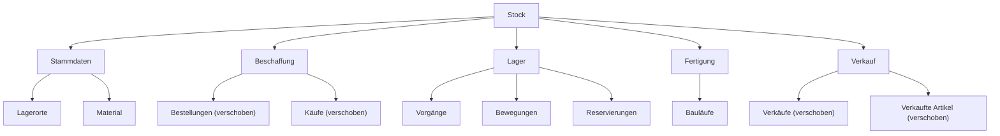
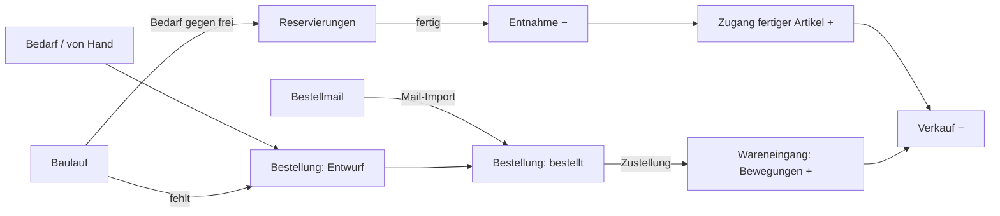

# Paket · Lager («Taxmod Stock») — Konzeptentwurf

**Stand 2026-10-20. Entwurf, nichts entschieden, nichts gebaut.** Aus [INF-073](../../neues-konzept-eingang.md#inf-073--bestand-und-fertigung-vom-wareneingang-über-die-platine-zum-verkauf)
und [INF-075](../../neues-konzept-eingang.md#inf-075--prozesse-und-formulare-im-modell-anlegen). Was er entscheiden soll, steht in §10;
alles andere ist mein Vorschlag (`INFERRED`), bis es eine `D-<nnn>` hat (`PR-3`). Code des Moduls: [`sfambach/wp_tax_stock`](https://github.com/sfambach/wp_tax_stock).

**Seine Worte, auf denen der Entwurf steht (alle 2026-10-20):**

> *«habe mir das schon irgendwie mehr all umfassender vorgestellt. Verbrauchen und We als aktion prozess, ich überlege aber weil tax
> eigentlich nur datenstruktur ist ob es hier ein tax stock modul oder sowas braucht»*

> *«erstmal hier konzipieren was nötig ist welche datenstrukturen dazu gehören. samples für den eigenen gebrauch. produktion nutzt kann
> bauteil listen nutzen, eigener ast im baum stock alle datenstrukturen kommen darunter»*

> *«wir hatten schon ein modul das sich um wes überemail kümmert das muss mit hierein denke ich»*

> *«ja aber auch pcs und dandere sachen sind bestand die ich wieder verkaufen möchte»* — *«evtl müssen wir die strukturen dafür etwas aufräumen»*

> *«genaus geht produzierte ware in den bestand über»* — §3.7, Vorgang «Baulauf-Zugang»

> *«vielleicht kann man eine linie zeigehn zwischen technische beschreibeibung und ebstand aber nur wenn das sinnvoll ist»* — §2

> *«ich weiss nicht wir haben ja knoten damit wir relativ frei sind wäre nicht eine materil das bezug zu einem knoten hat das richtige und ein material kann wiederum bestand haben sonst vermixen wi rhier dinge kannst du das mal untersuchen»* — *«war nur ne idee lass uns das est konzipieren»* — §2, §3.2

---

## 1 · Der Schnitt: Modell hält Daten, Modul hält Vorgänge

- **Der Modeller bleibt Datenstruktur.** Er rechnet nicht und kennt keine Abläufe.
- **Das Modul besitzt die Vorgänge:** Masken, Regeln, die Rechnung «Bestand» und den Mail-Import. Es schreibt **nur** über denselben
  Weg wie jede andere Änderung ([D-911](../../NewConcept/90-decision-log.md): eine Handlung, eine Änderungsnummer, alles oder nichts).
- **Alle Lagerdaten sind Sätze im Modell, unter «Stock».** Damit gelten Sicherung ([D-908](../../NewConcept/90-decision-log.md)),
  Änderungsbuch, Block `taxmod/record` ([D-912](../../NewConcept/90-decision-log.md)) und der Connector ohne neuen Code — und jede
  Tatsache hat **einen** Ort (Code-Standard: *«One place owns each piece of state»*).

⚠️ **«Eigener Ast» — zwei Wege, beide ohne neuen Code:**

| | Hauptast «Stock» neben `Model`, wie «Kontact» | Ast «Stock» unter `Model` |
|---|---|---|
| Vorbild | [D-884](../../NewConcept/90-decision-log.md): Kontact steht seit 2026-09-20 neben `Model`, «Verweise über Astgrenzen hinweg gehen weiter» | Hardware Project, PC, Messwesen |
| Geerbte Felder | **keine** — «Bezeichnung», «Beschreibung», «Herkunftshinweis» hängen an `Model` ([D-883](../../NewConcept/90-decision-log.md)) und müssten an «Stock» neu angelegt werden | erbt sie wie alles unter `Model` |
| Verschieben von Bestellungen, Käufen, Verkäufen | **ihre Werte in diesen Feldern hängen an den Kanten von `Model`** — nach dem Verschieben stünden sie ohne Feld da; braucht eine Umschreibung aller Sätze | Werte bleiben, nur der Ort ändert sich |

**Vorschlag: unter `Model`.** Es ist im Baum genauso ein eigener Ast, und nichts muss umgeschrieben werden. *Gemessen am 2026-10-20
(`taxmod/read-tree`): Hauptäste sind Model, Compositions, Primitives, Kontact; Bestellungen, Käufe, Verkäufe, Verkaufte Artikel liegen
direkt unter `Model`; die Käufe aus dem Auftrag vom 2026-10-19 schreiben «Bezeichnung» und «Herkunftshinweis». Dass die Werte nach
einem Verschieben ohne Feld dastünden, habe ich aus dem Speichermodell geschlossen (Werte hängen an der Kante), nicht ausprobiert.*

## 2 · Die Linie und das Material

**Die Linie** (sein Gedanke, und er trägt): links steht, **was ein Ding ist** — gilt auch, wenn ich es nie besessen oder längst verkauft
habe. Rechts steht, **was ich damit tue** — Menge, Ort, Wert, wofür, wann rein, wann raus.

**Das Material** (sein zweiter Gedanke, er ersetzt meinen «Lagerartikel» mit vier festen Feldern Bauteil/Modell/Projekt/Exemplar —
das war die Vermischung: die Lagerseite hätte die Arten der Technikseite einzeln kennen müssen):

- **Ein Material ist ein eigenes Ding der Lagerseite** mit eigenem Namen. **Nur das Material hat Bestand.**
- **Es hat einen Bezug zur Technik — frei, nicht nach Art getrennt:** auf einen Knoten (eine Art, «Schrauben M3» → Knoten «Schrauben»)
  oder einen Satz (ein konkretes Ding, «LM2930T-5.0» → Bauteil-Satz, «dieser 286er» → Exemplar). Kommt morgen eine neue Art hinzu,
  ändert sich auf der Lagerseite nichts.
- **Der Bezug ist optional.** Lötzinn, Kabelbinder, Versandkartons sind Material ohne technische Beschreibung.
- **Verweise gehen nur von rechts nach links.** Technik weiss nichts vom Lager; der Bestand erscheint dort nur als gerechnete Anzeige.
  Prüfbar mit einem Wächter: kein Feld eines Knotens ausserhalb «Stock» zielt auf einen Knoten in «Stock».
- **Bewegungen, Reservierungen, Käufe, Verkäufe nennen immer das Material**, nie die Technik direkt.
- **Mengenware und Einzelstück sind dasselbe Material**, nur die Menge ist anders: «LM2930T-5.0» hat 7, «dieser 286er» hat 0 oder 1.

**Was das Modell für den freien Bezug heute hergibt** (gelesen in `NodesScreen::barredTargets()` und [D-790](../../NewConcept/90-decision-log.md), nicht im Browser geprüft):

| Weg | Heute | Was fehlt |
|---|---|---|
| **Bezug auf einen Knoten** — Typ «Node reference» | vorhanden (Datentyp unter `Data Types`) | nichts; wählt eine Art, kein konkretes Ding |
| **Bezug auf einen Satz irgendwo unter `Model`** | **nicht möglich:** ein Satzverweis nennt **einen** Zielknoten und bietet dessen Sätze samt Unterknoten an; `Model` selbst ist als Ziel gesperrt, weil eine Astwurzel «keine **eine** Speicherantwort» hat ([D-678](../../NewConcept/90-decision-log.md), [D-238](../../NewConcept/90-decision-log.md)) | Code im Modeller: ein Satzverweis «jeder Satz unter Model» — gespeichert wird ohnehin die Satz-Id, die Speicherfrage stellt sich für Sätze also nicht. Dazu eine **Suche** statt Liste: unter `Model` liegen tausende Sätze, die Auswahlliste «Models» allein war schon 171 KB ([D-898](../../NewConcept/90-decision-log.md)) |
| **Knoten + Satz zusammen** — erst die Art, dann der Satz darin | nicht möglich | Code: Satzauswahl, gefiltert nach dem gewählten Knoten |

**Vorschlag:** zwei Felder am Material, **«Bezug Art»** (Knotenverweis, gibt es) und **«Bezug Ding»** (Satzverweis auf jeden Satz unter
`Model`, braucht Code). Bis der Code da ist, reicht «Bezug Art» plus Bezeichnung; der 286er bekommt «Bezug Ding» nachgetragen.

## 3 · Die Datenstrukturen unter «Stock»

Gruppenknoten (Stammdaten, Beschaffung, Lager, Fertigung, Verkauf) haben keine Felder. Jeder Satz erbt «Bezeichnung» und «Beschreibung»
von `Model` ([D-883](../../NewConcept/90-decision-log.md)), wenn «Stock» unter `Model` steht (F1). «Exemplare» bleiben links, wo sie sind, ohne neues Feld.

### 3.1 Lagerorte

| Feld | Typ | Mult. | Zweck |
|---|---|---|---|
| Übergeordnet | Satzverweis → Lagerorte | 0..1 | Regal › Kiste › Fach |
| Kurzzeichen | Text | 0..1 | was auf dem Etikett steht, z. B. «S1-03» |

### 3.2 Material

| Feld | Typ | Mult. | Zweck |
|---|---|---|---|
| Bezeichnung | geerbt von `Model` | 1..1 | eigener Name der Lagerseite, z. B. «LM2930T-5.0», «Dupont-Kabel 30 cm rot», «286er Klassiker (eBay 2026-06)» |
| Bezug Art | Knotenverweis → unter `Model` | 0..1 | welche Art Ding (§2) |
| Bezug Ding | Satzverweis → jeder Satz unter `Model` | 0..1 | welches konkrete Ding — **braucht Code** (§2) |
| Einzelstück | Ja/Nein | 0..1 | Bestand nur 0 oder 1; die Maske bucht dann ±1 |
| Verwendung | Konstante: Lager · Eigenbedarf · zum Verkauf · Sammlung · Ersatzteilspender | 0..1 | was ich damit vorhabe |
| Einheit | Konstante → Einheiten | 0..1 | leer = Stück |
| Standard-Lagerort | Satzverweis → Lagerorte | 0..1 | Vorschlag beim Wareneingang; wo es wirklich liegt, sagen die Bewegungen |
| Mindestbestand | Ganzzahl | 0..1 | darunter «nachbestellen» |

**Nicht gespeichert:** Bestand, reserviert, frei, Durchschnittswert — gerechnet aus §3.5 und §3.6.

### 3.3 Exemplare — unverändert

Sie bleiben technische Beschreibung. **Ob ein Exemplar im Bestand ist, wird gerechnet:** Summe der Bewegungen des Materials, das auf es zeigt = 1.
Keine Spalte «verkauft» am Exemplar — sonst stünde die Tatsache zweimal und auf der falschen Seite der Linie.

### 3.4 Bestellungen und Käufe — verschoben, plus Felder

Bestellungen und Käufe ([D-933](../../NewConcept/90-decision-log.md)) wandern unter «Stock › Beschaffung»; Daten und Ids bleiben.

| Knoten | Feld | Typ | Mult. | Zweck |
|---|---|---|---|---|
| Bestellungen | Status | Konstante: Entwurf · bestellt · teilweise eingegangen · eingegangen · storniert | 0..1 | ein Bestellvorschlag ist eine Bestellung «Entwurf» |
| Käufe | Material | Satzverweis → Material | 0..* | Mengenware: einer; Einzelstücke: je Exemplar einer. Ersetzt Kauf → Exemplare ([D-897](../../NewConcept/90-decision-log.md), A6) |
| Käufe | Eingegangen | Dezimalzahl | 0..1 | bei Teillieferung; leer = alles |

### 3.5 Vorgänge und Bewegungen — der Kern

Jeder Wareneingang, Verbrauch, Verkauf, jede Inventur ist ein **Vorgang** mit **Bewegungen** als Positionen — wie Bestellung → Käufe.

**Vorgänge**

| Feld | Typ | Mult. | Zweck |
|---|---|---|---|
| Art | Konstante: Wareneingang · Verbrauch · Baulauf-Entnahme · Baulauf-Zugang · Verkauf · Zerlegung · Inventur · Umbuchung | 1..1 | |
| Datum | Datum | 1..1 | |
| Bestellung | Satzverweis → Bestellungen | 0..1 | Wareneingang |
| Baulauf | Satzverweis → Bauläufe | 0..1 | Fertigung |
| Verkauf | Satzverweis → Verkäufe | 0..1 | Verkauf |
| Projekt | Satzverweis → Projekte | 0..1 | freier Verbrauch («für BT2PS2») |
| Quelle | Konstante: von Hand · Mail-Import · Connector | 0..1 | wer gebucht hat |
| Positionen | Satzverweis → Bewegungen | 0..* | |

**Bewegungen**

| Feld | Typ | Mult. | Zweck |
|---|---|---|---|
| Material | Satzverweis → Material | 1..1 | Mengenware oder Einzelstück |
| Menge | Dezimalzahl mit Vorzeichen | 1..1 | + Zugang, − Abgang |
| Lagerort | Satzverweis → Lagerorte | 0..1 | |
| Wert je Stück | Einheitenwert, Währung ([D-929](../../NewConcept/90-decision-log.md)) | 0..1 | Zugang: Einstandspreis; Abgang: Durchschnitt zum Buchungszeitpunkt |
| Kauf | Satzverweis → Käufe | 0..1 | Herkunft eines Zugangs |
| Gezählt | Dezimalzahl | 0..1 | nur Inventur; Menge ist die Differenz |

**Bestand = Summe «Menge»** je Material, in **einer** Abfrage für eine ganze Liste (`CD-7`).

### 3.6 Reservierungen

| Feld | Typ | Mult. | Zweck |
|---|---|---|---|
| Material | Satzverweis → Material | 1..1 | auch ein Einzelstück: «diese Karte kommt in jenen PC» |
| Menge | Dezimalzahl | 1..1 | |
| Baulauf / Projekt | Satzverweis | 0..1 je | wofür |
| Status | Konstante: offen · entnommen · aufgehoben | 1..1 | |

**frei = Bestand − offene Reservierungen.** Aufteilen zwischen Projekten = zwei Reservierungen.

### 3.7 Bauläufe — Produktion nutzt die Stückliste

| Feld | Typ | Mult. | Zweck |
|---|---|---|---|
| Projekt | Satzverweis → Projekte | 1..1 | woher die Stückliste kommt |
| Platine | Satzverweis → Platine/Revision des Projekts | 0..1 | wenn es mehrere gibt |
| Stückzahl | Ganzzahl | 1..1 | |
| Status | Konstante: geplant · Teile reserviert · in Bau · fertig · abgebrochen | 1..1 | |
| Begonnen am / Fertig am | Datum | 0..1 | |
| Exemplare | Satzverweis → Exemplare | 0..* | wenn jedes gebaute Stück ein Einzelstück sein soll (je Stück ein Material) |

**Die Stückliste wird nicht kopiert.** Bedarf = je `Part List Item` des Projekts ([D-774](../../NewConcept/90-decision-log.md):
Bauteil, Anzahl, Bestückung) «Anzahl × Stückzahl», ohne «nicht bestücken»; das Bauteil führt über sein Material zum Bestand.
Abweichungen beim Bau stehen in den Bewegungen der Entnahme. **Selbstkosten je Stück = Wert der Entnahme ÷ Stückzahl**, als «Wert je
Stück» in der Zugangsbewegung.

### 3.8 Verkäufe — verschoben, plus ein Feld

Verkäufe und Verkaufte Artikel ([D-934](../../NewConcept/90-decision-log.md)) wandern unter «Stock › Verkauf». «Verkaufte Artikel» hat
schon «Exemplar» (0..1); neu **Material** (0..1), das «Exemplar» dort entfällt (A6). Gesetzt → der Verkauf bucht den Abgang, und «Einstandspreis je
Stück» kommt aus dem Bestand.

## 4 · Die Vorgänge als Ablauf

| Vorgang | Auslöser | Was entsteht |
|---|---|---|
| **Wareneingang** | Bestellung eingegangen — ganz oder je Position; oder frei | Bewegung je Material des Kaufs |
| **Verbrauch** | Artikel, Menge, optional Projekt | Bewegungen − |
| **Baulauf** | Projekt + Stückzahl → reservieren → fertig | Entnahme − aus der Stückliste, Zugang + des fertigen Artikels |
| **Verkauf** | Verkaufte Artikel | Bewegung − |
| **Zerlegung** | Einzelstück wird Ersatzteilspender | Einzelstück −1, gewonnene Teile + |
| **Inventur** | gezählte Menge | Bewegung = gezählt − Bestand; **der Anfangsbestand ist eine Inventur**, nach Bedarf ([INF-073](../../neues-konzept-eingang.md#inf-073--bestand-und-fertigung-vom-wareneingang-über-die-platine-zum-verkauf), Schritt 1) |
| **Umbuchung** | Lagerort wechseln | − am alten, + am neuen Ort |

## 5 · Mail-Import gehört ins Modul

Der Import der Bestellmails (`einkauf@fambach.net`, Ordner `kaeufe-import` auf Earth, schreibt heute Bestellungen, Käufe und Verkäufe
über den Connector) wird **der Eingang von Beschaffung und Verkauf** im Modul:

- **Bestellbestätigung** → Bestellung «bestellt» mit Käufen, wie heute.
- **Versand-/Zustellmail** → Bestellung «eingegangen» und ein Vorgang Wareneingang, Quelle «Mail-Import».
- **eBay-Verkauf** → Verkauf mit Positionen, wie heute, plus Abgangsbewegung.
- **Zuordnung Kauf → Material/Exemplar** über Artikel- bzw. Teilenummer; was sich nicht zuordnen lässt, steht in einer Liste «zuordnen».
- Händler-Parser (eBay, Reichelt, JLCPCB …) bleiben je ein Modul im Import.

⚠️ *Nicht gelesen: den Code von `kaeufe-import` habe ich nicht gesehen, er liegt nur auf Earth. Ob er Zustellmails erkennt, weiss ich nicht.*

## 6 · Aufräumen der vorhandenen Strukturen

Was beim Lesen der Entscheidungen auffiel — Tatsachen an zwei Orten oder zwei Wege für dasselbe:

| # | Befund | Vorschlag |
|---|---|---|
| A1 | **Kaufdaten doppelt:** das Exemplar trägt eigene Kaufangaben (Datum, Preis, Währung, Händler — [D-867](../../NewConcept/90-decision-log.md)), der Kauf zeigt auch auf seine Exemplare ([D-897](../../NewConcept/90-decision-log.md)) | Kaufangaben am Exemplar entfernen, Werte in einen Kauf überführen, wo noch keiner ist |
| A2 | **Bestelldaten doppelt:** bei den 31 alten Käufen stehen Plattform, Händler, Datum an der Position, bei neuen an der Bestellung ([D-933](../../NewConcept/90-decision-log.md)) | je alter Kauf eine Bestellung anlegen, Felder am Kauf entfernen |
| A3 | **Zwei Kataloge:** Käufe zeigen auf «Models», Stücklisten auf «Electronic Parts» | über den Material zusammenführen (§3.2); «Modell» am Kauf bleibt für Sammlerkäufe |
| A4 | **Händler als Text** an Käufen und Verkäufen, «Lieferant» als Knoten an der Preisangabe ([D-927](../../NewConcept/90-decision-log.md)) | offen lassen bis Stufe 2 — eBay-Verkäufer sind keine Lieferanten |
| A6 | **Kauf → Exemplare** und **Verkaufte Artikel → Exemplar** greifen über die Linie direkt auf die Technik | durch den Material ersetzen (§3.4, §3.8) |
| A5 | **Bestellung «Bestand»** mit zehn gezählten Teilen (Auftrag vom 2026-10-19) | nach Stufe 1 in eine Inventur umbuchen, Bestellung entfernen |

## 7 · Beispieldaten aus seinem Bestand

Echt, ausser *(erfunden)*.

**Lagerorte** *(erfunden)*: «Bauteileschrank» S1 › «Spannungsregler» S1-03, «Transistoren» S1-04; «Keller-Regal» K1.

**Inventur 2026-10-19 — Mengenware, seine gezählten Teile**

| Material (Bauteil) | Gezählt = Menge | Wert je Stück |
|---|---|---|
| LM2930T-5.0 | 7 | 1,80 € |
| LM2940T-5.0 | 7 | 2,10 € |
| L7805CV | 1 | 0,40 € |
| L7809CV | 10 | 0,33 € |
| MCP1700-3302E | 10 | 0,59 € |
| TL431 | 13 | 0,16 € |
| IRF5305 | 1 | 0,83 € |
| FQP27P06 | 11 | 2,15 € |
| 2N7000 | 40 | 0,09 € |
| BUZ11 | 9 | 1,05 € |

**Wareneingang Einzelstück, aus Mail** — Bestellung 27-14743-39156, eBay, «Retro PC Klassiker 286 … Bastlerware defekt», 96 € + 10,49 €
Versand: Material → Exemplar «286er Klassiker», Verwendung *zum Verkauf (erfunden)*; Bewegung +1, Wert 106,49 €, Lagerort K1.

**Wareneingang Mengenware, aus Mail** — Bestellung 18-15212-31076, eBay, Dupont-Kabel 30 cm: sechs Käufe → ein Vorgang, sechs Bewegungen
(Blau, Weiss, Grün, Gelb je +50; Schwarz, Rot je +100). ⚠️ *Gekauft je Beutel, verbraucht je Kabel — Einheit (F6).*

**Baulauf** — Kiselev-Backplane (18 Positionen, [D-912](../../NewConcept/90-decision-log.md)), Stückzahl 2 *(erfunden)*: Bedarf =
2 × jede Position; frei wird reserviert, was fehlt landet in einer Bestellung «Entwurf»; «fertig» bucht die Entnahme und «Kiselev-Backplane» +2.

**Verbrauch** — 1 × L7805CV für eine Reparatur *(erfunden)* → Bestand 0, bei Mindestbestand 2 unter «nachbestellen».

**Reservierung aufgeteilt** — 2N7000: 8 für BT2PS2, 4 für ein zweites Projekt *(erfunden)* → frei 28.

**Verkauf** — ein Greaseweazle ([D-934](../../NewConcept/90-decision-log.md)) −1, Einstandspreis aus dem Baulauf.

## 8 · Bewertung

**Gleitender Durchschnitt** für Mengenware: ein Abgang wird mit dem Durchschnitt zum Buchungszeitpunkt bewertet und dieser Wert in der
Bewegung **gespeichert**, weil er sich später nicht zurückrechnen lässt (wie der Einstandspreis, [D-933](../../NewConcept/90-decision-log.md)).
Einzelstücke tragen ihren eigenen Wert.

## 9 · Wo es läuft, und INF-075

- **Admin-Seite «Lager»:** Masken für §4, Bestandsliste (Filter: «nachbestellen», «fehlt für Baulauf», «zum Verkauf», «zuordnen»).
- **Connector:** dieselben Vorgänge als Abilities (`taxmod-stock/receive`, `…/consume`, `…/count`, `…/build`, `…/sell`).
- **Beitrag:** «Bestand» über den vorhandenen Block; ein eigener Block erst, wenn gebraucht.
- **INF-075:** das Lager ist der erste konkrete Prozess, gebaut als Code im Modul; «Prozesse als Daten» erst aus zwei, drei echten
  Fällen ableiten. Die Ereignisse (PSR-14, [D-631](../../NewConcept/90-decision-log.md)–[D-633](../../NewConcept/90-decision-log.md))
  sind später der Andockpunkt.

## 10 · Was er entscheiden soll

| | Frage | Mein Vorschlag |
|---|---|---|
| **F1** | «Stock» als Ast unter `Model` oder als Hauptast daneben wie «Kontact» ([D-884](../../NewConcept/90-decision-log.md))? | **unter `Model`** — sonst gehen beim Verschieben die geerbten Felder verloren (§1) |
| **F2** | Bestellungen, Käufe, Verkäufe unter «Stock» verschieben? | **ja**, Ids bleiben |
| **F3** | Material (§2): eigenes Ding mit Bestand, freier Bezug auf Art und/oder Ding, Technik verweist nie aufs Lager? | **ja**, mit Wächter |
| **F3a** | «Bezug Ding» auf jeden Satz unter `Model` — Code im Modeller mit Suche | **ja**, als erster Bauschritt im Modeller |
| **F4** | Aufräumen A1–A3 und A6 vor dem Bau? | **ja**, A4 später, A5 nach Stufe 1 |
| **F5** | Mail-Import ins Repo `wp_tax_stock` holen? | **ja**, eigener Ordner, läuft weiter auf Earth |
| **F6** | Einheiten (Beutel ↔ Stück) | **später**, Stufe 1 nur «Stück» |
| **F7** | Reihenfolge | **1** Aufräumen, Knoten «Stock», Material, Inventur, Wareneingang, Verbrauch, Bestandsliste · **2** Mail-Import mit Wareneingang und Verkauf · **3** Reservierung, Bedarf, Bauläufe · **4** Mindestbestand, Umbuchung, Zerlegung |

## 11 · Annahmen, die das Konzept nicht sagt

- Mengen sind Dezimalzahlen (Meterware), angezeigt ohne Nachkommastellen, wenn ganz.
- Ein Abgang darf den Bestand unter 0 drücken; die Maske warnt, sperrt nicht — der Bestand ist am Anfang lückenhaft.
- Vorhandene Exemplare zählen als Bestand erst, wenn sie ein Material und eine Zugangsbewegung haben — Übernahme als Inventur, nur für Stücke, die er abgeben oder zählen will.
