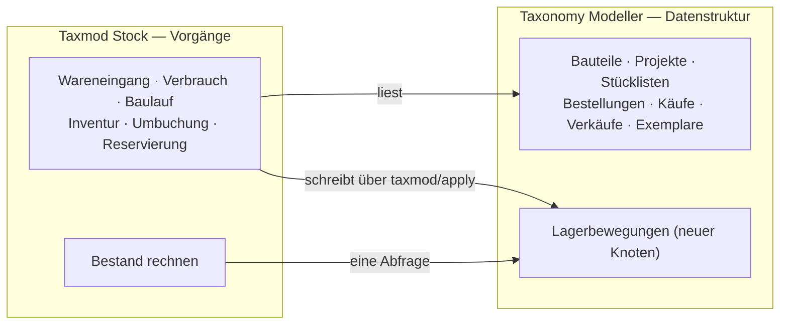
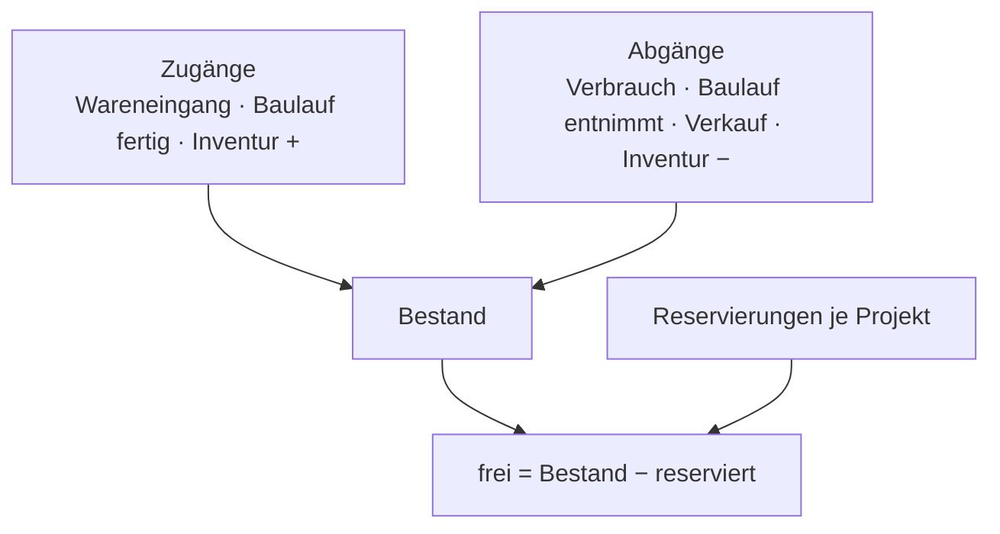

# Paket · Lager («Taxmod Stock») — Konzeptentwurf

**Stand 2026-10-20. Entwurf, nichts entschieden, nichts gebaut.** Aus [INF-073](../../neues-konzept-eingang.md#inf-073--bestand-und-fertigung-vom-wareneingang-über-die-platine-zum-verkauf)
und [INF-075](../../neues-konzept-eingang.md#inf-075--prozesse-und-formulare-im-modell-anlegen). Was er entscheiden soll, steht in §8;
alles andere ist mein Vorschlag (`INFERRED`), bis es eine `D-<nnn>` hat (`PR-3`).

> *«habe mir das schon irgendwie mehr all umfassender vorgestellt. Verbrauchen und We als aktion prozess, ich überlege aber weil tax
> eigentlich nur datenstruktur ist ob es hier ein tax stock modul oder sowas braucht»* — der Eigentümer, 2026-10-20

---

## 1 · Der Schnitt: Modell hält Daten, Modul hält Vorgänge

- **Der Modeller bleibt, was er ist:** Struktur und Sätze. Er rechnet nicht und kennt keine Abläufe.
- **Das Modul besitzt die Vorgänge:** Masken, Regeln, Prüfungen und die Rechnung «Bestand». Es schreibt **nur** über denselben Weg wie
  jede andere Änderung ([D-911](../../NewConcept/90-decision-log.md): eine Handlung, eine Änderungsnummer, alles oder nichts).
- **Die Buchungen sind Sätze im Modell**, nicht in eigenen Tabellen des Moduls. Damit gelten Sicherung ([D-908](../../NewConcept/90-decision-log.md)),
  Änderungsbuch, Block `taxmod/record` ([D-912](../../NewConcept/90-decision-log.md)) und Lesen über den Connector ohne neuen Code —
  und es gibt **einen** Ort je Tatsache (Code-Standard: *«One place owns each piece of state»*).
- **Muster wie bei Bestellungen und Verkäufen** ([D-933](../../NewConcept/90-decision-log.md), [D-934](../../NewConcept/90-decision-log.md)):
  ein Vorgang ist ein Satz mit Positionen.

## 2 · Bestand = Summe der Bewegungen

- Keine gespeicherte Bestandszahl. Eine Bewegung trägt: Artikel, Menge (±), Datum, Art, Lagerort (`0..1`), Wert je Stück, Herkunft
  (Kaufposition, Projekt, Baulauf, Verkaufsposition — je `0..1`), Hinweis.
- **Inventur** schreibt keine Zahl, sondern die Differenz zwischen gezählt und gerechnet als Bewegung. Der Anfangsbestand ist eine
  Inventur «nach Bedarf» — so wie er es beschrieben hat: erfasst wird, wenn ein Bau ansteht, nur für dessen Teile.
- Gerechnet wird in **einer** Abfrage für alle Artikel einer Seite (`CD-7`).

## 3 · Die Vorgänge

| Vorgang | Auslöser | Was entsteht |
|---|---|---|
| **Wareneingang** | eine Bestellung ([D-933](../../NewConcept/90-decision-log.md)) als eingegangen markieren — ganz oder Position für Position (Teillieferung); oder frei, ohne Bestellung | Zugang je Position, Wert = Einstandspreis je Stück |
| **Verbrauch** | frei: Artikel, Menge, optional Projekt | Abgang |
| **Baulauf** | Projekt + Stückzahl: Stückliste × Anzahl wird entnommen; fertig gemeldet | Abgänge der Teile, Zugang der Platine/des Geräts mit **Selbstkosten = Summe der entnommenen Werte** |
| **Verkauf** | Verkaufsposition ([D-934](../../NewConcept/90-decision-log.md)) | Abgang; Einstandspreis je Stück kommt aus dem Bestand statt von Hand |
| **Inventur** | gezählte Menge eintragen | Differenzbewegung |
| **Umbuchung** | Lagerort wechseln | Abgang + Zugang, Summe 0 |
| **Reservierung** | Projekt reserviert Menge; aufteilbar zwischen Projekten | kein Bestand, nur «frei» sinkt |
| **Bedarf** | Stückliste gegen «frei» | Liste «fehlt» → Bestellvorschlag (Entwurf einer Bestellung) |

## 4 · Was ein Lagerartikel ist

Vorschlag: **jeder Satz eines Knotens, an dem die Zusatzfunktion «Lager» gewählt ist** — der vorhandene Mechanismus für «Verhalten,
das man an einer Stelle anschaltet» ([D-845](../../NewConcept/90-decision-log.md), `src/Core/Addon/`). Zuerst an «Electronic Parts»,
später an Projekten/Platinen. Kein zweiter Mechanismus, kein Sonderfall nach Knotennamen.

Exemplare (Einzelstücke) bleiben, was sie sind: ein Baulauf kann je gebautem Stück ein Exemplar anlegen, statt eine Menge zu buchen.

## 5 · Bewertung

Vorschlag: **gleitender Durchschnitt** — ein Abgang wird mit dem Durchschnittswert des Bestands zu diesem Zeitpunkt bewertet.
Einfach, reicht für Selbstkosten und Verkaufspreis. FIFO wäre genauer bei schwankenden Preisen, kostet aber eine Zuordnung
Abgang → Zugang.

## 6 · Wo es läuft

- **Zuerst:** eine Admin-Seite «Lager» mit den Masken aus §3 und einer Bestandsliste (filterbar, «unter Mindestbestand», «fehlt für Projekt X»).
- **Über den Connector:** dieselben Vorgänge als Abilities (`taxmod-stock/receive`, `…/consume`, …), damit Claude Wareneingänge aus
  Bestellmails buchen kann — wie heute `taxmod/apply`.
- **Im Beitrag:** eine Zeile «Bestand» am Bauteil über den vorhandenen Block; ein eigener Block erst, wenn er gebraucht wird.

## 7 · Verhältnis zu INF-075 (Prozesse und Formulare)

Das Lager ist der **erste konkrete Prozess**. Vorschlag: es als Code zu bauen und den allgemeinen Mechanismus «Prozesse als Daten»
erst danach aus zwei, drei echten Fällen abzuleiten — nicht vorher auf Vorrat.

Die geplanten Ereignisse (PSR-14, [D-631](../../NewConcept/90-decision-log.md)–[D-633](../../NewConcept/90-decision-log.md))
wären der saubere Andockpunkt (z. B. «Bestellung eingegangen» → Wareneingang anbieten). Sie sind nicht gebaut; das Modul braucht sie für
Stufe 1 nicht.

## 8 · Was er entscheiden soll

| | Frage | Mein Vorschlag |
|---|---|---|
| **F1** | Eigenes Modul? Als eigenes Plugin (eigenes Repo, setzt den Modeller voraus) oder als abgegrenzter Teil im Modeller-Plugin? | **eigenes Plugin** — eigene Version, eigener Takt, der Modeller bleibt schlank. ⚠️ *Er hat am 2026-10-20 das Repo [`sfambach/wp_tax_stock`](https://github.com/sfambach/wp_tax_stock) angelegt — ein deutliches Zeichen, aber noch keine `D-<nnn>`.* |
| **F2** | Buchungen als Sätze im Modell oder in eigenen Tabellen des Moduls? | **Sätze im Modell** (§1) |
| **F3** | Lagerartikel: nur Bauteile oder jeder Knoten mit Zusatzfunktion «Lager»? | **Zusatzfunktion**, zuerst an Bauteilen |
| **F4** | Bewertung: Durchschnitt oder FIFO? | **Durchschnitt** |
| **F5** | Lagerorte von Anfang an? | **ja, als `0..1`** — leer erlaubt, später nachrüsten kostet einen Umbau aller Bewegungen |
| **F6** | Reihenfolge | Stufe 1: Wareneingang, Verbrauch, Inventur, Bestandsliste · Stufe 2: Reservierung, Bedarf, Bestellvorschlag · Stufe 3: Baulauf mit Selbstkosten, Verkauf als Abgang · Stufe 4: Mindestbestand, Umbuchung |

## 9 · Annahmen, die das Konzept nicht sagt

- Die Bestellung «Bestand» mit zehn Teilen (2026-10-19) wird in Stufe 1 zur Inventur/Anfangsbestand umgedeutet; die Bestellung selbst bleibt als Satz stehen oder wird entfernt — **seine Wahl**.
- Mengen sind ganze Stück. Meterware (Draht, Lötzinn) braucht eine Einheit je Artikel — offen.
- Ein Abgang darf den Bestand nicht unter 0 drücken; die Maske warnt, sperrt aber nicht (Bestand ist oft nicht gepflegt).
