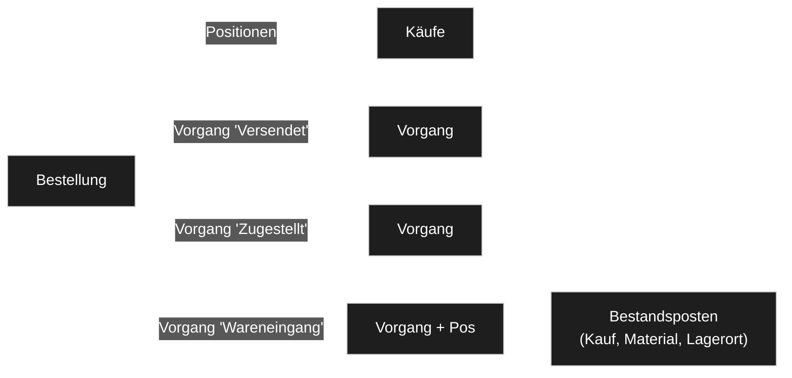
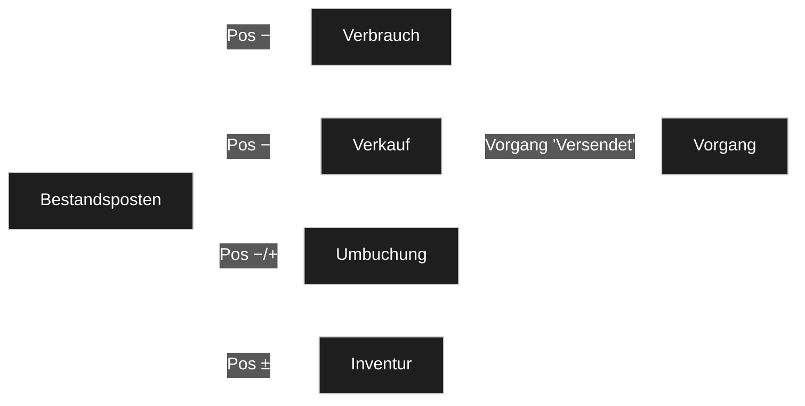
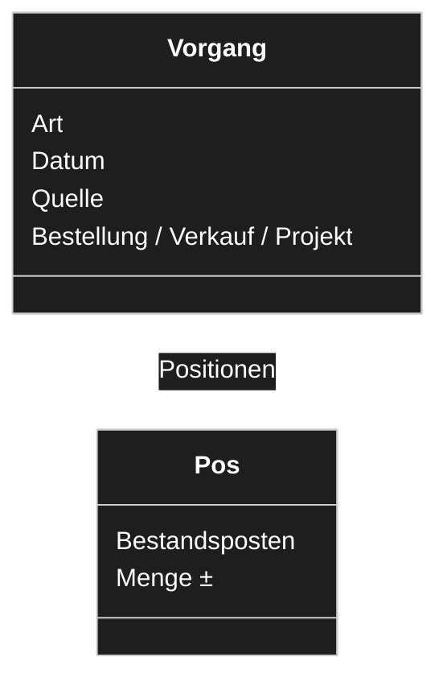
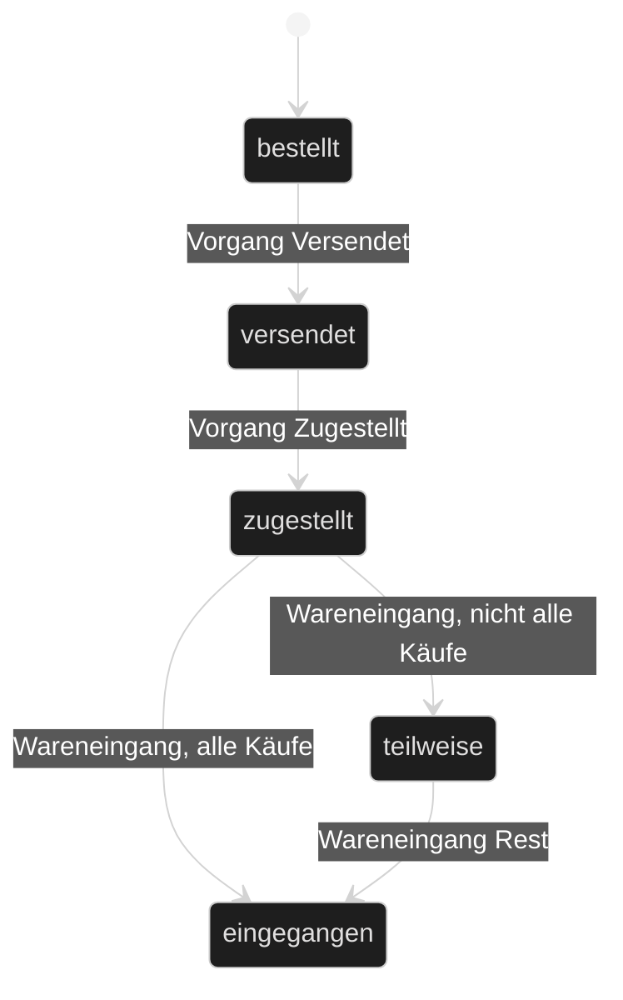
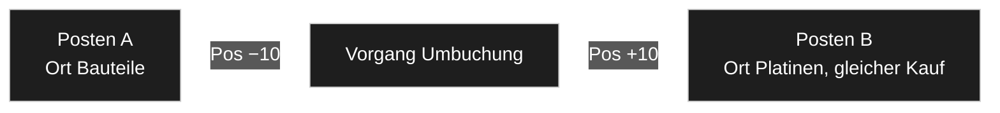
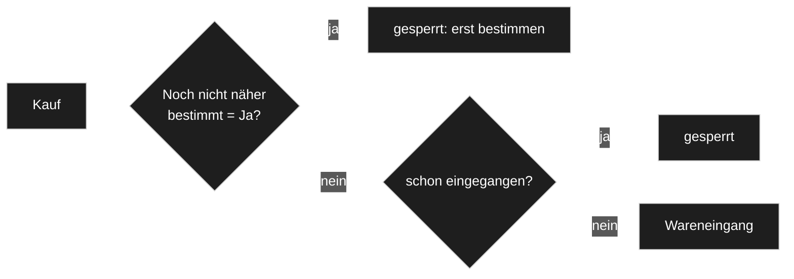
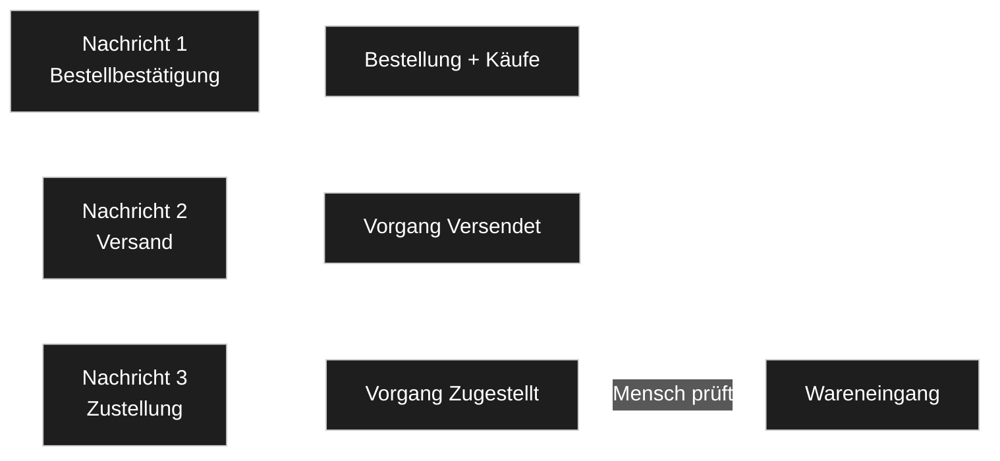

# Lager: Prozesse, Belegfluss und Bewegungen

*Entwurf vom 2026-10-23, Thread «Taxmod Stock – Lagermodul». Gehört zu [`konzept.md`](konzept.md). Nichts hier ist entschieden,
was nicht eine `D-<nnn>` trägt. Die offenen Punkte stehen am Ende als «Fragen an Stefan» und im Eingang als
[INF-087](../../neues-konzept-eingang.md) bis [INF-092](../../neues-konzept-eingang.md).*

**Sein Auftrag** (23.10., Interface-Thread):

> *«hätte eher eine box mit allen updates in der reihenfolge wie sie aufgetreten sidn erwartet und dann werden alle nacheinander
> eingespielt up das tracking zu haben»* — *«ja bitte möchte die bewegungen tracken vielleicht kannst du das allemein als
> bewegungstabelle abliegen in die wir auch interne bewegungen schreiben ?»* — *«vielleicht sollte das lager mal die prozesse
> konzipieren 🙂»* — *«die belegflüsse und so»*

**Der Kern in einem Satz:** Es gibt **eine** Bewegungstabelle, und das ist die schon gebaute Tabelle **«Vorgänge»**. Jedes Ereignis,
ob Lieferung oder intern, ist ein Vorgang mit Art, Datum und Quelle. Ein Vorgang, der Mengen bewegt, hat Positionen. Ein Vorgang, der
nur einen Zustand meldet (versendet, zugestellt), hat keine.

---

## LP1 — Der Belegfluss beim Einkauf



Eine Bestellung hält ihre Käufe als Positionen ([D-933](../../NewConcept/90-decision-log.md): *«der Knoten «Bestellungen» … verweist
mit «Positionen» (0..*) auf «Käufe»»*). Alles, was danach mit der Bestellung geschieht, ist ein **Vorgang**, der mit seinem Feld
«Bestellung» auf sie zeigt. Erst der Wareneingang legt Bestand an: je gebuchtem Kauf einen Bestandsposten
([D-956](../../NewConcept/90-decision-log.md): *«Jeder Zugang legt einen Posten an (Material, Kauf 0..1, Lagerort, Wert je Stück)»*).

Die Reihenfolge der Belege ist also: **Bestellung → Käufe → (Versendet) → (Zugestellt) → Wareneingang → Bestandsposten**. Die
gestrichelten Schritte sind Meldungen; sie kommen, wenn ein Händler sie schickt, und fehlen sonst.

**gebaut:** Bestellung, Käufe, Wareneingang, Bestandsposten ja (Modul 0.1.1–0.1.3). Vorgänge «Versendet» und «Zugestellt» nein.

---

## LP2 — Der Belegfluss nach dem Wareneingang



Jeder Abgang nennt den Posten, aus dem er kommt (D-956: *«jeder Abgang nennt seinen Posten»*). Ein Verkauf ist ein Vorgang mit
Feld «Verkauf», der auf «Verkäufe» zeigt ([D-934](../../NewConcept/90-decision-log.md)); sein Versand an den Käufer ist wieder nur eine
Meldung, gleich gebaut wie beim Einkauf.

**gebaut:** Verbrauch und Inventur ja (Modul). Verkauf als Abgang, Umbuchung als Vorgang, Versand eines Verkaufs nein.

---

## LP3 — Eine Bewegungstabelle: «Vorgänge»



Die Tabelle, die er sich wünscht, gibt es schon: «Vorgänge» (Knoten `149000110149`) mit Art, Datum, Bestellung, Projekt, Quelle und
Positionen ([`konzept.md` §3.5](konzept.md#35-vorgänge-und-vorgänge-pos--der-kern)). Live stehen dort 40 Sätze, 39 davon
Wareneingänge (Stand 23.10.). Eine zweite Tabelle daneben würde dieselbe Bewegung zweimal halten (Code-Standard: *«One place owns
each piece of state»*).

Zwei Sorten Vorgang, eine Tabelle:

| Sorte | Hat Positionen? | Arten (heute) | Arten (neu, offen) |
|---|---|---|---|
| **Mengenbewegung** | ja | Wareneingang, Verbrauch, Baulauf-Entnahme, Baulauf-Zugang, Verkauf, Zerlegung, Inventur, Umbuchung | – |
| **Meldung** | nein | – | Versendet, Zugestellt ([INF-087](../../neues-konzept-eingang.md)) |

Damit steht an **einer** Stelle, in Datumsfolge, alles, was einer Bestellung, einem Verkauf oder einem Posten passiert ist: das ist
die «box mit allen updates in der reihenfolge wie sie aufgetreten sind».

**gebaut:** Tabelle ja, Arten der Mengenbewegung ja (Konstanten `149000110122`–`149000110129`). Meldungsarten nein.

---

## LP4 — Der Zustand einer Bestellung kommt aus ihren Vorgängen



Heute hat «Bestellungen» ein gespeichertes Feld **Status** (Feld `149000110134` → Bestellstatus `149000110136`: Entwurf, bestellt,
teilweise eingegangen, eingegangen, storniert; angelegt mit Stufe 1 am 21.10.). Das Modul setzt es beim Wareneingang. Der Zustand
liesse sich aber auch aus dem letzten Vorgang ablesen, dann stünde er nicht zweimal.

Mein Vorschlag ([INF-088](../../neues-konzept-eingang.md)): **Status bleibt gespeichert, und nur der Vorgang setzt ihn**, im selben
Schreibakt. Gerechnete Felder kann der Modeller heute nicht ([INF-081](../../neues-konzept-eingang.md) ist offen); die Liste der
Bestellungen soll den Status aber ohne Modul zeigen. Die Werte «versendet» und «zugestellt» fehlen im Bestellstatus und kämen dazu.

**gebaut:** Status-Feld ja, gesetzt beim Wareneingang ja; «versendet»/«zugestellt» nein.

---

## LP5 — Interne Bewegungen



Intern bewegt sich Ware auf vier Wegen, alle als Vorgang:

| Vorgang | Positionen | Quelle im Konzept |
|---|---|---|
| **Umbuchung** zwischen Lagerorten ([D-972](../../NewConcept/90-decision-log.md)) | − am alten Posten, + an einem neuen mit gleicher Herkunft | `konzept.md` §4 |
| **Verbrauch / Entnahme** | − am Posten, optional Projekt | §4 |
| **Baulauf** | Entnahme − je Stücklistenteil, Zugang + des fertigen Artikels | §3.7 |
| **Zerlegung** | Einzelstück −1, gewonnene Teile + | §4 |
| **Inventur** | Differenz gezählt − Bestand | §4 |

⚠️ **Ein Widerspruch zu seinem Wunsch:** `konzept.md` §4 sagt für die Umbuchung eines **ganzen** Postens: *«Lagerort ändern»* — ohne
Vorgang. Dann bleibt keine Spur. So sind am 22.10. die 83 JLC-Posten nach «Platinen» gewandert: nur der Lagerort wurde geändert, im
Verlauf des Postens steht es nur als Änderung im Protokoll, nicht als Bewegung. Mein Vorschlag ([INF-089](../../neues-konzept-eingang.md)):
**jede Umbuchung ist ein Vorgang**, auch der ganze Posten — dann mit −n am alten und +n an einem neuen Posten.

**gebaut:** Verbrauch, Inventur ja; Umbuchung, Baulauf, Zerlegung nein.

---

## LP6 — Sperren vor dem Wareneingang



Drei Regeln, alle aus seinem Konzept vom 21.10. (`konzept.md` §3.5a, R1–R4):

- **R1, gebaut:** Ein Kauf mit «Noch nicht näher bestimmt» = Ja (Feld `149000110102`) geht nicht in den Wareneingang. Das Modul sperrt
  ihn in der Maske und auf dem Server.
- **Schon eingegangen, gebaut:** Ein Kauf, der schon einen Bestandsposten hat, wird nicht ein zweites Mal gebucht.
- **R2, entschieden, gebaut:** Teil-Wareneingang über Käufe ist erlaubt (D-956: *«Teil-Wareneingang ist erlaubt: bestimmte Käufe einer
  Bestellung werden gebucht, während andere noch unbestimmt sind»*). Die Bestellung steht dann auf «teilweise eingegangen».

Offen ist eine **Teilmenge innerhalb eines Kaufs** (50 bestellt, 30 geliefert). `konzept.md` §3.4 sieht dafür ein Feld «Eingegangen»
am Kauf vor; gebaut ist es nicht ([INF-090](../../neues-konzept-eingang.md)).

---

## LP7 — Was der Eingang je Nachricht schreibt



Der Eingang spielt die Nachrichten einer Bestellung schon nacheinander ein ([D-980](../../NewConcept/90-decision-log.md): *«jede
Nachricht mit Sendungsnummer, Zustellung oder Versand ein eigener Schreibvorgang … Datum ist das der Nachricht»*). Heute schreibt er
dabei nur Felder der Bestellung (Sendungsnummer, «Eingegangen am»). Vorgeschlagen ist: **je Nachricht zusätzlich ein Vorgang**, im
selben Akt.

Eine Zustellung bucht **keinen** Wareneingang von selbst ([INF-091](../../neues-konzept-eingang.md)): zugestellt heisst «der Karton
ist da», nicht «die Käufe sind bestimmt und eingelagert». Der Wareneingang bleibt ein Schritt, den er im Lager-Reiter auslöst — dort
greifen die Sperren aus LP6 und der Lagerort-Vorschlag aus D-972.

Was der Eingang dafür braucht:

```text
SKETCH — Ziel-Ids für den Eingang (live gelesen 2026-10-23; die mit «neu» gibt es noch nicht)

Vorgänge            Knoten 149000110149
  Art               Feld   149000110124 → Vorgangsarten 149000110121
                           neu: «Versendet», «Zugestellt»
  Datum             Feld   149000110125   = Datum der Nachricht
  Bestellung        Feld   149000110126
  Quelle            Feld   149000110129 → Buchungsquellen 149000110142
                           von Hand 149000110143 · Mail-Import 149000110144 · Connector 149000110145
  Sendungsnummer    neu    Text 0..1 (INF-092)
  Meldungstext      neu    Text 0..1 (INF-092)
Bestellungen        Status Feld 149000110134 → Bestellstatus 149000110136
                           neu: «versendet», «zugestellt» (INF-088)
```

**gebaut:** nein.

---

## LP8 — Stand je Stufe

| Stufe | Was | gebaut |
|---|---|---|
| Bestellung, Käufe | Belege des Einkaufs ([D-933](../../NewConcept/90-decision-log.md)) | ja |
| Meldungen Versendet / Zugestellt | Vorgänge ohne Positionen | nein |
| Wareneingang | Vorgang + Pos + Bestandsposten, Sperren R1/R2, Lagerort nach Typ | ja (Modul 0.1.3) |
| Teilmenge je Kauf | Feld «Eingegangen» | nein |
| Verbrauch, Inventur | Vorgang + Pos − / ± | ja (Modul) |
| Umbuchung als Vorgang | − alter Posten, + neuer Posten | nein |
| Verkauf als Abgang + Versand | Vorgang Verkauf mit Pos −, Meldung Versendet | nein |
| Baulauf, Zerlegung | `konzept.md` §3.7, §4 | nein |
| Geräte als Exemplare | Preis, Datum, Garantie ([D-972](../../NewConcept/90-decision-log.md)) | nein |

---

## Fragen an Stefan

1. **Lieferereignisse** (versendet, zugestellt) als Vorgänge ohne Positionen in derselben Tabelle «Vorgänge»? — *Empfehlung: ja.* ([INF-087](../../neues-konzept-eingang.md))
2. **Bestellstatus** gespeichert lassen und nur vom Vorgang setzen (plus «versendet», «zugestellt»), oder nur aus den Vorgängen rechnen? — *Empfehlung: gespeichert, vom Vorgang gesetzt.* ([INF-088](../../neues-konzept-eingang.md))
3. **Umbuchung** immer als Vorgang mit Positionen, auch wenn ein ganzer Posten umzieht? — *Empfehlung: ja.* ([INF-089](../../neues-konzept-eingang.md))
4. **Teilmenge je Kauf** (30 von 50 geliefert) erlauben? — *Empfehlung: ja, mit Feld «Eingegangen» am Kauf.* ([INF-090](../../neues-konzept-eingang.md))
5. **Zustellung** bucht den Wareneingang nicht von selbst, er bleibt dein Schritt im Lager? — *Empfehlung: ja.* ([INF-091](../../neues-konzept-eingang.md))
6. **Neue Felder am Vorgang:** Sendungsnummer und Meldungstext? — *Empfehlung: ja, beide.* ([INF-092](../../neues-konzept-eingang.md))
7. **Chargen bei Platinen:** Ist der Bestandsposten die Charge (ein Posten je Kauf, also je Bestellung und Version), mit der Bestellnummer (z. B. JLC W…) als angezeigter Chargennummer, ohne eigenes Feld? — *Empfehlung: ja.* Sein Wunsch: *«für platinen bräuchten wir auch chargen glaube ich gleich version 2 bestellungen andere charge»*. ([INF-093](../../neues-konzept-eingang.md))

## Annahmen

- **Quelle «API» fehlt.** Die Buchungsquellen kennen von Hand, Mail-Import und Connector. Die API-Module (JLC, eBay) bräuchten eine
  eigene Quelle oder schreiben als «Connector». Nicht entschieden; nicht als Frage gestellt, weil es den Ablauf nicht ändert.
- **Ein Vorgang je Nachricht**, nicht je Bestellung: eine Bestellung mit zwei Paketen hat zwei «Versendet».
- **Sendungsnummer bleibt auch an der Bestellung** (D-933, 0..*); am Vorgang steht, mit welcher Meldung sie kam.
- **«Verkauf → Versand»** ist gleich gebaut wie beim Einkauf und hat darum keine eigene Frage.
- **Abweichung zum Interface-Thread:** Dort hiess es, der Bestellstatus `149000110136` hänge an keinem Feld der Bestellungen. Er hängt
  am Feld «Status» (`149000110134`), angelegt mit Stufe 1 am 21.10. (`stufe1-stock.json`, Änderung 60), und das Modul setzt ihn beim
  Wareneingang.
