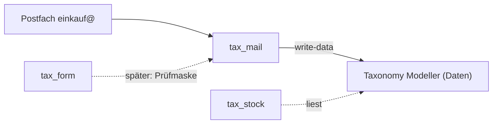
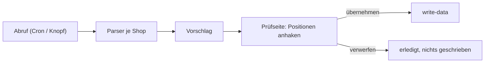
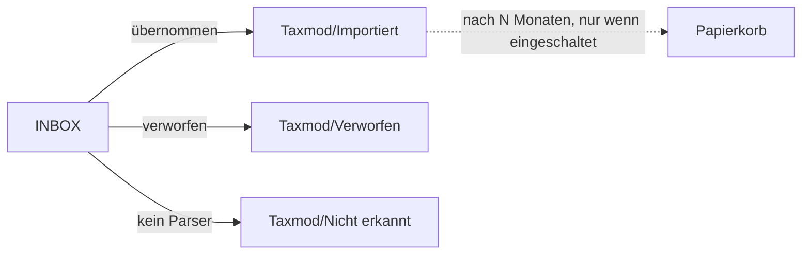
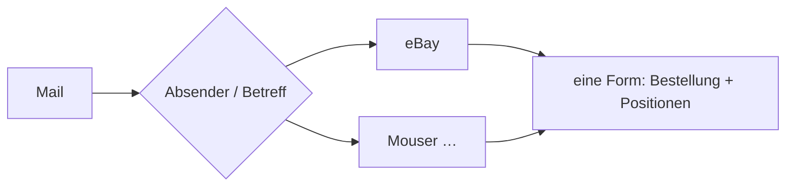

# Paket · Mail-Import («tax_mail») — Konzeptentwurf

**Stand 2026-10-20. M1–M8 entschieden: [D-942](../../NewConcept/90-decision-log.md). Gebaut: 0.0.1, nicht veröffentlicht, nicht installiert** (§11). Aus [INF-075](../../neues-konzept-eingang.md#inf-075--prozesse-und-formulare-im-modell-anlegen)
(Fall «Eingang prüfen», Mail-Import in WordPress). Was er entscheiden soll, steht in §9; alles andere ist mein Vorschlag (`INFERRED`),
bis es eine `D-<nnn>` hat (`PR-3`). Code des Moduls: [`sfambach/wp_tax_mail`](https://github.com/sfambach/wp_tax_mail) (von ihm angelegt am 2026-10-20).

**Seine Worte, auf denen der Entwurf steht (alle 2026-10-20):**

> *«woher weiss ich denn das ein gerade bestelltes teil nun in der db ist»* — *«und evtl will ich ja nicht alle positonen in die db übernehmen»*

> *«alleine in wp können wir das aber nicht machen wir brauche immer den python translator oder»*

> *«angeblich geht imap auf starto es wird ein wp modul empfolen oder eigenes skript das bin ich unsclüssig was sinnvoller ist»*

> *«neuer thread neues modul können wir getrennt von allen andern implementieren oder tax_mail module»*

⚠️ **Widerspruch zu einem offenen Vorschlag:** das Lager-Konzept ([`../lager/konzept.md`](../lager/konzept.md) §5, Frage F5) legt den
Mail-Import ins Lager-Modul. Sein letzter Satz oben sagt «getrennt». Dieser Entwurf folgt ihm; F5 wäre damit erledigt (M1).

⚠️ **Nicht gelesen:** den Python-Importer `kaeufe-import` auf Earth habe ich nicht gesehen. Was hier über ihn steht, stammt aus den
Chats: fünf Shop-Parser (eBay, Mouser, Reichelt, Conrad, AliExpress) und JLCPCB, Postfach `einkauf@fambach.net`, schreibt über
`taxmod/write-data` ([D-936](../../NewConcept/90-decision-log.md)) ohne Rückfrage.

---

## 1 · Was das Modul ist — und was nicht

- **tax_mail holt Bestellmails, erkennt sie und schlägt Sätze vor.** Geschrieben wird erst, wenn er es auswählt.
- **Es besitzt keine Daten des Bestands.** Bestellungen, Käufe, Verkäufe bleiben Sätze im Modeller ([D-933](../../NewConcept/90-decision-log.md), [D-934](../../NewConcept/90-decision-log.md)).
- **Es kennt das Lager nicht.** Ein Wareneingang aus einer Zustellmail ist Sache von tax_stock; tax_mail meldet nur «Bestellung X
  ist eingegangen» (§7).
- Eigenes Plugin wie tax_stock, setzt den Modeller voraus, läuft ohne ihn nicht.

## 2 · Ablauf

1. **Abruf:** nur neue Mails seit dem letzten Lauf (IMAP-UID merken), §3–§4.
2. **Parser:** je Absender ein Parser, liefert Bestellung + Positionen in **einer** Form, egal welcher Shop (§5).
3. **Vorschlag:** wird abgelegt, nicht geschrieben (§6). Ist die Bestellnummer schon im Modell, steht das am Vorschlag.
4. **Prüfseite:** je Vorschlag die Positionen mit Haken «übernehmen». Bestellkopf kommt mit, sobald eine Position übernommen wird.
5. **Schreiben:** eine Änderungsliste an `taxmod/write-data`, alles oder nichts, als der angemeldete Benutzer.
6. **Unbekannte Mail** (kein Parser passt): landet als Vorschlag «nicht erkannt» mit Betreff und Absender, damit nichts verschwindet.

## 3 · IMAP auf Strato

- **PHP-Erweiterung `imap` gibt es nicht mehr** (seit PHP 8.4 ausgelagert; fambach.net läuft auf 8.5).
- **Vorschlag: reine PHP-Bibliothek** über Composer, die IMAP selbst über eine TLS-Verbindung spricht (Kandidat `webklex/php-imap`,
  Version und Abhängigkeiten **nicht geprüft**). Kein fremdes WordPress-Plugin: die bekannten (z. B. Postie) machen Beiträge aus
  Mails, keine Taxmod-Sätze — Parser und Schreiben müssten wir trotzdem bauen.
- **Gebaut (0.0.1), Abweichung vom Vorschlag oben, nicht entschieden:** statt `webklex/php-imap` ein eigener kleiner IMAP-Client
  (`src/Core/Imap`, sieben Befehle). Grund: die Bibliothek zieht Carbon, Symfony HttpFoundation und Illuminate Pagination nach —
  Pakete, die andere Plugins in anderer Version laden können, und WordPress hat keine Trennung dafür. Zurück zur Bibliothek ist
  ein Tausch hinter einer Schnittstelle (`ImapStream`/`ImapClient`).
- **Ob Strato ausgehende Verbindungen auf Port 993 zulässt, ist ungeprüft.** Erster Bauschritt ist darum ein Knopf
  «Verbindung testen» auf der Einstellungsseite, sonst nichts. Geht es nicht, ist das Konzept an dieser Stelle zu Ende (M3).
- **Zugangsdaten:** Vorschlag in `wp-config.php` als Konstanten, nicht in der Datenbank — dann stehen sie in keiner Sicherung und
  keinem Änderungsbuch (M4).
- **Mails werden nicht gelöscht** — aufgeräumt wird durch Verschieben, siehe §3a.

## 3a · Postfach aufräumen

> *«was noch fehlt ist aufräumen des postfachs das sollten wir gleich mitandenken»* (2026-10-20)

- **Der Abruf verschiebt nichts.** Erst wenn er einen Vorschlag erledigt (übernommen oder verworfen), wandert die Mail in den
  passenden Ordner. Die INBOX zeigt damit genau das, was noch offen ist.
- **Nicht erkannte Mails** wandern sofort nach «Nicht erkannt»; dort sieht er, für welchen Shop ein Parser fehlt.
- **Werbung und Newsletter** desselben Shops (kein Bestellbezug) erkennt der Parser als «kein Beleg» und schiebt sie nach «Verworfen».
- **Löschen nur als eigene Einstellung, standardmässig aus:** Mails in «Importiert»/«Verworfen», älter als N Monate, in den
  Papierkorb des Postfachs — nie endgültig. Rechnungen können steuerlich aufbewahrungspflichtig sein; darum bleibt es aus, bis er
  es einschaltet.
- **Ordnernamen** in den Einstellungen; das Modul legt fehlende Ordner beim «Verbindung testen» an.
- **Der Altbestand** (Mails, die der Python-Importer schon verarbeitet hat): ein einmaliger Lauf «Altbestand einsortieren», der
  jede Mail, deren Bestellnummer schon im Modell steht, nach «Importiert» schiebt — ohne Vorschlag.

## 4 · Auslöser

- **WP-Cron, einmal täglich**, und per Knopf von Hand — sein Wort 2026-10-20: *«einmal täglich reicht eigentlich und per knopf manuell auslösbar»*. Der Rhythmus ist in den Einstellungen wählbar (aus, stündlich, 2× täglich, täglich): *«ich würde sagen das machen wir einstellbar in der admin config zum modul»*. Höchstens 60 Mails je Lauf, passt zu Stratos Zeitlimits.
- WP-Cron läuft nur bei Seitenaufrufen; bei gecachten Seiten (WP Super Cache) seltener. Darum zusätzlich **Knopf «Jetzt abrufen»**
  auf der Prüfseite. Ein echter Server-Cron bei Strato wäre besser, ob sein Paket ihn hat, ist ungeprüft.

## 5 · Parser

- **Die sechs Python-Parser werden nach PHP übersetzt** — der grösste Brocken. Je Shop eine Klasse hinter einer Schnittstelle
  (`erkennt(Mail): bool`, `lies(Mail): Bestellvorschlag`).
- **Prüfbar machen:** je Shop echte Beispielmails als Testdaten, **anonymisiert** (Name, Adresse, Telefon raus), im Repo. Der
  PHP-Parser muss dasselbe liefern wie der Python-Parser heute — das ist der Test.
- **Arten von Mails:** Bestellbestätigung → Bestellung «bestellt» mit Käufen; Versand-/Zustellmail → Status der vorhandenen
  Bestellung; eBay-Verkauf → Verkauf mit Positionen. Welche davon der Python-Importer heute erkennt, weiss ich nicht (siehe oben).

## 6 · Wo ein Vorschlag liegt

| | A · eigene Tabelle im Modul | B · Satz im Modell, Status «Vorschlag» | C · `wp_options` |
|---|---|---|---|
| Bestand bleibt sauber | **ja** | nein, verworfene Vorschläge liegen zwischen den Daten | ja |
| braucht Code im Modeller | nein | ja (Status ausblenden, Rechte) | nein |
| viele Mails | gut | gut | schlecht (eine grosse Option) |

**Vorschlag: A.** Ein Vorschlag ist kein Bestand, sondern Eingang — wie sein Einwand zu Formularen: «hat nichts mit dem Datenbestand
zu tun». Tabelle `wp_taxmail_proposals` (Mail-UID, Shop, Bestellnummer, Status offen/übernommen/verworfen/nicht erkannt, die
erkannte Bestellung als JSON, Ids der geschriebenen Sätze). AR-1 betrifft das Modell, nicht den Eingang eines Moduls.

## 7 · Schnittstellen zu den anderen Modulen

- **Modeller:** schreibt nur über `taxmod/write-data` (im selben PHP-Prozess über die Abilities-API, als der angemeldete Benutzer;
  ein Admin darf das schon). Liest Bestellnummern über `taxmod/read-tree`/`read-node`, um Doppeltes zu erkennen. **Ziel-Knoten
  (Bestellungen, Käufe, Verkäufe) werden in den Einstellungen gewählt, nicht im Code fest** — der Baum wird gerade umgebaut
  ([D-940](../../NewConcept/90-decision-log.md)), die Ids können wandern.
- **tax_form:** die Prüfseite ist erst eine eigene Admin-Seite von tax_mail. Steht tax_form, kann sie ein Formular «Eingang
  prüfen» werden; bis dahin keine Abhängigkeit (M6). Abstimmung im Thread zum Lager-Modul.
- **tax_stock:** tax_mail löst nach dem Schreiben ein Ereignis aus (WordPress-Action, z. B. `taxmail_order_written`,
  `taxmail_order_delivered`). tax_stock kann daraus einen Wareneingang vorschlagen. tax_mail ruft tax_stock nie direkt auf.

- **tax_ebay** (eBay-API, `docs/pakete/ebay/konzept.md`): eBay-Käufe und -Verkäufe kommen über die API, tax_mail lässt
  eBay-Mails aus — abgestimmt mit jenem Thread, nicht entschieden (M7). Vorbehalt: ob die API Käufe eines privaten Kontos liefert,
  ist ungeprüft; sonst bleibt der eBay-Parser für Käufe hier. Doppelte erkennen beide über Plattform + Bestellnummer. **Das
  Vorschlagsformat (Bestellung + Positionen) ist in beiden Modulen gleich**, damit eine Prüfseite beide zeigen kann.

## 8 · Übergang von Earth

- Der Python-Importer läuft weiter, bis tax_mail für einen Shop dasselbe liefert. **Beide gleichzeitig schreiben lassen nicht** —
  sonst doppelte Bestellungen. Umschalten je Shop oder alles auf einmal (M7).
- Der Python-Code kommt als Vorlage (nicht als laufender Teil) in das neue Repo unter `legacy/`, ohne Mails und Belege (M8).

## 9 · Was er entscheiden soll

| | Frage | Mein Vorschlag |
|---|---|---|
| **M1** | tax_mail als eigenes Plugin, getrennt vom Lager; Lager-F5 entfällt | **ja** |
| **M2** | Neue Bestellungen nur als Vorschlag, schreiben erst nach Auswahl je Position | **ja** |
| **M3** | IMAP per PHP-Bibliothek in WordPress, erster Schritt nur «Verbindung testen» | **ja** |
| **M4** | Zugangsdaten in `wp-config.php` statt in der Datenbank | **ja** |
| **M5** | Vorschläge in eigener Tabelle des Moduls (§6 A) | **ja** |
| **M6** | Prüfseite zuerst eigene Admin-Seite, später Formular aus tax_form | **ja** |
| **M7** | Umstellung von Earth: je Shop oder alles auf einmal | **je Shop**, Reichelt/Mouser zuerst; eBay erst nach Abgrenzung zum Modul `wp_tax_ebay` (eBay-API), sonst kommen eBay-Käufe doppelt |
| **M8** | Python-Code als Vorlage ins Repo (`legacy/`, ohne Mails) | **ja** |
| **M9** | Postfach aufräumen nach §3a: Verschieben in Ordner, Löschen nur optional (Papierkorb, aus) | **ja** |

## 10 · Annahmen, die das Konzept nicht sagt

- Ein Postfach (`einkauf@fambach.net`), ein Benutzer prüft (er).
- Beträge und Währungen wie heute im Python-Importer; Einheitenwert nach [D-929](../../NewConcept/90-decision-log.md), nicht neu erfunden.
- Doppelte Bestellung = gleiche Bestellnummer und gleicher Shop.
- Mails älter als der erste Lauf werden nicht nachgeholt, ausser er stellt ein Startdatum ein.

## 11 · Gebaut (0.0.1) und was dabei angenommen wurde

- **Gebaut:** IMAP-Client, Abruf (WP-Cron, Rhythmus einstellbar, Knopf), Vorschlagstabelle, Prüfseite «Eingang prüfen», Schreiben über
  `write-data`, Parser Reichelt, Mouser, Conrad, AliExpress, JLCPCB (aus `legacy/` übertragen), deutsche Oberfläche.
- **Geprüft:** Kern-Tests; Parser gegen den Python-Importer auf synthetischen Mails (gleiche Ergebnisse); Schreiben gegen ein lokales
  WordPress 7.1.3 mit dem Modeller. **Nicht geprüft:** Strato-Postfach, echte Shop-Mails.
- **Annahmen (`INFERRED`):**
  - ein Vorschlag je Mail, nicht je Bestellung wie im Python-Importer; eine Versandmail ergänzt eine vorhandene Bestellung
    (Sendungsnummer, «Eingegangen am»), oder bringt sie neu, wenn sie Positionen nennt (JLCPCB, Mouser);
  - Doppelte nur über Plattform + Bestellnummer; der Abgleich über Artikelnummern aus dem Python-Importer fehlt noch;
  - Conrad-Rechnungen, Stornos und Kundenservice-Mails werden angezeigt, aber nur verworfen;
  - Ziel-Ids (Knoten, Felder, Währungen, Pflichtteile) stehen als Vorgabe im Code und in der Option `taxmail_targets`.

