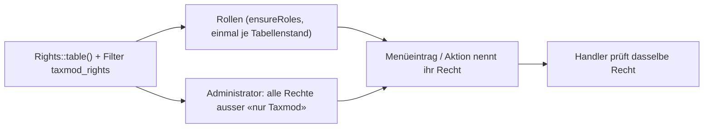

# Rechte und Rollen — Stufe 1 im Modeller

**Entscheidungen:** [D-1585](../../NewConcept/90-decision-log.md) (Rechte, Rollen, Tax-Benutzer), [D-1586](../../NewConcept/90-decision-log.md) (nur sichtbar, was erlaubt ist).
**Wächter:** `scripts/dev/rights-check.php`.

Eine Tabelle (`src/WordPress/Rights.php`) nennt jedes Recht; die Rollen tragen Rechte aus ihr. Der Administrator bekommt alle über `user_has_cap`, nicht als gespeicherte Fähigkeit — ein neues Recht braucht so keine Wanderung. Die Rollen werden beim Umbau je Release angelegt bzw. angeglichen (nur ihre `taxmod_*`-Fähigkeiten); keine Rolle wird gelöscht.

| Rolle | Rechte |
|---|---|
| Taxmod: Lager | view, write_data, stock_book |
| Taxmod: Einkauf | view, write_data, purchase |
| Taxmod: Fertigung | view, write_data, manufacture |
| Taxmod: Versand/Verkauf | view, write_data, sell, ship |
| Taxmod: Nur lesen | view |
| Datenschreiber ([D-936](../../NewConcept/90-decision-log.md)) | view, write_data |

## Welche Stelle welches Recht prüft

| Stelle | Recht |
|---|---|
| Modellseite (Menü «Taxonomy Modeller»), Knotenakte, eingebettete Knotenseite, Feldeinstellungen | model |
| Satzakte der Knotenseite (speichern, anlegen, verdoppeln, Variante, löschen, verschieben, Teile), Satzeditor in Modulen, Feldsteuerelemente, «Neuer Satz» im Wähler | write_data |
| Wähler (Knoten, Satz, Suche, Zweige), Satzfilter, Druckaufträge, Druck-Abilities, Lese-Abilities, `ModelDoor::catalogue` | view |
| Konfiguration (mit Druck- und Scanner-Reiter), Aufräumen, Sicherung, Änderungen, Regelseite, Hinweis zum Feldsiegel, Umbau-Fehlerhinweis, tägliche Sicherung | configure |
| Posteingang, Dokumente, automatische Übernahme | purchase |

Sammelaktionen: `ListPage::bulkBar()` nimmt je Aktion `[Beschriftung, Recht]`; ohne Recht wird sie nicht gezeichnet, und der Handler fragt `ListPage::mayAct()` mit derselben Liste.

## Angenommen (nicht im Beschluss)

- **A1** Der Datenschreiber bekommt «view» dazu — bisher durfte jeder Schreibende lesen; ohne das bräche `auto_einkauf`.
- **A2** Posteingang und Dokumente gehören zu «purchase» (sie legen Käufe an).
- **A3** Druck- und Scanner-Reiter sitzen in der Konfiguration und bleiben «configure»; das Drucken selbst ist «view».
- **A4** `Plugin::CAPABILITY` bleibt als Brücke für die Module (= «model», also wie bisher nur Administrator), bis jedes Modul sein Recht prüft (Stufe 3); der Wächter zählt die Stellen je Modul und lässt sie nur fallen.
- **A5** Rollennamen werden beim Anlegen in der Sprache der Website gespeichert (WordPress übersetzt Rollennamen nur in seiner eigenen Textdomäne).
