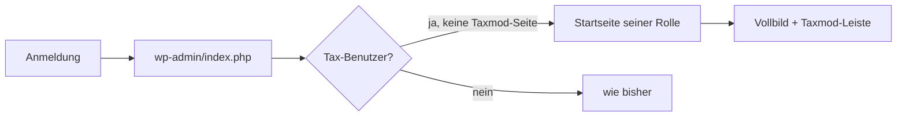

# Vollbild und Tax-Benutzer — Stufe 2

**Entscheidung:** [D-1585](../../NewConcept/90-decision-log.md) (3). **Wächter:** `scripts/dev/taxmod-user-check.php`.

- **Vollbild-Baustein** `Admin\FullScreen` im Modeller: ein Schalter je Person (Benutzer-Meta `taxmod_fullscreen`, Startwert aus dem bisherigen Lager-Schalter). Auf jeder Seite unter dem Taxmod-Menü verschwinden die WordPress-Leisten. Unten rechts steht die Taxmod-Leiste: Start, Meine Einstellungen, Profil, «Mit WordPress-Leisten» und Abmelden. Das Lager liest und schaltet denselben Schalter und behält nur seine eigene Spaltenlage.
- **Tax-Benutzer** `Admin\TaxmodUser`: Recht `taxmod_app_only`, per Haken im Profil eines anderen Benutzers (wer dessen Rollen ändern darf). Ein Administrator bekommt ihn nie. Nach der Anmeldung geht es nach `index.php`. Jede Nicht-Taxmod-Seite außer Profil und den Anfragen der Seiten (`admin-post`, `admin-ajax`, `async-upload`) leitet auf die Startseite. Der Tax-Benutzer hat keine Toolbar, auch nicht auf der Website, und kann das Vollbild nicht abschalten.
- **Startseite:** Module melden Einträge über `taxmod_start_pages` (Recht + Seite). Der erste Eintrag, dessen Recht die Person hat und dessen Seite sie öffnen darf, gewinnt. Sonst gilt die erste Taxmod-Seite, die sie öffnen darf, sonst das Profil. Das Lager meldet: Lager buchen → Bestand, Einkauf → Einkauf, Ansehen → Cockpit.
- **Meine Einstellungen:** das Modul, das sie zeichnet, meldet die Adresse über `taxmod_own_settings_url` (heute das Lager).

## Angenommen

- **B1** Die Leiste steht unten rechts, damit sie keine Kopfzeile einer Seite verdeckt.
- **B2** Bis die Module in Stufe 3 ihre Rechte prüfen, öffnen Lagerseiten nur Administratoren. Ein Tax-Benutzer landet bis dahin auf der ersten Modeller-Seite, die er darf (z. B. Druckaufträge).
- **B3** Den Haken setzt, wer `promote_user` hat. Auf dem eigenen Profil steht er nicht, damit sich niemand selbst aussperrt.
