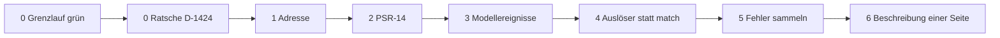

# Renderer-Plan: Umsetzung ab 17.11.2026

Stefan 17.11.2026 im Review-Thread: «plan vorziehen». Grundlage: [`plan.md`](plan.md) (Stand 05.09.), Beschlüsse D-628, D-629, D-635; Sperre D-1424.

| Schritt | Inhalt (aus plan.md §4) | Gate |
|---|---|---|
| 0 | Grenzlauf wirklich grün (Skript meldete Rot als Grün; 29 Rote am 17.11.) | Architektur: Lauf-Protokoll |
| 0 | Ratsche `core-html-ratchet-check.php`: HTML-Dateien, Escapes, Hooks im Kern, Verteiler-Zweige, Modeller-Seiten ohne Template dürfen nur fallen | gebaut 17.11. |
| 1 | Adresse als Wertobjekt | Kern + Grenzlauf |
| 2 | PSR-14-Dispatcher | Kern + Grenzlauf |
| 3 | Modellereignisse (vier Eingetretene) | Kern + Grenzlauf |
| 4 | `match ($do)` wird Aussender + Listener; `do-parity-check` | Kern + Grenzlauf, Ratsche: Zweige fallen auf 0 |
| 5 | Fehler sammeln, je Adresse | Kern + Grenzlauf |
| 6 | Eine Seite (die Knotenseite) als getippte Beschreibung, gezeichnet am Rand | Bildschirmfoto, Ratsche fällt |

- **Rand-Renderer = `ListPage`.** Der Rand-Renderer des Plans und `ListPage` werden ein Zeichner, kein dritter daneben (Review 17.11., Nachtrag). *INFERRED (Architektur), nicht von Stefan gesagt.*
- **Reihenfolge, nicht Zwang** (D-635): Schritte dürfen zusammen kommen; PR-9 bleibt.
- **Jeder Schritt:** `php -l`, Wächter, Kern, Grenzlauf (echte Exit-Codes), dann Gate beim Architektur-Thread.
- Schritt 7 (übrige Kern-Dateien) und 8 (Browser + Protokoll) folgen nach 6 als eigenes Paket.
- Offen bleibt §7 des Plans (fünf Fragen an Stefan); keine hält Schritt 1–4 auf.

## Stand

### Schritt 1 · Adresse — gebaut 17.11.2026

- `Taxmod\Core\Event\Address` (Knoten, Kante?, Satz?, Feld?), Schreibweise `node=12;edge=5;record=7;field=min`.
- `Control::$address` und `Control::at()`, `Complaint::$address` und `Complaint::at()`; `ControlMarkup` zeichnet sie als `data-taxmod-address`.
- `Rendering::complaintsFor()` gibt jeder Beschwerde Knoten und Kante mit.
- Knotenseite: jeder Akt (Baumzeile, Kopf, Feldzeile, Satzzeile, Vorschau, Satz-Editor, Verschieben, Papierkorb-Dialog) trägt seine Adresse.
- Zusage `event-address-check`: grün. Ratsche unverändert (54/249/0/38/9).

**Angenommen, nicht vom Konzept gesagt** (PR-2, *INFERRED*, Gate prüft):

| | Annahme | Grund |
|---|---|---|
| A1 | Die Zusage gilt für **Akte** (`name="do…"`), nicht für Wort-Träger (`word:…`), die nur Übersetzungen in den Kern tragen. | Ein Wort-Träger wird nie als Knopf gezeichnet und betrifft keine Stelle. |
| A2 | Der Knoten einer Feldzeilen-Adresse ist der **Knoten der Seite** (die Verwendungsstelle), nicht der Besitzer einer geerbten Kante. | Ein Akt an einer geerbten Zeile wirkt «hier und darunter» (`toggle_field_hide`). |
| A3 | Ein Feldname in der Adresse ist ein Schlüssel `[a-z0-9_:-]`, kein Text. | Die Adresse wird so ohne Escape gezeichnet; die Ratsche zählt Escapes im Kern. |
| A4 | Die Beschwerde trägt in Schritt 1 Knoten und Kante; den Satz setzt Schritt 5, wo gesammelt wird. | Plan §4: «Sonst ändert sich nichts.» |
