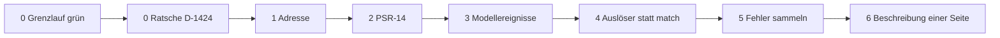
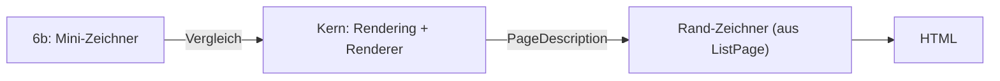
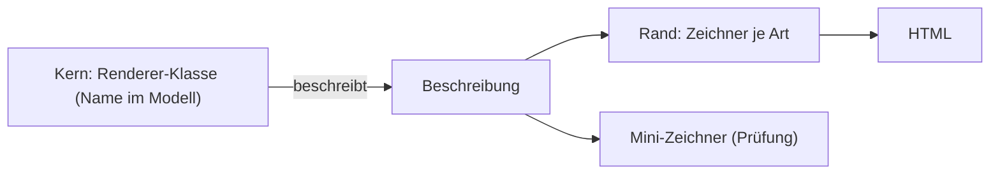

# Renderer-Plan: Umsetzung ab 17.11.2026

Stefan 17.11.2026 im Review-Thread: «plan vorziehen». Grundlage: [`plan.md`](plan.md) (Stand 05.09.), Beschlüsse D-628, D-629, D-635; Sperre D-1424.

| Schritt | Inhalt (aus plan.md §4) | Gate |
|---|---|---|
| 0 | Grenzlauf wirklich grün (Skript meldete Rot als Grün; 29 Rote am 17.11.) | Architektur: Lauf-Protokoll |
| 0 | Ratsche `core-html-ratchet-check.php`: HTML-Dateien, Escapes, Hooks im Kern, Verteiler-Zweige, Modeller-Seiten ohne Template dürfen nur fallen | gebaut 17.11. |
| 1 | Adresse als Wertobjekt | Kern + Grenzlauf |
| 2 | PSR-14-Dispatcher | Kern + Grenzlauf |
| 3 | Modellereignisse (vier Eingetretene) | Kern + Grenzlauf |
| 4 | `match ($do)` wird Aussender + Listener; `do-parity-check` | Kern + Grenzlauf, Ratsche: Zweige fallen auf 0 |
| 5 | Fehler sammeln, je Adresse | Kern + Grenzlauf |
| 6 | Eine Seite (die Knotenseite) als getippte Beschreibung, gezeichnet am Rand | Bildschirmfoto, Ratsche fällt |

- **Rand-Renderer = `ListPage`.** Der Rand-Renderer des Plans und `ListPage` werden ein Zeichner, kein dritter daneben (Review 17.11., Nachtrag). *INFERRED (Architektur), nicht von Stefan gesagt.*
- **Reihenfolge, nicht Zwang** (D-635): Schritte dürfen zusammen kommen; PR-9 bleibt.
- **Jeder Schritt:** `php -l`, Wächter, Kern, Grenzlauf (echte Exit-Codes), dann Gate beim Architektur-Thread.
- Schritt 7 (übrige Kern-Dateien) und 8 (Browser + Protokoll) folgen nach 6 als eigenes Paket.
- Offen bleibt §7 des Plans (fünf Fragen an Stefan); keine hält Schritt 1–4 auf.

## Stand

### Schritt 1 · Adresse — gebaut 17.11.2026

- `Taxmod\Core\Event\Address` (Knoten, Kante?, Satz?, Feld?), Schreibweise `node=12;edge=5;record=7;field=min`.
- `Control::$address` und `Control::at()`, `Complaint::$address` und `Complaint::at()`; `ControlMarkup` zeichnet sie als `data-taxmod-address`.
- `Rendering::complaintsFor()` gibt jeder Beschwerde Knoten und Kante mit.
- Knotenseite: jeder Akt (Baumzeile, Kopf, Feldzeile, Satzzeile, Vorschau, Satz-Editor, Verschieben, Papierkorb-Dialog) trägt seine Adresse.
- Zusage `event-address-check`: grün. Ratsche unverändert (54/249/0/38/9).

**Angenommen, nicht vom Konzept gesagt** (PR-2, *INFERRED*, Gate prüft):

| | Annahme | Grund |
|---|---|---|
| A1 | Die Zusage gilt für **Akte** (`name="do…"`), nicht für Wort-Träger (`word:…`), die nur Übersetzungen in den Kern tragen. | Ein Wort-Träger wird nie als Knopf gezeichnet und betrifft keine Stelle. |
| A2 | Der Knoten einer Feldzeilen-Adresse ist der **Knoten der Seite** (die Verwendungsstelle), nicht der Besitzer einer geerbten Kante. | Ein Akt an einer geerbten Zeile wirkt «hier und darunter» (`toggle_field_hide`). |
| A3 | Ein Feldname in der Adresse ist ein Schlüssel `[a-z0-9_:-]`, kein Text. | Die Adresse wird so ohne Escape gezeichnet; die Ratsche zählt Escapes im Kern. |
| A4 | Die Beschwerde trägt in Schritt 1 Knoten und Kante; den Satz setzt Schritt 5, wo gesammelt wird. | Plan §4: «Sonst ändert sich nichts.» |

### Schritt 2 · PSR-14 — gebaut 17.11.2026

- `psr/event-dispatcher` ^1.0 als Abhängigkeit (drei Schnittstellen, kein Code; die Freigabe-Pipeline installiert sie mit `--no-dev`).
- `Taxmod\Core\Event\Dispatcher`, `ListenerProvider` (Anmeldung nach Klasse und, bei einem `Named`-Ereignis, nach Kennung), `Named`.
- **Noch sendet niemand**; das Plugin verhält sich unverändert.
- Zusage `core-has-no-hooks-check`: grün (mit Gegenprobe).

**Angenommen** (*INFERRED*): A5 — die Kennung hängt am Ereignis über eine Schnittstelle `Named`, nicht an einer Basisklasse; `ListenerProvider::heard()` erlaubt dem Aussender in Schritt 4, eine unbekannte Kennung weiter zu werfen (Plan: «eine unbekannte Kennung wirft weiterhin»).

### Schritt 3 · Modellereignisse — gebaut 17.11.2026

- `ModelChanged` mit den vier Arten `NodeChanged`, `EdgeChanged`, `NodeRecordChanged`, `EdgeRecordChanged` (D-631); `ChangedTogether` für das Sammelschreiben beim Parken; `JournalListener` schreibt ins Änderungsbuch und gibt die Aktnummer zurück.
- `ModelEditor`, `Labels`, `DataEntry`, `SettingsEditor` senden statt selbst zu schreiben (`report()`); `sendingTo()` nimmt einen anderen Dispatcher an, ohne ihn schreibt der eigene Aufzeichnungs-Listener.
- Zusage `journal-parity-check`: dieselbe Folge schreibt dieselben Zeilen wie der Code vor Schritt 3 (Referenz auf frischer DB geschrieben, auf frischer und gewanderter DB gleich).
- Die Zeilen, «die `DataEntry` bisher schuldig blieb» (Plan §4): schon seit TASK-056 geschrieben (`DataEntry::melden()`); die Referenz enthält sie (`record`, `record_value`).

**Angenommen** (*INFERRED*): A6 — `SettingsEditor` sendet mit, obwohl der Plan nur drei Dienste nennt: er schreibt ins selbe Buch, ein vierter Weg daran vorbei wäre die Lücke, die Schritt 3 schliesst. A7 — die Ereignisse tragen in Schritt 3 noch keine `Address` (an vielen Meldestellen ist nur die Kante oder der Satz bekannt, nicht der Knoten); sie kommt, wo Schritt 5 sammelt. A8 — Ein gemeinsamer Dispatcher für das ganze Plugin entsteht in Schritt 4, wo die Auslöser ihn brauchen.

### Schritt 4 · Auslöser statt `match` — gebaut 17.11.2026

- `Taxmod\Core\Event\ControlPressed` («Bedienelement betätigt», `Named`, mit `Address`, Antwort und «wo stehen bleiben»).
- `NodesScreen::handlePost()`: die 39 Zweige des `match ($do)` sind 39 Anmeldungen `listen(ControlPressed::class, …, '<kennung>')`; eine unbekannte Kennung wirft weiter («Unknown action.»). Klammer (`beginAct`/`endAct`) und Fehlerbehandlung unverändert.
- Zusage `do-parity-check`: grün. **Ratsche sichtbar geändert:** «arms of the node page dispatcher» zählt 0, wenn kein `match ($do)` mehr da ist (vorher Abbruch mit Exit 2), Decke 38 → 0.
- `SettingsScreen` und `CleanupScreen` (Plan §4) haben keinen Verteiler: `SettingsScreen` liest kein `do`, `CleanupScreen` einen einzigen Akt; nichts umzustellen.

**Angenommen** (*INFERRED*): A9 — die Anmeldungen stehen in `handlePost()` selbst, weil sie die gelesenen Eingaben brauchen; ein gemeinsamer Dispatcher fürs Plugin (A8) folgt erst, wenn ein zweiter Zuhörer dazukommt (Schritt 8, Protokoll). A10 — die Adresse des Ereignisses ist Knoten (+ Kante, wenn `relation` gesendet wird); der Satz kommt in Schritt 5.

### Schritt 5 · Fehler sammeln — gebaut 17.11.2026

- `Taxmod\Core\Exception\RefusedByValidators` trägt alle Beschwerden eines Speicherns; `ControlPressed::complain()/complaints()` sammelt sie für den Akt.
- `saveRecord()` gibt jeder Beschwerde den Satz zur Adresse (Knoten · Kante · Satz); `handlePost()` legt sie eine Stunde für die Person ab (`taxmod_complaints`), die nächste Seite zeigt jede einmal, als Zeile mit `data-taxmod-address`.
- Zusage `complaint-address-check`: grün.

**Angenommen** (*INFERRED*): A11 — in Schritt 5 stehen die Beschwerden als Liste in der Meldung, jede mit Adresse; **am Feld** gezeichnet werden sie mit der Beschreibung in Schritt 6 (`FeldBeschreibung.meldungen`, Plan §3), weil sie sonst einen zweiten Zeichenweg neben dem alten bräuchten (D-638). A12 — wer aus einem Modul speichert (`RETURN_TO`), bekommt weiter nur den Satz; die Liste gibt es auf der Knotenseite.

### Schritt 6a · Die Beschreibung als Objekte — gebaut 17.11.2026

- `Taxmod\Core\Description`: `PageDescription`, `SectionDescription`, `RowDescription`, `FieldDescription`, `ControlDescription`, `Message` (Plan §3, englische Namen nach `CD-9`). Kein Markup; JSON nur über `toJson()/fromJson()`.
- Zusage «description-roundtrip»: `tests/Core/DescriptionTest` (Kernlauf, braucht kein WordPress) — Struktur → JSON → Struktur ist dasselbe Objekt.
- **Noch nichts zeichnet daraus.** Kein zweiter Zeichenweg neben dem alten (D-638).

### Schritt 6b/6c · offen — Vorschlag fürs Gate (6c: siehe unten, Umfang erweitert)

| | Inhalt | Umfang (gemessen 17.11.) |
|---|---|---|
| 6b | Der zweite, winzige Zeichner (D-636) als Prüfung, nicht als Oberfläche: baut aus `PageDescription` schlichtes HTML und vergleicht Felder, Werte, Reihenfolge, Bedienelemente mit der Seite | klein |
| 6c | Die Knotenseite zieht **in einem Zug** um (D-637, D-638): `Rendering` liefert für sie die Beschreibung statt HTML, `ListPage` wird der Rand-Zeichner (D-1424 *INFERRED*), Meldungen am Feld (A11); Ratsche fällt | gross: `NodesScreen` 8 728 Zeilen, `Rendering` 8 838, 54 Kern-Dateien mit HTML |

### Schritt 6b · Der zweite Zeichner — gebaut 18.11.2026

- `tests/Support/PlainDrawer`: schlichtes HTML allein aus `PageDescription` (D-636). Liegt unter `tests/`, nicht im Kern (keine Kern-HTML-Datei mehr, Ratsche unverändert).
- `tests/Support/PageInventory`: Inhalt einer Seite in Reihenfolge (Felder, Werte, Bedienelemente, Meldungen) — aus der Beschreibung (`of`) oder aus beliebigem HTML (`read`) nach einem festen Vertrag (`data-taxmod-field`, `button[name]`, `data-taxmod-message`).
- Zusage im Kernlauf: `tests/Core/PlainDrawerTest` — gezeichnet = beschrieben; fehlendes oder zusätzliches Stück fällt auf; fremdes Markup (Tabelle, Select) wird nur über den Vertrag gelesen.
- **A13**: Den Vergleich an echten Seiten (`page-parity-check`, Rand-Zeichner = Mini-Zeichner = Beschreibung je Modeller-Seite, beide DBs) kann es erst geben, wenn eine Seite eine Beschreibung liefert — er wird in 6c Schritt 3 scharf geschaltet, nicht vorher.

### Schritt 6c · Plan (Architektur 17.11.: «alle Modeller-Seiten und alle Kern-HTML-Dateien in einem Zug»)

Ziel: Ratsche **0 Kern-HTML-Dateien, 0 Escapes im Kern, 0 Seiten ohne Vorlage**. Ein Branch (`claude/project-thread-mmhezm`, erst nach dem Merge von 5 + 6a). Zwischenstände dürfen unvollständig sein (D-635); gemergt wird nur komplett, mit Bildschirmfoto-Gate (D-638: nie zwei Zeichenwege auf main).

**Umfang (gemessen 18.11.)**

| Gruppe | Dateien | Escapes |
|---|---|---|
| nur Kommentare (Mermaid ` `, Doku-`<tr>`) | FrozenState, SettingShape, ScannedCode, ModelEditor, Control, RenderResult, Surroundings | 0 |
| Gutenberg-Inhalt, keine Seite | Page/StarterPattern | 0 |
| Bausteine | ControlMarkup, DialogMarkup, GridMarkup, HintMarkup, IconMarkup, SelectMarkup, ToggleMarkup, SharedBodies, ConflictDialog | 34 |
| Feld-Zeichner | Choice, ChooserCell, Chooser, Code, ColorChoice, Color, DateTime, Field, Jump, Mailto, Media, Plain, Reference, Repeatable, Residue, Slider, Spinner, Textarea, TypedField, UserRef | 49 |
| Zusammengesetzte | FieldRow, Form, Record, Table, Tree, TreeNode, Head, Page, Labels, Settings, Summary, ComparisonTable, Compact, Complex | 102 |
| Kacheln | Tile/TileGrid, Tile/PeriodChart | 0 |
| Seitenaufbau | Service/Rendering (8 838 Zeilen) | 55 |
| Seiten ohne Vorlage (9) | SettingsScreen ×3, NodesScreen, CleanupScreen, BackupScreen, ScannerTab, InboxScreen, ImportWiring (Fehlerhinweis) | – |

**Reihenfolge**

1. **Prüfung ehrlich machen** (benannte Prüfungsänderung, PR-9): Ratsche zählt Tags nur ausserhalb von Kommentaren. Grund: Mermaid-` ` ist DC-4-Doku, kein Markup. Fällt 54 → 47. StarterPattern zieht an den Rand (`WpStarterPatterns`) → 46.
2. **6b zuerst** (gebaut 18.11.): Mini-Zeichner + Inventar. `page-parity-check` wird mit dem Rand-Zeichner (Schritt 3) scharf.
3. **Rand-Zeichner**: `ListPage` wird Zeichner für `PageDescription`; Bausteine (Gruppe «Bausteine») ziehen hinein, Kern behält nur Beschreibungsklassen.
4. **Feld-Zeichner**: je Feldart eine Beschreibung (`FieldDescription` mit Art + Wert + Steuerelementen), gezeichnet am Rand.
5. **Zusammengesetzte + Kacheln** → `SectionDescription`/`RowDescription`; Kacheln als eigene Beschreibung.
6. **Rendering** liefert für alle Seiten nur noch `PageDescription`; Meldungen am Feld per Adresse (A11).
7. **Seiten**: alle 9 auf die Vorlage (`ListPage`), Toolbar eine Zeile (UI-Regel).
8. **Abschluss**: Decken auf 0/0/0 (benannt), Kern + Grenzlauf beide DBs grün, `page-parity-check` grün, Bildschirmfotos vorher/nachher je Seite → Architektur-Gate → Merge → WP-Upload.

**Am Gate entschieden (18.11., D-1429)**

- O1: Ratsche ignoriert Kommentare — **ja (D-1429)**
- O2: Escapes im Kern auch auf 0 — **ja (D-1429)**
- O3: Kacheln ziehen mit — **ja (D-1429)**

### Schritt 6c · Entwurf des Wortschatzes (vor dem Bau, fürs Gate)

**Messung 18.11., die den Weg festlegt:** die Klassen der Renderer stehen **im Modell** — `settings_value.klasse` und `nodes.klasse` tragen `Taxmod\Core\Renderer\CompactRenderer`, `…\ChooserRenderer`, `…\ReferenceRenderer` usw. **A14:** die Renderer-Klassen behalten Namen und Ort im Kern (keine Datenwanderung); sie **beschreiben** künftig statt zu zeichnen. Der Rand bekommt je Beschreibungsart einen Zeichner. Dasselbe gilt für `StarterPattern` (`implemented_by`).

Was heute im Kern gezeichnet wird, nach Art (Tags gezählt ohne Kommentare):

| Art | heute | Beschreibung (neu, ohne Markup) |
|---|---|---|
| Wert anzeigen | Plain, Field, Reference, UserRef, Color, Choice, ColorChoice, Jump, Mailto, Media | `FieldDescription` + `display`: Text, Link, Farbe, Bild, Liste |
| Wert eingeben | Field, Textarea, Code, Spinner, Slider, DateTime, Toggle/Checkbox, Select, Media, Chooser, ChooserCell, Compact | `FieldDescription` + `input`: Art, Name (Einreich-Vertrag des Kerns), Pflicht, Breite, Muster, min/max/Schritt, Optionen |
| Wiederholt, Rest | Repeatable, Residue | `ListDescription` (Einträge) |
| Bausteine | ControlMarkup, SelectMarkup, ToggleMarkup, IconMarkup, HintMarkup, DialogMarkup, ConflictDialog, GridMarkup, SharedBodies | `ControlDescription` (gibt es), `DialogDescription`, `Hint`, Icon als Name; Raster/geteilte Körper sind Zeichner-Sache |
| Zeilen, Tabellen | FieldRow, Table, ComparisonTable, Head | `TableDescription` (Spalten, Zeilen aus Feldern/Text/Bedienelementen, Blättern, Filter) |
| Baum | Tree, TreeNode | `TreeDescription` (Knoten: Tiefe, Name, Link, gefaltet, Bedienelemente) |
| Blöcke | Form, Record, Page, Complex, Settings, Labels, Summary | `SectionDescription` (gibt es) + Kinder |
| Kacheln | TileGrid, PeriodChart | `TileDescription`, `ChartDescription` (Reihen, Werte) |
| Seitenaufbau | Rendering (21 span, 18 input, 13 button …) | liefert `PageDescription` |

Am Gate bestätigt (18.11., D-1429 A14), mit Bedingung: eine neue Art nur, wenn mindestens zwei Stellen sie brauchen (D-1296). Regeln, die der Entwurf hält:

- Jede Beschreibung trägt **nur Text und Werte**, nie Markup; Escapen nur am Rand (D-1429 O2).
- **Keine Tag-Namen als Art** («div», «span»): sonst wäre der Mini-Zeichner ein HTML-Kopierer und D-636 bewiese nichts.
- Was nur Aussehen ist (Klassen, Raster, Dashicons), entscheidet der Rand-Zeichner; der Kern nennt Bedeutung (z. B. `destroys`, `available`, Icon-Name).
- Der Name eines Eingabefelds bleibt Kern-Sache: `Submission` liest ihn zurück, er ist ein Vertrag, kein Aussehen.

**Bau-Reihenfolge innerhalb von 6c** (jeder Commit: Kern + Grenzlauf beide DBs grün, PR-9): Wortschatz-Klassen + Mini-Zeichner + Inventar erweitern → Rand-Zeichner je Art → Renderer einer Art nach der anderen umstellen (alte Zeichnung derselben Art fällt im selben Commit) → Rendering → Seiten → Decken 0.

### Schritt 6c · Stand des Baus

| Teil | Stand | Ratsche (Dateien / Escapes) |
|---|---|---|
| 1 Ratsche ohne Kommentare, Startmuster am Rand | gebaut 18.11. | 54/249 → 42/247 |
| 2 Getippte Werte beschreiben: Plain, Field, Textarea, Code, Spinner, Slider, Color, Mailto, Jump, Reference, UserRef, Checkbox → `ShownValue`, `ValueInput`, `Locked`, `Sequence`; Rand: `Taxmod\WordPress\Draw\EdgeDrawer` | gebaut 18.11. | → 34/228 |
| 3 Auswahl, Schalter, Zeitpunkt: Choice, ColorChoice, Toggle, DateTime, Summary-Auswahl und alle Auswahlfelder in `Rendering` → `Choosing` (+`ChoicePurpose`), `AddChosen`; `SelectMarkup` und `ToggleMarkup` ziehen an den Rand (`Taxmod\WordPress\Draw`) | gebaut 18.11. | → 30/213 |
| 4 Bausteine: `Control` ist selbst eine Beschreibung; neu `Icon`, `Hint`, `Carried`, `ActsForm`, `DialogBox`; `ControlMarkup`, `DialogMarkup`, `IconMarkup`, `HintMarkup`, `GridMarkup`, `ConflictDialog` ziehen an den Rand. Die drei CSS-Klassen, die handgebautes Kern-Markup noch braucht, stehen bis zum Ende von 6c in `Look` (A15) | gebaut 18.11. | → 24/186 |
| 5 Kacheln (D-1429 O3): `TileGrid`, `PeriodChart` an den Rand | gebaut 18.11. | → 22/186 |
| 6 Medien: `MediaLink` (+`MediaLook`), `MediaButtons`, `MediaPicker`; `MediaRenderer::link()`/`buttons()` geben bis zum Ende von 6c das Gezeichnete weiter (A15) | gebaut 18.11. | → 21/167 |
| 7 `RenderResult` trägt die Beschreibung mit (`piece()`); was noch Markup ist, reist bis zum Ende von 6c als Gerüst `Drawn` (A15), siebte Zahl der Ratsche, Decke 1 | gebaut 18.11. | 21/167 |
| 8 Baum: `TreeView` (+`TreeLine`), `NodeInTree`, `PickableNode`, `TreeChoice`, `CurrentChoice`, `SharedBody`; Tree, TreeNode, ChooserCell, Chooser beschreiben nur noch. Der Wähler macht seine Vorlage aus der Beschreibung statt sein eigenes Markup per Regex zu zerlegen; `SharedBodies` ist nur noch der Speicher, die Vorlagen zeichnet der Rand (`SharedTemplates`). `Section` und `DialogBox` nehmen eine Beschreibung oder bis zum Ende von 6c noch Markup (A15) | gebaut 18.11. | → 16/157 |
| 9 Satzauswahl (Summary): `RecordPicker`, `RecordBrowser` (+`RecordBranch`), `RecordChoice`, `ValueKind::Record`; `browserBody`, `pick`, `multiDialog` geben Beschreibungen | gebaut 18.11. | → 15/117 |
| 10 Einstellungen und Feldzeile: `SettingsPanel`, `SettingRow` (+`SettingOrigin`), `FieldRow`; Settings und FieldRow beschreiben nur noch | gebaut 18.11. | → 13/95 |
| 11 Beschriftungen, Tabelle, Komplex: `LabelsPanel`, `TableView` (leere Spalten fallen am Rand, D-954), `PartCount` (D-825), `ComplexView`, `UnfoldingSummary`; `ComparisonTable` behält nur `ordered()`, Zeichnen in `Draw/ComparisonTableMarkup`; `ResidueRenderer` → `Draw/ResidueMarkup` (nur Rand) | gebaut 18.11. | → 8/68 |
| 12 Formular, Satz, Kompakt, Kopf, Seite, Wiederholung, Feldtyp, Schalterkaskade: `FormView`, `RecordView`, `CompactView`, `HeadView`, `PageView`, `RepeatableList`, `OrderedChoice`; `TypedFieldRenderer` gibt nur noch Beschreibungen. Übrig mit Markup: nur `Rendering.php` | gebaut 18.11. | → 1/54 |

- **A15** — *Gerüst, nicht Ziel:* solange zusammengesetzte Renderer noch Markup bauen, brauchen sie das gezeichnete Stück eines Renderers, der schon nur beschreibt. Dafür reicht der Rand seinen Zeichner einmal über den Autoloader herein (`src/WordPress/Draw/register.php`, `RenderResult::drawWith()`). Es fällt, wenn der letzte zusammengesetzte Renderer beschreibt; vor dem Merge prüft das die Ratsche mit (Ziel 0).
- **A16** — *Gleiches Markup:* der Rand-Zeichner zeichnet Zeichen für Zeichen, was der Kern vorher zeichnete. Damit bleiben alle Prüfungen und Bildschirme gleich, und eine Abweichung ist ein Fehler, keine Absicht. Escapen dort mit `htmlspecialchars`, weil der Kernlauf ohne WordPress den Zeichner auch ruft.
- **A17** — *Die Module nennen die alten Namen:* Lager, Fertigung, eBay, eBay-API und Etiketten rufen `Taxmod\Core\Renderer\ControlMarkup`, `DialogMarkup`, `GridMarkup`, `IconMarkup`, `SelectMarkup` und `Taxmod\Core\Tile\PeriodChart` (gemessen 18.11. in den Modul-Repos, je Modul in D-1430). Damit sie nicht brechen, findet der alte Name die Klasse am Rand weiter (`class_alias` beim Autoload, eine Liste in `src/WordPress/Draw/FormerNames.php`, von der Ratsche als sechste Zahl gezählt, Decke 10), nur wenn ein Modul danach fragt. Jedes Modul stellt auf die neuen Namen um; danach fällt die Brücke. **Das ist Modul-Arbeit, nicht Teil dieses Branches.**
- **A18** — *Der Schlüssel einer geteilten Vorlage* (D-866) war der Hash ihres Markups; für eine beschriebene Vorlage ist er jetzt der Hash ihrer Beschreibung, weil der Kern nicht zeichnet. Gleiche Beschreibung, gleiches Markup, also bleibt er ein Hash des Inhalts (Review 2026-11-17, E8). Sichtbar ändert sich nur der Schlüssel selbst; gemessen 18.11. an sechs Knotenseiten beider DBs: sonst Zeichen für Zeichen gleich.
- Prüfungsänderungen Teil 9 (PR-9, benannt): `FlatRecordDialogTest`, `RecordDialogCreateTest`, `PickFieldTest` zeichnen das Ergebnis jetzt mit dem Rand-Zeichner, weil `browserBody`/`pick` Beschreibungen geben; die Erwartungen bleiben.
- `design-guard`: die geteilten Bausteine stehen jetzt unter `src/WordPress/Draw/TileGrid.php` statt `src/Core/Tile/` (benannte Prüfungsänderung, PR-9: nur der Pfad folgt dem Umzug).
