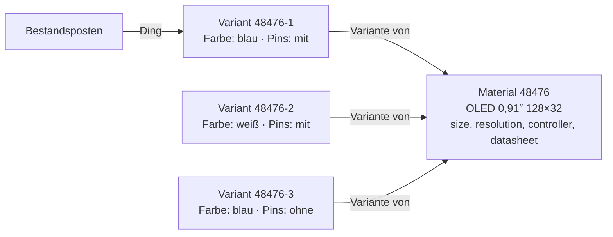

# Material variants: plan (D-1208)

Status: **steps 1–4 built** (Modeller 0.2.32); steps 5–8 open. Basis: [D-1208](../../NewConcept/90-decision-log.md), entry [INF-113](../../neues-konzept-eingang.md).

## The model

A variant is a record of its own, with its own id (D-995: the material number is the record id). It points at its parent with **«Variante von»**: one parent, no cycle, no variant of a variant. It holds only the fields whose edge carries the add-on **«Je Variante»**. Every other field is read from the parent, at one place in the modeller, and is locked on the variant.

## Steps

| # | What | Where | Check |
|---|---|---|---|
| 1 | Add-on «Je Variante» on an edge, like «Rechnen» (D-1022) | Modeller core `Addon` | core test: flag set/unset, shipped add-on listed |
| 2 | Relation «Variante von» between records: one parent, no cycle, no variant of a variant | Modeller core + persistence | core test: invariants refused with a reason |
| 3 | Reading with fallback: a variant's empty non-flag field comes from its parent, for a whole batch in one read (CD-7) | `ModelDoor` / record reads, one place | boundary check: list of variants costs one extra read, not one per row |
| 4 | Writing: non-flag fields locked on a variant ~~; flag fields locked on the parent~~ (struck: his answer on pictures, below, has the parent's flag values as the fallback) | Modeller write path | boundary check |
| 5 | Name of a variant: parent name + flag values («OLED 0,91″ 128×32 · weiß · mit Pins») and shown number «parent-n» | Modeller, computed | core test |
| 6 | Model screen: «Varianten erzeugen» at a record (choose values per flag field, all combinations or single), list of variants under the record | `NodesScreen` | boundary check |
| 7 | Stock: the thing is the variant; receiving a material that has variants asks for the variant; material list and group stock show the sum at the parent | `wp_tax_stock` | stock-check |
| 8 | Data: displays 48476 / 49379 / 49364 become one parent with three variants; «Displayfarbe» (149000110375) goes into «Farben» (D-1080) | WP-Upload order | owner checks the live data |

Each step ends with something the owner can operate, and both test runs stay green (PR-9).

## Built in step 3, and what was assumed

- `read-node` names the add-ons chosen at each field (`addons`), from the modeller's one resolver.
- `ModelDoor::records()` and `ModelDoor::valuesOf()` hand a module the values a variant shows; parents outside the list cost one more read for all of them (`scripts/dev/varianten-check.php`).
- The modeller's own screens and `read-node` still show the stored values: the variant's own fields only.

## Built in step 4

- `DataEntry` refuses a value on a parent's field at a variant, with the parent's number in the message; a value the variant already holds may be sent again unchanged (a form sends every field back). Clearing is never refused, so old values of a record that became a variant can be cleaned up.
- Saving «Variante von» checks the three rules of `Variants::complaints`.
- Not built: the modeller's form does not yet show the parent's fields locked; that comes with the variant list in step 6.
- ⚠️ Assumed: «Variante von» is an **aggregation** to the material's own node. Found while building: a *composition* from a node to itself makes `create_record` loop without end (pre-existing, not caused by variants).

## How variants are shown (proposal, his question 2026-11-06: «wie stellen wir die varienten da unter dem vater material als eigenes material ??»)

- Each variant is a material of its own: own number «48476-1», own label/QR, found by the search on its own.
- Material list and group stock: one row per parent with the summed stock; the variants open beneath it (indented rows with colour/pins and their own stock). A material without variants stays one row.
- Parent's detail page (standard page, D-1196): head, then a section «Varianten» as a list (one row each, own stock, print, book).
- Variant's detail page: head says «Variante von 48476 …» with a link; fields from the parent are shown but locked.
- Model screen: the variants stand under their parent in the record list of the same node.

## Open (for the owner)

- ~~Own picture?~~ Answered 2026-11-06: *«eigenes bild wäre möglich»* — the pictures carry the flag, and a variant without its own shows the parent's. Every flag field falls back to the parent when the variant leaves it empty. The pins field already exists and gets the flag.
- Purchase and bill of materials: does a BOM position name a variant, or may it say «any variant» (InvenTree)? Assumed: it names a variant.
- ~~Re-soldering pins?~~ Answered 2026-11-06: *«anlöten von pins ist ein umbuchen wobei ich eher auslöte»* — soldering pins on or off is a rebooking between variants. Flag fields named: pictures, with/without pins, pin assignment.
