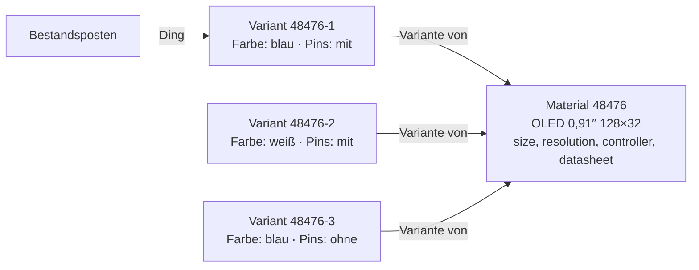

# Material variants: plan (D-1208)

Status: **planned, not built.** Basis: [D-1208](../../NewConcept/90-decision-log.md), entry [INF-113](../../neues-konzept-eingang.md).

## The model

A variant is a record of its own, with its own id (D-995: the material number is the record id). It points at its parent with **«Variante von»**: one parent, no cycle, no variant of a variant. It holds only the fields whose edge carries the add-on **«Je Variante»**. Every other field is read from the parent, at one place in the modeller, and is locked on the variant.

## Steps

| # | What | Where | Check |
|---|---|---|---|
| 1 | Add-on «Je Variante» on an edge, like «Rechnen» (D-1022) | Modeller core `Addon` | core test: flag set/unset, shipped add-on listed |
| 2 | Relation «Variante von» between records: one parent, no cycle, no variant of a variant | Modeller core + persistence | core test: invariants refused with a reason |
| 3 | Reading with fallback: a variant's empty non-flag field comes from its parent, for a whole batch in one read (CD-7) | `ModelDoor` / record reads, one place | boundary check: list of variants costs one extra read, not one per row |
| 4 | Writing: non-flag fields locked on a variant; flag fields locked on the parent | Modeller write path | boundary check |
| 5 | Name of a variant: parent name + flag values («OLED 0,91″ 128×32 · weiß · mit Pins») and shown number «parent-n» | Modeller, computed | core test |
| 6 | Model screen: «Varianten erzeugen» at a record (choose values per flag field, all combinations or single), list of variants under the record | `NodesScreen` | boundary check |
| 7 | Stock: the thing is the variant; receiving a material that has variants asks for the variant; material list and group stock show the sum at the parent | `wp_tax_stock` | stock-check |
| 8 | Data: displays 48476 / 49379 / 49364 become one parent with three variants; «Displayfarbe» (149000110375) goes into «Farben» (D-1080) | WP-Upload order | owner checks the live data |

Each step ends with something the owner can operate, and both test runs stay green (PR-9).

## Open (for the owner)

- ~~Own picture?~~ Answered 2026-11-06: *«eigenes bild wäre möglich»* — the pictures carry the flag, and a variant without its own shows the parent's. Every flag field falls back to the parent when the variant leaves it empty. The pins field already exists and gets the flag.
- Purchase and bill of materials: does a BOM position name a variant, or may it say «any variant» (InvenTree)? Assumed: it names a variant.
- Re-soldering pins: rebook from «ohne» to «mit» as a transfer between variants? Assumed yes, as a stock transaction.
