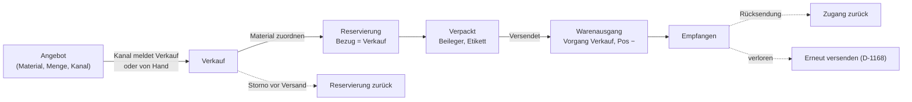
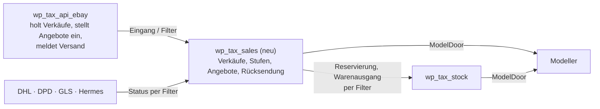

# Paket · Verkauf: vom Angebot über den Warenausgang bis zur Zahlung — Konzeptentwurf

**Stand 2026-11-06. Entwurf, nichts davon entschieden ausser dem, was eine `D-<nnn>` trägt.** Aus
[INF-111](../../neues-konzept-eingang.md#inf-111--verkauf-als-eigener-fachbereich). Fragen an ihn in §7 (VK1–VK7);
alles ohne Beschluss ist mein Vorschlag (`INFERRED`, [PR-4](../../../CLAUDE.md)).

**Sein Wort (2026-11-06):** *«ich denke wir brauchen noch einen thread der sich um den verkauf kümmert»*.

---

## 1 · Bestandsaufnahme: was es schon gibt

| Baustein | Beschluss | gebaut |
|---|---|---|
| Satz «Verkäufe» + Positionen «Verkaufte Artikel» (Verkaufspreis, Einstandspreis, Exemplar, Projekt) | [D-934](../../NewConcept/90-decision-log.md), [D-1097](../../NewConcept/90-decision-log.md) | ja (Daten) |
| eBay-Verkäufe kommen über den Eingang (Art `sold`) | [D-979](../../NewConcept/90-decision-log.md) | ja (Modeller 0.1.47, eBay) |
| eBay-Versandseite: Stufen Offen · Verpackt · Versendet · Empfangen, Beileger, 62-mm-Etikett, «Mark shipped» | [D-976](../../NewConcept/90-decision-log.md), [D-985](../../NewConcept/90-decision-log.md), [D-989](../../NewConcept/90-decision-log.md) | ja (eBay 0.0.71) |
| Erneut versenden: zweite Ware als Verlust | [D-1168](../../NewConcept/90-decision-log.md) | ja (eBay 0.0.69, Lager 0.45.0) |
| Angebote bei eBay einstellen, Knoten «Angebote», Footer, Bilder aus dem Beitrag | [D-976](../../NewConcept/90-decision-log.md), [D-977](../../NewConcept/90-decision-log.md), [D-984](../../NewConcept/90-decision-log.md) | **nein** |
| Warenausgang als Prozess: «Verkauf (reserviert sofort …)», Versandstufen gehen darin auf | [D-1044](../../NewConcept/90-decision-log.md) | **nein** |
| Reservierung mit Bezug Verkauf; Verbrauch für genau diesen Bezug geht aus der Reservierung | [D-1083](../../NewConcept/90-decision-log.md), [D-1088](../../NewConcept/90-decision-log.md) | Reservierung ja (Lager), Bezug Verkauf nie benutzt |
| Vorgangsart «Verkauf» (Mengenbewegung) | [`../lager/prozesse.md`](../lager/prozesse.md) §2 | Konstante ja, Buchung **nein** |
| Logistik-Bereich «Warenausgang» | [D-1029](../../NewConcept/90-decision-log.md), [D-1053](../../NewConcept/90-decision-log.md) | leer bis auf die eBay-Seite |

**Die Lücke:** ein Verkauf berührt heute den Bestand nicht. Er wird weder reserviert noch als Warenausgang gebucht; der
verkaufte Artikel kennt sein Material nicht; ausser eBay gibt es keinen Weg, einen Verkauf zu erfassen; und die Stufen leben
als Option im eBay-Modul statt am Verkauf.

## 2 · Ablauf

1. **Angebot** (Kanal eBay, später eigener Shop, D-1051 Etappe 8): Material, Menge, Preis. Die angebotene Menge zeigt daneben
   den verfügbaren Bestand («Lager sagt 7, angeboten 5», [D-976](../../NewConcept/90-decision-log.md) §4).
2. **Verkauf** entsteht aus dem Kanal (eBay über den Eingang, [D-979](../../NewConcept/90-decision-log.md)) oder **von Hand**
   (Kleinanzeigen, direkt, Flohmarkt) — `VK5`.
3. **Material zuordnen:** je verkauftem Artikel das Material und, wenn bekannt, der Bestandsposten. Bei eBay über die SKU des
   Angebots (`taxmod-<id>`, [D-976](../../NewConcept/90-decision-log.md) §3) automatisch, sonst ein Dialog «Material zuordnen»
   mit der Satzauswahl des Modellers (A4). Ohne Zuordnung bleibt der Verkauf in «Zuzuordnen».
4. **Reservierung** sofort nach der Zuordnung ([D-1044](../../NewConcept/90-decision-log.md): *«reserviert sofort»*), als
   Vorgang «Reservierung» mit Bezug = Verkauf ([D-1083](../../NewConcept/90-decision-log.md)). Der verfügbare Bestand sinkt, der
   Bestand nicht. Reicht der Bestand nicht, wird trotzdem reserviert und die Fehlmenge rot gezeigt (`INFERRED`).
5. **Verpackt:** Beileger und Versandetikett (Etikett druckt der Modeller, R7).
6. **Versendet = Warenausgang** (`VK3`): Vorgang der Art «Verkauf» mit Pos − je Bestandsposten, aus der reservierten Menge
   ([D-1088](../../NewConcept/90-decision-log.md)); die Reservierung ist damit erledigt. Der Einstandspreis je Stück des
   Postens wird in den verkauften Artikel übernommen. Bei eBay meldet das eBay-Modul die Sendungsnummer.
7. **Empfangen:** aus dem Paketdienst-Status (DHL/DPD/GLS/Hermes-Module) oder von Hand.
8. **Zahlung** (`VK6`): bezahlt/offen am Verkauf; bei eBay aus `paymentSummary`, sonst von Hand oder PayPal-Modul.

**Zurücknehmen** ([D-1010](../../NewConcept/90-decision-log.md), [D-1036](../../NewConcept/90-decision-log.md)): jede Stufe
geht einen Schritt zurück; «Versendet» zurück storniert den Warenausgang (Gegenbuchung) und stellt die Reservierung wieder her.
Ein Verkauf vor dem Versand storniert = Reservierung storniert. Nach dem Versand ist der Weg die **Rücksendung**
([D-1044](../../NewConcept/90-decision-log.md)): Zugang zurück auf einen Posten, Prüfung wie beim Wareneingang.

## 3 · Schnitt der Module

- **Vorschlag `VK1`: eigenes Modul `wp_tax_sales`** nach dem Muster der Fertigung ([D-1142](../../NewConcept/90-decision-log.md)):
  es besitzt den Verkaufsprozess über alle Kanäle und hängt seine Seiten in den Logistik-Bereich «Warenausgang». Bestand,
  Reservierung und Vorgänge bleiben im Lager und werden nur per Filter benutzt; das Modell nur über `ModelDoor` (R2).
- **eBay wird reine Anbindung** ([D-1006](../../NewConcept/90-decision-log.md)): Verkäufe holen, Angebot einstellen und Menge
  nachführen, Versand melden, DHL-Etikettlink liefern. Die Versandseite mit ihren Stufen zieht in das Verkaufsmodul
  ([D-1044](../../NewConcept/90-decision-log.md): *«Die Versandstufen der eBay-Versandseite gehen darin auf»*); bis dahin bleibt
  sie, wie sie ist.
- **Die Stufe gehört an den Verkauf** (Feld am Satz, nicht Option `taxmod_ebay_stages`), damit sie für alle Kanäle gilt und in
  der Historie steht (`INFERRED`, [INF-094](../../neues-konzept-eingang.md#inf-094--versandstufen-für-alle-verkaufsquellen)).

## 4 · Oberfläche (Logistik › Warenausgang)

Alles im gemeinsamen Template (L1–L5), Aktionen als Dialog (K3), Knöpfe rechts.

| Punkt | Inhalt |
|---|---|
| **Übersicht** | Kacheln (C1): Zuzuordnen · Zu verpacken · Unterwegs · Überfällig · Offen bezahlt |
| **Verkäufe** | alle Verkäufe aller Kanäle; Filter Kanal, Stufe, bezahlt; Klick → Detailansicht (L5) mit Positionen, Reservierung, Warenausgang, Sendungen, Historie |
| **Zuzuordnen** | verkaufte Artikel ohne Material; Sammelaktion «Material zuordnen» |
| **Versand** | Reiter Offen · Verpackt · Versendet · Empfangen (wie heute bei eBay, für alle Kanäle) |
| **Angebote** | je Angebot Kanal, Menge angeboten / verfügbar, Preis, Zustand; «Vorbereiten», «Bei eBay einstellen» ([D-977](../../NewConcept/90-decision-log.md)) |
| **Rücksendungen** | zurückgekommene Ware, Prüfung, Zugang |
| **Neuer Verkauf** | Dialog: Kanal, Käufer (nur Name, [D-934](../../NewConcept/90-decision-log.md)), Positionen per Satzauswahl, Preis |

## 5 · Daten (Vorschlag, R8: vorhandene Knoten zuerst)

- **Verkaufte Artikel** bekommen **Material** (Satzverweis, 0..1) und **Bestandsposten** (0..1). «Exemplar» bleibt für
  Einzelstücke.
- **Verkäufe** bekommen **Stufe** (Auswahl Offen/Verpackt/Versendet/Empfangen/Storniert) und **Zahlstatus** (vorhandene Auswahl
  offen/bezahlt der Rechnungen, [D-1024](../../NewConcept/90-decision-log.md), wiederverwenden). Plattform = Kanal.
- **Angebote** wie [D-976](../../NewConcept/90-decision-log.md) §4, Verweis auf Material statt nur Projekt.
- **Gewinn** wird nie gespeichert: Erlös − Einstand − Porto − Gebühren, beim Anzeigen gerechnet
  ([D-934](../../NewConcept/90-decision-log.md): *«der Gewinn wird nicht gespeichert»*).
- Keine Anschrift im Modell ([D-934](../../NewConcept/90-decision-log.md)); die Adresse liest der Kanal nur für die Versandseite.

## 6 · Etappen

1. Modul-Gerüst, Verkäufe-Liste + Detail (lesend, alle Kanäle), Material zuordnen, Verkauf von Hand.
2. Reservierung beim Zuordnen, Warenausgang bei «Versendet», Storno beider.
3. Versandstufen am Verkauf; Umzug der eBay-Versandseite (eBay liefert Adresse, Etikettlink, Meldung per Filter).
4. Angebote + eBay-Einstellen + Mengenabgleich ([D-976](../../NewConcept/90-decision-log.md) Schritte 2–3).
5. Rücksendung, Zahlung, Auswertung (Gewinn je Verkauf/Monat als Kachel).

Jede Etappe endet mit etwas, das er bedienen kann ([PR-2](../../../CLAUDE.md)).

## 7 · Fragen an ihn

| | Frage | Mein Vorschlag |
|---|---|---|
| **VK1** | Eigenes Modul `wp_tax_sales` oder im Lager (`wp_tax_stock`, Bereich Warenausgang)? | eigenes Modul, wie Fertigung (D-1142) |
| **VK2** | Die eBay-Versandseite zieht ins Verkaufsmodul und gilt für alle Kanäle? | ja, in Etappe 3 |
| **VK3** | Warenausgang beim Klick «Versendet» oder schon bei «Verpackt»? | «Versendet» |
| **VK4** | Reservieren, auch wenn der Bestand nicht reicht (Fehlmenge rot)? | ja |
| **VK5** | Welche Kanäle ausser eBay? (Kleinanzeigen, direkt/bar, Forum, eigener Shop später) | Kanal = Auswahl am Verkauf, erweiterbar |
| **VK6** | Zahlung mitführen (bezahlt am, Zahlweg)? | ja, Zahlstatus + Zahlweg |
| **VK7** | [INF-095](../../neues-konzept-eingang.md#inf-095--bestellungen-und-verkäufe-ein-knoten-mit-richtung): Bestellungen und Verkäufe bleiben zwei Knoten? | ja, zwei Knoten, gleiches Template |
