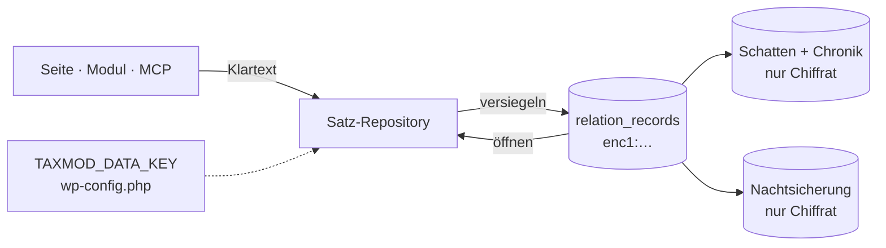
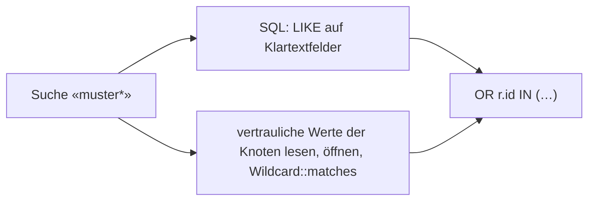
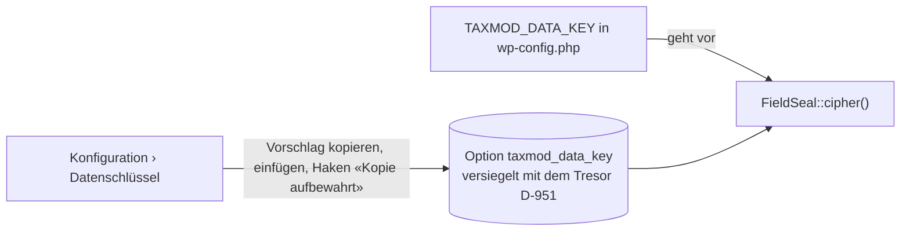

# Vertrauliche Felder — Kontaktdaten verschlüsselt speichern

[D-1514](../../NewConcept/90-decision-log.md). Anlass: Stefan 20.11.2026 «alles, was unter Kontakt ist … dass die irgendwie
verschlüsselt sind. Dann können wir nämlich auch verschiedene Daten speichern.» Freigabe 21.11.2026: «also hier das ja».

## Was geschützt wird

- Ein Feld ist vertraulich, wenn an seiner **Kante** die Zusatzfunktion **«Vertraulich»** gewählt ist (`ConfidentialAddon`,
  Name `confidential`). Kein Sonderfall nach Knoten oder Name — welche Felder es sind, ist Modell, nicht Code.
- Versiegelt wird der **Text** (`value_text`) eines Wertes. Zahlen, Daten und Verweise bleiben, wie sie sind.
- Leser sehen Klartext wie bisher — Formulare, Wähler, Module, `taxmod/read-node` (für Administratoren, Stefans Karte
  20.11. 16:26 «Ja, mit Admin-Zugang»).

Schützt gegen: Datenbank-Dump, Sicherungsdatei, SQL-Lesezugriff, Hoster mit nur Datenbankzugang.
Schützt nicht gegen: Vollzugriff auf den Server (wp-config lesbar) und angemeldete Administratoren.

## Versiegeln

`FieldCipher` im Kern (ohne WordPress): libsodium XChaCha20-Poly1305, gespeichert als `enc1:<schlüssel-id>:<base64>`.

- Die Zusatzdaten sind ein fester Kontext, **nicht** Satz- oder Feld-Id: Undo, Zusammenführen und «Feld verschieben»
  kopieren gespeicherte Zeilen an eine andere Stelle, dort muss der Wert weiter aufgehen. *(INFERRED, Abweichung vom
  Vorschlag.)*
- Zweimal versiegeln = einmal; ein nie versiegelter Text öffnet sich als er selbst (Altbestand).

## Die eine Stelle

`FieldSeal` am Rand: das Satz-Repository versiegelt beim Schreiben (`putValue`) und öffnet beim Lesen (jede Wertzeile geht
durch `wert()`); die Chronik (`WpdbChangelog`) versiegelt den `value` eines eingefrorenen Stands, wenn er eine
vertrauliche Kante nennt (`relation=`, ältere Zeilen `path=`), und öffnet ihn beim Lesen. Schatten und Sicherung
kopieren Zeilen, wie sie sind — also Chiffrat. Der Wächter `field-cipher-check` hält fest, dass außer den erlaubten
Dateien niemand `value_text` anfasst.

## Suchen

`recordsWhere` (enthält / gleich), `recordsMatching` und `findByRelationValue` finden vertrauliche Werte, indem sie die
versiegelten Werte der gefragten Knoten lesen, öffnen und in PHP vergleichen. Kontakte sind wenige; ein Blindindex
kommt erst, wenn das zu langsam wird.

## Schlüssel

- Ein **eigener** Schlüssel (32 Byte, 64 Hex-Ziffern), eingegeben im Reiter **«Datenschlüssel»** der Konfiguration und
  gespeichert wie die Zugangsdaten der Module: versiegelt mit dem Tresor (D-951, `StoredSecret`). Ein Datenbank-Dump allein
  öffnet ihn nicht, dazu braucht es die Salts aus `wp-config.php`. Stefans Wunsch 21.11.: «muss ich den dann in der
  wp-config eingeben oder kann ich den auch in einer Einstellung eingeben?»
- Der Reiter zeigt einen frischen Vorschlag nur an — gespeichert wird erst, was Stefan einfügt und mit dem Haken «Kopie
  aufbewahrt» speichert. Ein Schlüssel, der die schon versiegelten Daten nicht öffnet, wird abgewiesen; ein Schlüssel in
  Gebrauch wird hier nicht ersetzt.
- **Stefan bewahrt eine Kopie außerhalb des Servers auf.** Werden die Salts geändert, öffnet sich die Option nicht mehr —
  dann trägt er den Schlüssel aus dem Passwortmanager neu ein, die Daten bleiben lesbar. Ohne Kopie sind sie weg, auch
  aus der Sicherung.
- `TAXMOD_DATA_KEY` in `wp-config.php` geht vor (wie bei D-951). Schlüsselwechsel: `TAXMOD_DATA_KEY_ID` (Vorgabe `k1`)
  für den neuen, `TAXMOD_DATA_KEYS_OLD` (`['k1' => '…']`) für die alten, die nur noch lesen.
- Fehlt der Schlüssel, wird ein vertrauliches Feld **nicht geschrieben** (Fehlermeldung, nie still Klartext), ein
  versiegelter Wert liest sich als «🔒», und «🔒» als Wert wird abgewiesen. Administratoren sehen einen Hinweis mit Link
  zum Reiter.

## Altbestand

`FieldSealJob` versiegelt, was ein Feld hielt, bevor es vertraulich wurde — live, im Schatten und in der Chronik — in
Häppchen zu 500 Zeilen, angestoßen von `admin_init` höchstens alle fünf Minuten (sofort wieder, solange Arbeit übrig
ist). *INFERRED: Das Versiegeln ändert die Speicherform, nicht den Wert — darum kein Akt, keine neue Version, keine
Schattenzeile; ein Undo darf nie Klartext zurückbringen.*

## Umfang

Nur der Kontakt-Ast (Stefans Wort). **Später gesondert** (Prüftor 20.11.): Postfach-Rohtexte (`taxmod_inbox`),
`taxmail_proposals`, Druckaufträge (`taxmod_print_jobs`, Etiketten mit Adresse — nach dem Druck löschen/kürzen prüfen),
Transient `taxmod_body_*`, Käuferadressen in Verkäufen.

## Annahmen

- Zusammenfassungen (D-885), die aus vertraulichen Feldern entstehen, werden **selbst** als vertraulich markiert, sonst
  stünde der Name in ihnen lesbar. Die Änderungsliste markiert sie mit.
- Eine Kennzahl (D-1149), die nach einem vertraulichen Feld filtert, findet nichts (`MetricSums` vergleicht in SQL).
- `set_addons` ersetzt die Zusatzfunktionen einer Kante — die Änderungsliste nimmt vorhandene mit.
