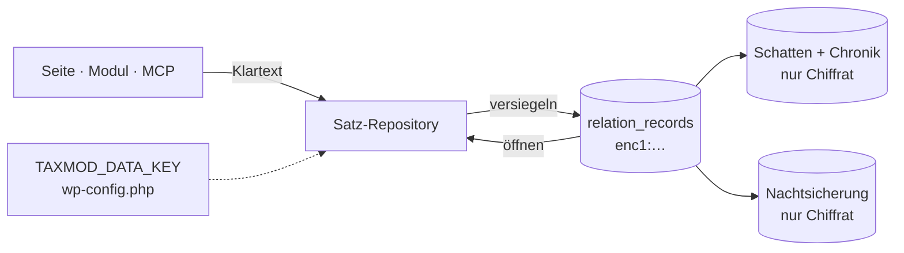
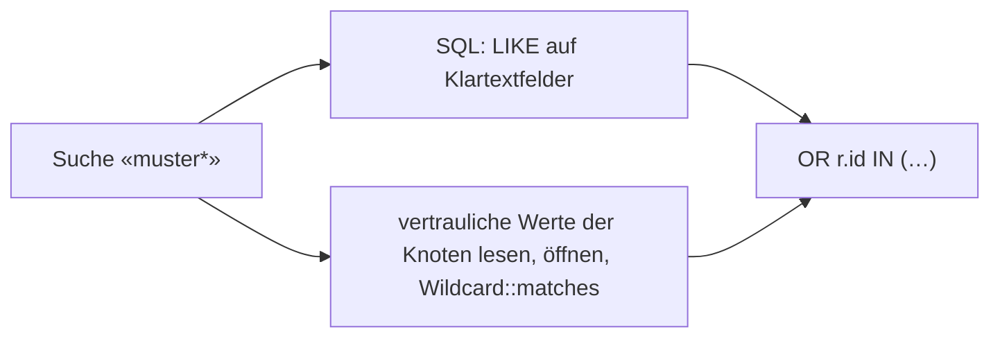
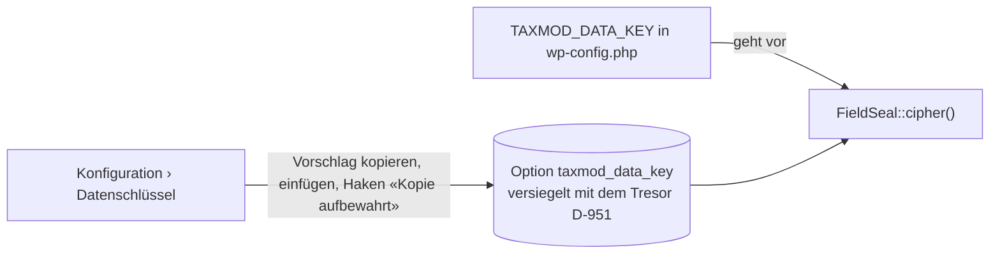
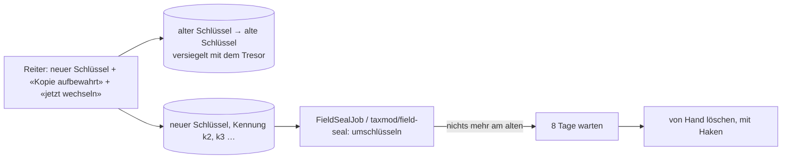
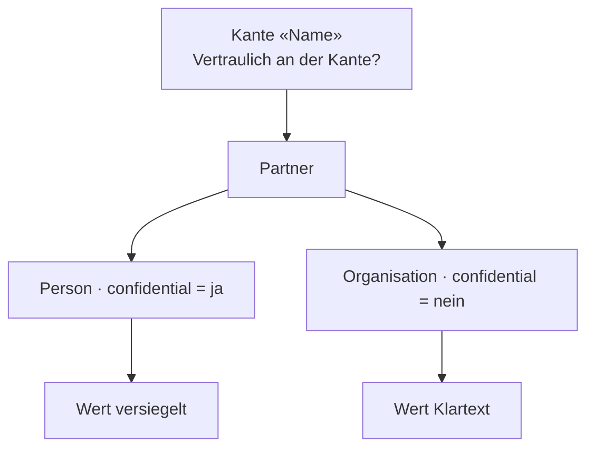

# Vertrauliche Felder — Kontaktdaten verschlüsselt speichern

[D-1514](../../NewConcept/90-decision-log.md). Anlass: Stefan 20.11.2026 «alles, was unter Kontakt ist … dass die irgendwie
verschlüsselt sind. Dann können wir nämlich auch verschiedene Daten speichern.» Freigabe 21.11.2026: «also hier das ja».

## Was geschützt wird

- Ein Feld ist vertraulich, wenn an seiner **Kante** die Zusatzfunktion **«Vertraulich»** gewählt ist (`ConfidentialAddon`,
  Name `confidential`). Kein Sonderfall nach Knoten oder Name — welche Felder es sind, ist Modell, nicht Code.
- Versiegelt wird der **Text** (`value_text`) eines Wertes. Zahlen, Daten und Verweise bleiben, wie sie sind.
- Leser sehen Klartext wie bisher — Formulare, Wähler, Module, `taxmod/read-node` (für Administratoren, Stefans Karte
  20.11. 16:26 «Ja, mit Admin-Zugang»).

Schützt gegen: Datenbank-Dump, Sicherungsdatei, SQL-Lesezugriff, Hoster mit nur Datenbankzugang.
Schützt nicht gegen: Vollzugriff auf den Server (wp-config lesbar) und angemeldete Administratoren.

## Versiegeln

`FieldCipher` im Kern (ohne WordPress): libsodium XChaCha20-Poly1305, gespeichert als `enc1:<schlüssel-id>:<base64>`.

- Die Zusatzdaten sind ein fester Kontext, **nicht** Satz- oder Feld-Id: Undo, Zusammenführen und «Feld verschieben»
  kopieren gespeicherte Zeilen an eine andere Stelle, dort muss der Wert weiter aufgehen. *(INFERRED, Abweichung vom
  Vorschlag.)*
- Zweimal versiegeln = einmal; ein nie versiegelter Text öffnet sich als er selbst (Altbestand).

## Die eine Stelle

`FieldSeal` am Rand: das Satz-Repository versiegelt beim Schreiben (`putValue`) und öffnet beim Lesen (jede Wertzeile geht
durch `wert()`); die Chronik (`WpdbChangelog`) versiegelt den `value` eines eingefrorenen Stands, wenn er eine
vertrauliche Kante nennt (`relation=`, ältere Zeilen `path=`), und öffnet ihn beim Lesen. Schatten und Sicherung
kopieren Zeilen, wie sie sind — also Chiffrat. Der Wächter `field-cipher-check` hält fest, dass außer den erlaubten
Dateien niemand `value_text` anfasst.

## Suchen

`recordsWhere` (enthält / gleich), `recordsMatching` und `findByRelationValue` finden vertrauliche Werte, indem sie die
versiegelten Werte der gefragten Knoten lesen, öffnen und in PHP vergleichen. Kontakte sind wenige; ein Blindindex
kommt erst, wenn das zu langsam wird.

## Schlüssel

- Ein **eigener** Schlüssel (32 Byte, 64 Hex-Ziffern), eingegeben im Reiter **«Datenschlüssel»** der Konfiguration und
  gespeichert wie die Zugangsdaten der Module: versiegelt mit dem Tresor (D-951, `StoredSecret`). Ein Datenbank-Dump allein
  öffnet ihn nicht, dazu braucht es die Salts aus `wp-config.php`. Stefans Wunsch 21.11.: «muss ich den dann in der
  wp-config eingeben oder kann ich den auch in einer Einstellung eingeben?»
- Der Reiter zeigt einen frischen Vorschlag nur an — gespeichert wird erst, was Stefan einfügt und mit dem Haken «Kopie
  aufbewahrt» speichert. Ein Schlüssel, der die schon versiegelten Daten nicht öffnet, wird abgewiesen; ein Schlüssel in
  Gebrauch wird hier nicht ersetzt.
- **Stefan bewahrt eine Kopie außerhalb des Servers auf.** Werden die Salts geändert, öffnet sich die Option nicht mehr —
  dann trägt er den Schlüssel aus dem Passwortmanager neu ein, die Daten bleiben lesbar. Ohne Kopie sind sie weg, auch
  aus der Sicherung.
- `TAXMOD_DATA_KEY` in `wp-config.php` geht vor (wie bei D-951); dort auch `TAXMOD_DATA_KEY_ID` (Vorgabe `k1`) und
  `TAXMOD_DATA_KEYS_OLD` (`['k1' => '…']`) für alte Schlüssel, die nur noch lesen.
- Fehlt der Schlüssel, wird ein vertrauliches Feld **nicht geschrieben** (Fehlermeldung, nie still Klartext), ein
  versiegelter Wert liest sich als «🔒», und «🔒» als Wert wird abgewiesen. Administratoren sehen einen Hinweis mit Link
  zum Reiter.

## Schlüsselwechsel (D-1562)

- Stefan 21.11. 12:35: «kann man den schlüssel ändern ?», «mit altem schlüssel neuer schlüssel».
- Der Reiter zeigt, wenn ein Schlüssel in Gebrauch ist, **«Schlüssel wechseln»**: frischer Vorschlag, Feld, Haken «Kopie
  aufbewahrt» und Haken «Ja, den Schlüssel jetzt wechseln». Ohne beide Haken, mit dem bisherigen Schlüssel oder mit einem
  Schlüssel, der nicht 64 Hex-Ziffern hat, ändert sich nichts.
- Der bisherige Schlüssel wird **alter Schlüssel**: versiegelt gespeichert (Option `taxmod_data_keys_old`, Tresor D-951),
  weiter zum Öffnen benutzt. Der neue versiegelt ab sofort, unter der nächsten freien Kennung (`taxmod_data_key_id`).
- `FieldSealJob` schlüsselt in denselben Häppchen um — live, Schatten, Chronik; wie das Versiegeln ohne Akt und ohne
  Undo. `taxmod/field-seal` zählt (`resealing_left`, je alter Schlüssel `sealed_with_old_keys`) und stößt einen Lauf an.
- **Ein alter Schlüssel wird nie von selbst gelöscht.** Die Nachtsicherungen (D-1407, sieben) enthalten noch Werte mit
  ihm; wer eine zurückspielt, braucht ihn. Löschen geht erst **acht Tage**, nachdem nichts mehr mit ihm versiegelt ist,
  und nur von Hand mit Haken; der Reiter zeigt, ab wann. Taucht wieder etwas mit ihm auf (alte Sicherung zurückgespielt),
  beginnen die acht Tage neu.

## Je Knoten (D-1578)

Stefan 21.11.2026 22:14: «Firmennamen soll lesbar bleiben». Person und Organisation teilen das Feld «Name» (D-1573);
nur das Verhalten unterscheidet sich.

- «Vertraulich» kann zusätzlich **je (Knoten, Kante)** stehen — dieselbe Adresse wie «hidden» (D-1144): der Satz
  `Knoten × Kante`, darin die Einstellung **`confidential`** (Wahrheitswert) der Wurzel. Ohne diese Einstellung an der
  Wurzel lehnt `set_confidential` laut ab.
- Wer gilt: der eigene Knoten, dann seine Vorfahren — der nähere schlägt den ferneren; sagt kein Knoten etwas, gilt
  «Vertraulich» an der Kante (`Core\Privacy\Confidentiality`, Kerntest Person versiegelt / Organisation Klartext).
- Der Plan (Kanten + Knotenangaben) wird in **einer** Abfrage gelesen. `DataEntry` reicht den Knoten des Satzes durch,
  ohne neue Abfrage; Kopien im `ModelEditor` (Feld verschieben, Zusammenführen) lesen höchstens einmal je Akt die Knoten
  ihrer Sätze.
- Ohne Knoten (wo die Antwort vom Knoten abhängt) gilt ein Wert als vertraulich — lieber einmal zu viel versiegelt.
- Agent: `taxmod/apply` Op **`set_confidential {node, field, confidential}`**.
- Bestand: `taxmod/field-seal` zählt zusätzlich `unseal_left` (versiegelt, aber für den Knoten seines Satzes nicht mehr
  vertraulich); **nur mit `unseal: true`** öffnet ein Lauf sie — live, Schatten, Chronik. `admin_init` öffnet nie.
- Suche: `findByRelationValue` vergleicht auf gemischten Kanten Klartext in SQL **und** die versiegelten Werte in PHP.

## Altbestand

`FieldSealJob` versiegelt, was ein Feld hielt, bevor es vertraulich wurde — live, im Schatten und in der Chronik — in
Häppchen zu 500 Zeilen, angestoßen von `admin_init` höchstens alle fünf Minuten (sofort wieder, solange Arbeit übrig
ist). *INFERRED: Das Versiegeln ändert die Speicherform, nicht den Wert — darum kein Akt, keine neue Version, keine
Schattenzeile; ein Undo darf nie Klartext zurückbringen.* Die Ability **`taxmod/field-seal`** zählt zuerst (`dry_run`,
Vorgabe) und versiegelt auf Wunsch ein Häppchen (höchstens 5000) — auch ohne Warten auf `admin_init`.

## Umfang

Nur der Kontakt-Ast (Stefans Wort). **Später gesondert** (Prüftor 20.11.): Postfach-Rohtexte (`taxmod_inbox`),
`taxmail_proposals`, Druckaufträge (`taxmod_print_jobs`, Etiketten mit Adresse — nach dem Druck löschen/kürzen prüfen),
Transient `taxmod_body_*`, Käuferadressen in Verkäufen.

## Annahmen

- Zusammenfassungen (D-885), die aus vertraulichen Feldern entstehen, werden **selbst** als vertraulich markiert, sonst
  stünde der Name in ihnen lesbar. Die Änderungsliste markiert sie mit.
- Eine Kennzahl (D-1149), die nach einem vertraulichen Feld filtert, findet nichts (`MetricSums` vergleicht in SQL).
- `set_addons` ersetzt die Zusatzfunktionen einer Kante — die Änderungsliste nimmt vorhandene mit.
- *INFERRED (D-1578):* Die Einstellung heißt `confidential` und ist ein Wahrheitswert an der Wurzel; Kopien von Verweisen
  (`TypedValue::ofReference`) bleiben unberührt, weil sie keinen Text tragen.
- Firmenadresse und Firmen-E-Mail bleiben, wie sie sind — offene Frage an Stefan.
