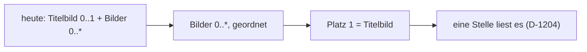

# Umbau: eine Bildliste, erstes Bild = Titelbild

Beschluss: [D-1205](NewConcept/90-decision-log.md). Stand: geplant, **gebaut: nein**.

Die Reihenfolge trägt `relation_records.position` schon. Keine neue Tabelle, kein neues Attribut.

## Schritte

Reihenfolge so, dass nach jedem Schritt alles läuft (alter und neuer Zustand).

| # | Schritt | Wo | Prüfung |
|---|---|---|---|
| 1 | **Die eine Stelle umstellen.** Materialkopf und Listen lesen schon nur über `StockService::titleImages($records)` (Lager 0.58.9). Nur diese Methode ändert sich: Titelbild-Feld, solange gefüllt, sonst erstes Bild der Liste. | Lager | neuer Check: kein Zugriff auf das Titelbild-Feld außer in `titleImages` |
| 2 | **Satztabelle (D-878):** ein mehrfaches Medienfeld zeigt das erste Bild klein plus die Anzahl, statt nur der Anzahl. | Modeller `Rendering` | bestehende Render-Checks anpassen (sichtbarer Teil des Umbaus, PR-9) |
| 3 | **Verschieben in der Maske:** je Bild ↑ / ↓ und «Als Titelbild» (setzt auf Platz 1). Schreibt nur `position`, als eine Änderung; rückgängig über die Geschichte. | Modeller Maske + `admin.js` | Check: Reihenfolge bleibt nach Speichern; Rückgängig stellt sie her |
| 4 | **Migration, erst trocken:** je Satz mit Titelbild-Wert: steht das Bild schon in «Bilder» → nach vorn; sonst an Platz 1 einfügen, Rest rückt nach. Trockenlauf zählt Sätze und Fälle, Stefan sieht die Zahl. | Modelländerung per Release-Schritt ([[taxmod-einspielen]]) | idempotent: zweiter Lauf ändert nichts |
| 5 | **Feld «Titelbild» weg:** erst verstecken (D-1144), nach Sichtung löschen. Fallback in Schritt 1 entfällt. | Modell | Check aus Schritt 1 wird streng |
| 6 | **Schreiber nachziehen:** `scripts/dev/bt2ps2-platinen.php` (setzt Titelbild), Lager `Structure` (`title_image`), Briefs für WP-Upload und Medien-Thread: `media:<id>` in «Bilder», Titelbild = Platz 1. | Modeller, Lager, Briefs | design-guard vor Commit |
| 7 | Release Modeller + Lager an WP-Upload; danach Migration live. | WP-Upload-Thread | PHP-Log sauber |

## Nicht betroffen

- Etiketten/Druck: nutzen keine Bilder (gemessen 2026-11-06).
- Import (`Import/Targets`): schreibt schon nur in «Bilder».
- eBay-/Verkauf-Export: noch nicht gebaut; eBay nimmt ebenfalls das erste Bild als Hauptbild, passt 1:1.

## Offen / angenommen

- **Angenommen:** ↑/↓-Knöpfe statt Ziehen (Ziehen kann später dazukommen).
- **Angenommen:** «Quellen» (auch mehrfaches Medienfeld) bekommt dieselben Knöpfe, weil der Mechanismus je Feldart gilt, nicht je Name (CD).
- **Nicht gemessen:** wie viele Sätze heute ein Titelbild haben; liefert der Trockenlauf in Schritt 4.
