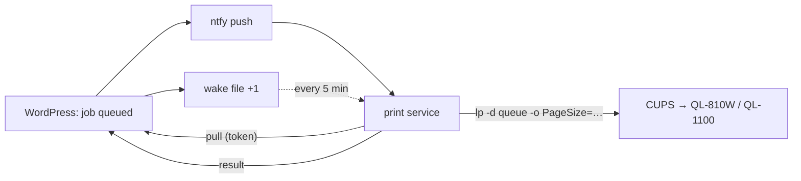

# Taxmod print service

Prints Taxmod labels at home: it fetches the jobs from WordPress and hands them to CUPS (stage 2 of
[D-1100](../../docs/NewConcept/90-decision-log.md), [D-1113](../../docs/NewConcept/90-decision-log.md)).
Python 3, standard library only.



It never polls WordPress: it waits for a push on its ntfy topic, looks at a small static file as a
fallback, and otherwise calls WordPress once an hour as a sign of life.

## Set up (Linux Mint)

1. WordPress: **Taxmod › Configuration › Printing › Set up access**. Copy the JSON it shows once.
2. On the PC with the printers:

   ```sh
   mkdir -p ~/.local/share/taxmod-print-agent ~/.config/taxmod-print-agent ~/.config/systemd/user
   cp taxmod_print_agent.py ~/.local/share/taxmod-print-agent/
   cp config.example.json ~/.config/taxmod-print-agent/config.json
   chmod 600 ~/.config/taxmod-print-agent/config.json
   ```

3. Put `rest`, `token`, `ntfy` and `wake_url` from step 1 into `config.json`, and under `printers`
   the CUPS queue per roll width (`lpstat -p` lists the queues).
4. Try it once: `python3 ~/.local/share/taxmod-print-agent/taxmod_print_agent.py --once`
5. Run it for good:

   ```sh
   cp taxmod-print-agent.service ~/.config/systemd/user/
   systemctl --user daemon-reload
   systemctl --user enable --now taxmod-print-agent
   loginctl enable-linger "$USER"   # keeps running without a login
   journalctl --user -u taxmod-print-agent -f
   ```

## Printers from the model (D-1190)

A label that names a printer (Logistik › Drucker, field «Drucker» on the label) brings the CUPS queue and its
«Druckoptionen» with the job; `printers` and `formats` in `config.json` are then not read for it. Queue and options must
be plain names (letters, digits, `_ . -`), or the job fails. The queue must exist on the PC that runs the service
(`lpstat -p`), e.g. `Phomemo_M220L` for the Phomemo M22L with `PageSize=w40h30`. The M22L on the M220 driver starts its lines 21 mm along
a 38 mm line; «Versatz (mm)» and «Zeilenlänge (mm)» of the printer make WordPress draw the label moved back by that much.

## Formats

Each label format brings CUPS options; the defaults are in `DEFAULT_FORMATS` in the script, and
`config.json` → `formats` overrides a format as a whole. `PageSize` must be a size the queue's PPD
knows (`lpoptions -p <queue> -l | grep PageSize`); a missing one — 62x30 for the material label —
is added with `brpapertoollpr_ql810w -P <queue> -n 62x30 -w 62 -h 30`. Find the right options with
**Test via print service**; a failed job shows the `lp` command it ran in the job list.

## Tests

`python3 -m unittest discover tools/print-agent`
